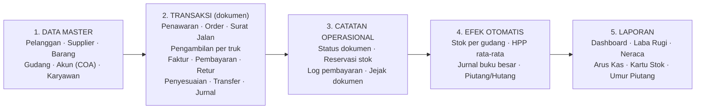

# 01 — Ringkasan Sistem Nusantara ERP

> **Tujuan dokumen:** menjelaskan apa yang dilakukan aplikasi *saat ini*, dengan bahasa yang bisa dipahami pemilik bisnis maupun staf akunting.
>
> **Dasar penulisan:** review kode aplikasi versi 3.3.0. Semua pernyataan menggambarkan perilaku aplikasi, **bukan** kebutuhan bisnis yang sudah disepakati.
>
> **Tanda di dokumen ini:**
> - **REQUIRES USER CONFIRMATION** — tidak bisa dipastikan dari kode; wajib ditanyakan ke pemilik bisnis.
> - ✅ Terbukti di aplikasi · 🟡 Dugaan dari implementasi · ❓ Belum diketahui

---

## 1. Nusantara ERP dalam satu paragraf

Nusantara ERP adalah aplikasi web (bisa dipasang seperti aplikasi/PWA) untuk mencatat **penjualan, pembelian, pengambilan barang, persediaan, kas & bank, pajak, dan pembukuan** dalam satu tempat. Setiap dokumen transaksi — misalnya Sales Order, Faktur, Penerimaan Barang, atau satu truk yang mengambil barang di supplier — otomatis **mengubah stok** (bila relevan) dan **membentuk jurnal akuntansi** (double-entry) di buku besar. Dari jurnal tersebut sistem menyusun Laba Rugi, Neraca, dan Arus Kas.

Alur utama untuk usaha trading adalah **pengambilan**: PO pelanggan dipasangkan dengan PO ke supplier untuk barang yang sama, lalu truk pelanggan mengambil barang langsung di supplier secara bertahap. Setiap truk memakai satu surat jalan, ditimbang (bruto − tara = netto), dan menjadi dasar tagihan ke pelanggan dan tagihan dari supplier per periode. Barang tidak masuk gudang. Rinciannya di [03 §V](03-ALUR-TRANSAKSI.md#v-pengambilan-trading) dan [04 §4.5](04-AKUNTANSI.md#45-pengambilan-trading).

Data disimpan di perangkat pengguna (IndexedDB) dan dapat disinkronkan ke cloud (Firebase) bila dikonfigurasi.

---

## 2. Model produk — bagaimana data mengalir

Cara paling mudah memahami sistem ini adalah sebagai lima lapis:

| Lapis | Isi | Contoh di aplikasi | Siapa yang mengisi |
|---|---|---|---|
| **1. Data master** | Data acuan yang jarang berubah | Pelanggan, Supplier, Barang, Gudang, Bagan Akun, Karyawan | Admin / staf |
| **2. Transaksi** | Dokumen yang mencatat kejadian bisnis | Sales Order, Purchase Order, pengambilan per truk, Faktur, Penerimaan Pembayaran | Staf penjualan, pembelian, gudang, akunting |
| **3. Catatan operasional** | Status dan hubungan antar dokumen | Status "Dikonfirmasi", reservasi stok, log pembayaran, "Jejak Dokumen" | Otomatis dari transaksi |
| **4. Efek otomatis** | Dampak ke stok dan akuntansi | Stok berkurang saat SO "Terkirim", jurnal Piutang vs Penjualan | **Sistem** (bukan diketik manual) |
| **5. Laporan** | Ringkasan untuk pengambilan keputusan | Laba Rugi, Neraca, Kartu Stok, Umur Piutang | Dibaca pemilik / manajer / akunting |

**Prinsip penting:** pengguna bekerja di lapis 1–2 (mengisi data dan dokumen). Lapis 3–5 dihasilkan sistem. Jurnal akuntansi **tidak perlu diketik** untuk transaksi rutin — hanya untuk koreksi atau kejadian khusus (Jurnal Umum).

Penjelasan rinci tiap alur ada di [03-ALUR-TRANSAKSI.md](03-ALUR-TRANSAKSI.md); dampak akuntansinya di [04-AKUNTANSI.md](04-AKUNTANSI.md).

---

## 3. Area fungsi yang tersedia saat ini

Status kematangan: **Lengkap** = alur utama berjalan end-to-end · **Parsial** = berjalan tetapi ada celah/perilaku yang perlu diperbaiki atau dikonfirmasi · **Pencatatan saja** = menyimpan data tanpa efek ke stok/akuntansi · **Placeholder** = tampilan/konfigurasi tanpa proses nyata.

| Area | Yang bisa dilakukan | Efek stok | Efek akuntansi | Kematangan |
|---|---|---|---|---|
| **Ringkasan (Dashboard)** | Periode (bulan ini / 3 bulan / tahun ini); kas & bank, piutang, hutang, laba kotor; **Alur transaksi** — funnel Diambil → Ditagih → Dibayar untuk pengambilan (ke pelanggan dan dari supplier) dan tahap pesanan gudang, bisa diklik ke daftar terkait; perlu tindakan; tren 6 bulan (Rp/Ton). Bagian lain (tagihan pelanggan, PO pengambilan berjalan, jatuh tempo, stok menipis, aktivitas) bisa ditampilkan lewat Atur Tampilan | — | Membaca jurnal & saldo faktur | Lengkap (dasar) |
| **Entri Harian** | Pintasan tugas harian: Catat Pengambilan, Impor Rekap Timbangan, Tagih Pelanggan, Biaya Operasional (+ Buat PO); angka hari ini | — | Lewat dokumen yang dibuat | Lengkap (dasar) |
| **Pengambilan (trading)** | Buka PO supplier untuk pengambilan (surat jalan dibuat sekaligus), catat pengambilan per truk dengan timbangan & foto tiket, impor rekap timbangan Excel, perubahan timbangan, rekap pengambilan, kuota & batas pengambilan, tagih pelanggan dan tagihan supplier dari pengambilan | **Tidak** (barang langsung dari supplier ke pelanggan) | Ya, per truk: pembelian, HPP, penjualan (lihat [04 §4.5](04-AKUNTANSI.md#45-pengambilan-trading)) | Lengkap (alur inti); format rekap timbangan asli **REQUIRES USER CONFIRMATION** |
| **Penawaran Harga** (jual & beli) | Buat, kirim, terima/tolak, konversi ke SO/PO | Tidak | Tidak | Parsial |
| **Sales Order (SO)** | Buat, ubah, hapus, ubah status (satuan/massal), cetak, duplikat, log pembayaran | Reservasi saat *Dikonfirmasi*; stok keluar saat *Terkirim* | Ya, saat *Terkirim* | Lengkap |
| **Surat Jalan (Delivery Order)** | Buat dari SO/PO/manual, pengiriman sebagian, cetak, pecah per truk (Excel). Surat jalan pengambilan dikelola di menu Pengambilan | **Tidak** | Tidak | Lengkap (sebagai dokumen) |
| **Faktur Penjualan (SI)** | Buat dari SO terkirim atau dari pengambilan (Tagih Pelanggan), cetak, batalkan | Tidak | Ya (piutang, pendapatan, PPN keluaran) | Parsial |
| **Penerimaan Pembayaran (SR)** | Catat pembayaran atas faktur | Tidak | Ya (kas/bank vs piutang) | Parsial |
| **Uang Muka Penjualan** | Catat DP, terapkan ke SO | Tidak | Ya | Parsial |
| **Retur Penjualan** | Buat dari SO/Faktur, posting | Stok kembali | Ya (balik pendapatan & HPP) | Parsial |
| **Target Penjualan** | Target per periode vs realisasi | — | — | Pencatatan saja |
| **Purchase Order (PO)** | Buat, ubah, hapus, cetak, duplikat, log pembayaran | Stok masuk saat *Diterima* | Ya, saat *Diterima* | Lengkap |
| **Penerimaan Barang** | Catat barang masuk dari PO dengan timbangan (qty surat jalan, bruto, tara, netto); Rekonsiliasi Timbangan; Validasi SJ Supplier | Ya (bila "Langsung update stok"); PO menjadi *Diterima* saat seluruh qty diterima | Lewat PO *Diterima*, atau per penerimaan bila PO difakturkan per penerimaan | Parsial |
| **Faktur Pembelian (PI)** | Buat dari PO diterima, per penerimaan (Rekonsiliasi Timbangan), atau dari pengambilan (Tagihan Supplier); batalkan | Tidak | Ya (persediaan & hutang) | Parsial |
| **Pembayaran ke Supplier (PP)** | Catat pembayaran atas faktur pembelian | Tidak | Ya (hutang vs kas/bank) | Parsial |
| **Uang Muka Pembelian** | Catat DP, terapkan ke PO | Tidak | Ya | Parsial |
| **Retur Pembelian** | Buat dari PO/Faktur, posting | Stok berkurang | Ya | Parsial |
| **Harga Supplier** | Daftar harga per supplier per barang dengan tanggal berlaku (dipakai otomatis di PO dan sebagai harga beli tiap pengambilan) | — | Menentukan nilai pembelian pengambilan | Lengkap (dasar) |
| **Barang & Stok** | Daftar barang, stok minimum, kartu stok, harga beli/jual | Ya (edit stok manual) | Tidak langsung | Lengkap (dasar) |
| **Gudang & Transfer** | Multi-gudang, stok per gudang, transfer antar gudang | Ya (antar gudang) | Tidak (nilai tetap) | Lengkap (dasar) |
| **Penyesuaian Stok** | Tambah/kurang stok (opname, rusak) | Ya | Ya (selisih persediaan) | Lengkap (dasar) |
| **Permintaan Barang, Job Costing** | Pencatatan permintaan & biaya pekerjaan | — | — | Pencatatan saja |
| **Kas & Bank** | Pengeluaran lain & penerimaan lain dengan kategori dan akun, rekap per kategori per bulan + ekspor Excel, transfer rekening, rekening koran, catat biaya/bunga bank dari baris rekening koran, rekonsiliasi (saldo rekening koran vs buku besar) | — | Ya, otomatis (lihat [04](04-AKUNTANSI.md) §6) | Parsial (rekening koran diketik manual) |
| **Buku Besar** | Neraca saldo, daftar jurnal, bagan akun (baca saja), Jurnal Umum | — | Ya | Lengkap (dasar) |
| **Anggaran** | Anggaran per akun, realisasi vs anggaran, transfer anggaran | — | Membaca jurnal | Lengkap (dasar) |
| **Biaya Akrual** | Catat biaya belum dibayar → posting jurnal | — | Ya (Jurnal Umum) | Lengkap (dasar) |
| **Penggajian** | Data karyawan, proses gaji, bayar gaji | — | Ya | Parsial (tanpa potongan PPh 21/BPJS) |
| **Aset Tetap** | Daftar aset, kategori, mutasi, disposisi | — | **Tidak** (tanpa penyusutan) | Pencatatan saja |
| **Pajak** | Pengaturan PPN/PKP/NPWP, rekap PPN, **Ekspor Coretax** (XML faktur pajak keluaran per masa pajak; CSV format lama tetap ada) | — | PPN ikut jurnal dokumen | Parsial (file XML perlu diuji impor di Coretax) |
| **Laporan** | Laba Rugi, Neraca, Arus Kas, Umur Piutang/Hutang, Kartu Stok, Kartu Piutang/Hutang, Rekap PPN (di Pajak & PPN), Laporan per Periode (pembelian, penjualan, pengambilan), Rekap Pengambilan, analisis | — | Membaca jurnal | Parsial |
| **Pengaturan** | Profil perusahaan, pengguna & peran, akses menu per pengguna, 2FA, backup & Arsip Excel per tahun, import Excel, notifikasi, kategori, satuan, ukuran teks | — | — | Lengkap |
| **Integrasi (API)** | API baca-saja untuk sistem lain | — | — | Siap kode; butuh deploy Firebase Functions |

Daftar lengkap setiap menu dan layarnya ada di [02-PETA-MODUL-DAN-NAVIGASI.md](02-PETA-MODUL-DAN-NAVIGASI.md).

---

## 4. Pengguna dan hak akses (peran)

Sistem memiliki peran bawaan (RBAC). Pembatasan diterapkan di tampilan (menu/tombol disembunyikan) dan di lapisan simpan data; pada mode cloud juga di aturan keamanan server (`firestore.rules`).

| Peran | Label di aplikasi | Bisa melihat | Bisa menambah/mengubah | Bisa menghapus |
|---|---|---|---|---|
| `admin` | Admin / Owner | Semua | Semua, termasuk pengguna & pengaturan | Ya |
| `manajer` | Manajer | Semua kecuali administrasi pengguna | Penjualan, pembelian, persediaan, master, aset, buku besar (tanpa hapus) | Ya (kecuali buku besar) |
| `akunting` | Akunting | Semua modul (baca) | Buku besar & pajak | Buku besar & pajak |
| `penjualan` | Penjualan | Penjualan, pembelian (baca), persediaan (baca), master | Penjualan & data pelanggan | Tidak |
| `viewer` | Viewer (hanya lihat) | Semua kecuali administrasi | Tidak | Tidak |
| `pending` | Menunggu persetujuan | Dashboard saja | Tidak | Tidak |

Catatan per modul:
- **Pengambilan** dan **Entri Harian** mengikuti hak modul Pembelian; menu **Tagih Pelanggan** mengikuti hak Penjualan. Data pengambilan (surat jalan per truk) boleh dicatat oleh pengguna dengan hak ubah Pembelian **atau** Penjualan. Menutup PO pengambilan butuh hak ubah Pembelian; bila pencatat tidak punya hak itu, PO tetap terbuka sampai ditutup pengguna yang berhak.
- **Akses menu per pengguna** (Manajemen Pengguna → tombol **Akses menu** di baris pengguna; Manajemen Pengguna dibuka dari menu pengguna atau Pengaturan Umum): admin mencentang grup menu yang boleh dibuka seorang pengguna, misalnya hanya Penjualan dan Pembelian & Entri Harian. Daftar ini hanya **mempersempit** peran, tidak menambah; tanpa daftar, pengguna mengikuti perannya. Ringkasan selalu tampil, dan peran Admin selalu melihat semua menu. Menu, halaman, tombol, dan pencarian ikut tersaring; pada mode cloud penyimpanan juga ditolak server. Perubahan berlaku saat pengguna membuka ulang aplikasi.

Fitur keamanan yang tersedia: login username + password (hash PBKDF2), verifikasi 2 langkah (TOTP), batas percobaan login (mode cloud), log aktivitas login, log audit perubahan data, kunci periode akuntansi, recycle bin.

- ✅ Pada mode lokal, aplikasi menyiapkan akun contoh: `admin`, `firna`, `richard`, `lisa` (semua berperan **admin**, ditandai wajib ganti password).
- ❓ Siapa saja pengguna nyata, perannya, dan apa yang boleh mereka lakukan — **REQUIRES USER CONFIRMATION**.
- ❓ Satu alamat email "admin utama" (bootstrap admin) tertanam di `firestore.rules` dan `src/core/user-role.js`. Perlu dipastikan email pemilik akun cloud yang benar — **REQUIRES USER CONFIRMATION**.

---

## 5. Penyimpanan data dan mode operasi

| Mode | Kapan aktif | Data disimpan di | Login | Catatan |
|---|---|---|---|---|
| **Lokal (offline)** | Tidak ada konfigurasi Firebase (`npm run dev:local`) | IndexedDB di browser/perangkat tersebut | Akun lokal di browser | Data **tidak** otomatis berpindah ke perangkat lain. Backup lewat file JSON. |
| **Cloud (Firebase)** | File `.env` berisi kredensial Firebase | Firestore (sinkron real-time) + cache lokal | Username via Cloud Function | Backup otomatis harian di server, log akses server. Beberapa koleksi belum ikut sinkron — lihat [08](08-TEMUAN-TEKNIS.md). |

- ❓ Apakah bisnis akan memakai satu komputer, beberapa komputer, atau HP? Apakah perlu akses dari luar kantor? — **REQUIRES USER CONFIRMATION** (menentukan mode lokal vs cloud).
- ❓ Apakah sudah ada data nyata yang tersimpan di project Firebase? — **REQUIRES USER CONFIRMATION**.

---

## 6. Hal yang **tidak** ada di sistem saat ini

Ini bukan kekurangan yang pasti harus ditambah — hanya batas cakupan saat ini, untuk dikonfirmasi relevansinya.

| Tidak tersedia | Keterangan |
|---|---|
| Produksi / manufaktur (BOM, work order) | Ada "Job Costing" sederhana, bukan modul produksi |
| Multi perusahaan / multi cabang akuntansi | Satu buku besar untuk satu perusahaan (multi-gudang tersedia) |
| Penyusutan aset otomatis | Aset hanya didaftar; tidak ada jurnal perolehan/penyusutan |
| Integrasi langsung dengan DJP | **Ekspor Coretax** membuat file XML faktur pajak keluaran yang diimpor manual di Coretax; tidak ada koneksi langsung ke sistem DJP |
| Potongan gaji (PPh 21, BPJS) | Penggajian hanya gaji pokok + tunjangan |
| Penutupan buku (closing entry) | Ada kunci periode; laba tahun berjalan tidak ditutup ke laba ditahan |
| Lot/batch, nomor seri, tanggal kedaluwarsa | Stok dicatat per barang per gudang |
| Satuan ganda / konversi satuan per barang | Satu satuan per barang |
| Portal pelanggan, e-commerce, CRM | — |
| Integrasi bank otomatis | Menu "SmartLink e-Banking" hanya tampilan konfigurasi |

---

## 7. Jenis usaha dan bukti di aplikasi

Gambaran usaha yang sudah dikonfirmasi pemilik ada di [11 §1–2](11-KEBUTUHAN-MEETING-14-SEP-2026.md): perusahaan **trading** yang menjembatani supplier dan pelanggan; barang utama saat ini batu split dalam satuan ton, diambil truk pelanggan langsung di supplier. Aplikasi sendiri tidak menyimpan deskripsi bisnis; petunjuk di data contoh dan template:

| Bukti | Lokasi | Interpretasi |
|---|---|---|
| Data barang contoh: batu split, abu batu, agregat slag (diambil di supplier, satuan Ton); pasir, sirtu, batu belah (stok gudang, satuan M3) | `src/core/demo-data.js` (data demo) | Perdagangan material curah |
| Pengambilan per truk dengan surat jalan bernomor PO, timbangan bruto/tara/netto, kapasitas bawaan 35 ton per truk | `core/trading.js`, menu Pengambilan | Sesuai alur pengambilan yang dikonfirmasi |
| Surat Jalan memiliki baris P/L/T dan fitur "Bagi per Truck" berdasarkan kapasitas | `erp-crud.js` (template Surat Jalan) | Pengiriman dengan truk, muatan besar |
| Pelanggan contoh berbentuk PT/CV/UD/Toko dengan termin pembayaran, PPN 11% | `demo-data.js` | Penjualan B2B dengan termin |

➡ Daftar barang lengkap dan satuannya — **REQUIRES USER CONFIRMATION**. Data contoh bukan data riil perusahaan.

---

## 8. Ringkasan satu kalimat untuk meeting

> *"Sistem ini sudah punya alur dagang lengkap — dari PO pelanggan, pengambilan per truk, sampai penagihan dan pembayaran — dengan pembukuan otomatis di belakangnya. Yang perlu kita pastikan bersama adalah langkah mana yang benar-benar dipakai bisnis sehari-hari, dan bagaimana laporan yang dibutuhkan pemilik."*
