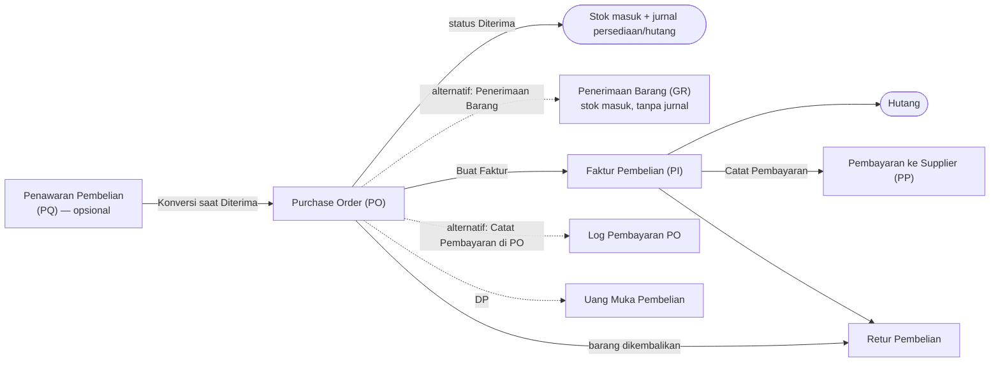

# 03 — Alur Transaksi (Cara Kerja Setiap Transaksi)

> **Tujuan:** menjawab pertanyaan praktis *"bagaimana saya mencatat X, dan apa yang terjadi setelah saya menekan Simpan?"* untuk setiap transaksi utama.
>
> **Dasar:** perilaku kode saat ini. Hal yang tidak bisa dipastikan ditandai **REQUIRES USER CONFIRMATION**. Temuan masalah dirujuk ke [08-TEMUAN-TEKNIS.md](08-TEMUAN-TEKNIS.md) dengan kode `T-xx`.
>
> Setiap transaksi dijelaskan dengan 13 pertanyaan yang sama:
> 1. Mulai dari mana? · 2. Data apa yang diisi? · 3. Field wajib? · 4. Apa yang terjadi saat disimpan? · 5. Stok berubah? · 6. Akuntansi berubah? · 7. Jurnal terbentuk? · 8. Dokumen/status apa yang dihasilkan? · 9. Bisa diubah? · 10. Jika sudah diposting? · 11. Bisa dibatalkan? · 12. Jika dibatalkan, stok & akuntansi? · 13. Cara menemukannya lagi?

---

## Peta alur besar

### Alur penjualan

| Langkah | Wajib? | Sifat | Mengubah stok | Membentuk jurnal |
|---|---|---|---|---|
| Penawaran (SQ) | Opsional | Komersial | Tidak | Tidak |
| Sales Order (SO) | **Wajib** untuk alur berbasis dokumen | Operasional | Reservasi (Dikonfirmasi), keluar (Terkirim) | Ya saat **Terkirim** |
| Surat Jalan (DO) | Opsional (untuk cetak & kontrol kirim) | Operasional/logistik | **Tidak** | Tidak |
| Faktur Penjualan (SI) | Opsional di sistem (umumnya wajib di bisnis) | Keuangan | Tidak | Ya |
| Penerimaan Pembayaran (SR) atau Log Pembayaran SO | Salah satu | Keuangan | Tidak | Ya |
| Retur Penjualan | Bila ada barang kembali | Operasional + keuangan | Ya (masuk) | Ya |

> ⚠ **Temuan penting (T-01):** saat ini *SO berstatus Terkirim* **dan** *Faktur yang dibuat dari SO tersebut* sama-sama membentuk jurnal pendapatan — sehingga penjualan tercatat dua kali di buku besar bila keduanya dipakai. Aturan perbaikan dijelaskan di [04-AKUNTANSI.md](04-AKUNTANSI.md) §4.
>
> ❓ Di bisnis nyata: kapan faktur dibuat — saat barang dikirim, atau ditagih belakangan (misalnya per bulan)? Satu faktur untuk satu pengiriman atau gabungan beberapa pengiriman? — **REQUIRES USER CONFIRMATION**

### Alur pembelian

| Langkah | Wajib? | Sifat | Mengubah stok | Membentuk jurnal |
|---|---|---|---|---|
| Penawaran Pembelian (PQ) | Opsional | Komersial | Tidak | Tidak |
| Purchase Order (PO) | **Wajib** untuk alur berbasis dokumen | Operasional | Masuk saat **Diterima** | Ya saat **Diterima** |
| Penerimaan Barang (GR) | Opsional (jalur terpisah) | Operasional/gudang | Ya (bila "langsung update stok") | **Tidak** |
| Faktur Pembelian (PI) | Opsional di sistem | Keuangan | Tidak | Ya |
| Pembayaran (PP) atau Log Pembayaran PO | Salah satu | Keuangan | Tidak | Ya |
| Retur Pembelian | Bila barang dikembalikan | Operasional + keuangan | Ya (keluar) | Ya |

> ⚠ **Temuan (T-02, T-07):** PO berstatus *Diterima* dan Faktur Pembelian dari PO tersebut sama-sama membentuk jurnal persediaan/hutang. Selain itu ada **dua cara** mencatat barang datang (status PO *Diterima* dan menu *Penerimaan Barang*) yang masing-masing menambah stok — bila keduanya dipakai, stok bertambah dua kali.
>
> ❓ Apakah barang dari supplier bisa datang bertahap (sebagian)? Kapan faktur supplier diterima? Siapa yang mencatat penerimaan di gudang? — **REQUIRES USER CONFIRMATION**

---

## A. Penawaran Penjualan (Sales Quotation, SQ)

| # | Pertanyaan | Jawaban (perilaku saat ini) |
|---|---|---|
| 1 | Mulai dari mana | Menu **Penjualan → Penawaran Penjualan** → tombol **Buat Quotation** |
| 2 | Data diisi | Pelanggan (ketik/pilih), tanggal, berlaku s/d, baris barang (barang atau manual, qty, harga), catatan |
| 3 | Wajib | Pelanggan; minimal 1 baris dengan qty & harga > 0 |
| 4 | Saat disimpan | Dokumen tersimpan berstatus **Draft** dengan nomor `SQ.YYYY.MM.NNNNN` |
| 5 | Stok | Tidak berubah |
| 6–7 | Akuntansi / jurnal | Tidak ada |
| 8 | Status | Draft → **Dikirim** (tombol Kirim) → **Diterima** / **Ditolak** (di detail) |
| 9 | Bisa diubah | ❌ Tidak ada tombol ubah/hapus |
| 10 | Setelah diterima | Muncul tombol **Convert → SO**: membuat SO Draft dengan baris yang sama |
| 11–12 | Batal | Status **Ditolak**; tidak ada efek stok/akuntansi |
| 13 | Menemukan lagi | Tab Penawaran Penjualan; "Jejak Dokumen" dari SO hasil konversi |

Catatan: baris "item manual" tersimpan dengan nama "Custom Item" (nama yang diketik hilang); konversi bisa dilakukan berulang kali pada penawaran yang sama (T-15); tombol Terima/Tolak memakai skrip inline yang diblokir kebijakan keamanan di hosting produksi (T-14).

## B. Sales Order (SO)

| # | Pertanyaan | Jawaban |
|---|---|---|
| 1 | Mulai dari mana | **Penjualan → Sales Order** → **Buat SO Baru** |
| 2 | Data diisi | Pelanggan, tanggal, jatuh tempo (opsional), status awal, gudang (bila >1 gudang), baris barang (barang/manual, qty, harga, diskon per baris), centang PPN |
| 3 | Wajib | Pelanggan, tanggal, minimal 1 baris |
| 4 | Saat disimpan | Nomor `SO.YYYY.MM.NNNNN`; total = subtotal + PPN (bila dicentang). Bila status **Dikonfirmasi** → stok direservasi (peringatan bila tidak cukup). Bila status **Terkirim** → stok langsung dikurangi |
| 5 | Stok | Reservasi saat *Dikonfirmasi*; stok fisik berkurang saat *Terkirim* |
| 6–7 | Akuntansi / jurnal | Saat *Terkirim*: Piutang (+PPN Keluaran) vs Penjualan, dan HPP vs Persediaan (harga pokok rata-rata). Pembayaran lewat "Catat Pembayaran": Kas/Bank vs Piutang |
| 8 | Status | Draft · Dikonfirmasi · Terkirim · Lunas · Dibatalkan (+ status impor Accurate: Menunggu Proses, Diproses Sebagian, Diproses) |
| 9 | Bisa diubah | ✅ Ya, di semua status (form Edit), termasuk mengganti status |
| 10 | Setelah Terkirim | Mengubah baris akan mengembalikan stok lama lalu mengurangi stok baru; jurnal dihitung ulang otomatis. ⚠ Perhitungan ulang stok saat edit tidak memperbarui stok per gudang dengan benar (T-05) |
| 11 | Batal | Ubah status ke **Dibatalkan** (tidak dikunci), atau **Hapus** (dengan undo + recycle bin) |
| 12 | Efek batal | Reservasi dilepas; bila sebelumnya Terkirim, stok dikembalikan; jurnal hilang dari buku besar (dihitung ulang dari status). Dokumen turunan (Surat Jalan, Faktur) **tidak** ikut dibatalkan |
| 13 | Menemukan lagi | Daftar SO (filter status, rentang tanggal, urut kolom), pencarian global, detail SO menampilkan Surat Jalan & Faktur terkait, tombol **Jejak** |

Fitur tambahan: ubah status langsung dari daftar, ubah status massal, duplikat, cetak "Pesanan Penjualan", ringkasan PDF per periode, import/export Excel/CSV.

❓ Apakah pelanggan memesan lewat PO resmi mereka? Apakah satu pesanan bisa dikirim bertahap? Apakah ada harga khusus per pelanggan? — **REQUIRES USER CONFIRMATION**

## C. Surat Jalan / Delivery Order (DO)

| # | Pertanyaan | Jawaban |
|---|---|---|
| 1 | Mulai dari mana | Detail SO → **Buat DO**, atau **Penjualan → Delivery Order** → **Buat DO Baru** |
| 2 | Data diisi | Referensi (Manual / Sales Order / Purchase Order), pelanggan/supplier, tujuan, tanggal kirim, status, driver, no. kendaraan, no. PO pelanggan, catatan, qty per barang |
| 3 | Wajib | Pihak, tujuan, tanggal |
| 4 | Saat disimpan | Nomor `DO.YYYY.MM.NNN`. Bila dari SO, qty terisi otomatis sebesar **sisa yang belum dikirim** (mendukung kirim sebagian). Bila tujuan berbeda dari alamat pelanggan, diberi tanda "TUJUAN DIUBAH" |
| 5 | Stok | ❌ **Tidak berubah** — stok hanya berubah lewat status SO *Terkirim* |
| 6–7 | Akuntansi | Tidak ada |
| 8 | Status | Pending · Dalam Pengiriman · Terkirim (form) — plus status impor: Terkirim/Faktur Sebagian/Difakturkan |
| 9 | Bisa diubah | ✅ Ya; perubahan status divalidasi |
| 10–12 | Batal | Hapus (undo + recycle bin); tidak ada efek stok/akuntansi |
| 13 | Menemukan lagi | Daftar Delivery Order (menampilkan asal SO/PO), detail SO/PO, Jejak Dokumen |

Fitur: cetak Surat Jalan, **Bulk Surat Jalan** (membagi total muatan per kapasitas truk menjadi beberapa lembar Excel).

❓ Apakah pengiriman barang **seharusnya** yang mengurangi stok (bukan status SO)? Apakah armada sendiri, ekspedisi, atau keduanya? — **REQUIRES USER CONFIRMATION**

## D. Faktur Penjualan (Sales Invoice, SI)

| # | Pertanyaan | Jawaban |
|---|---|---|
| 1 | Mulai dari mana | Detail SO → **Buat Faktur**, atau **Penjualan → Faktur Penjualan** → **Buat Faktur** |
| 2 | Data diisi | Sumber = SO berstatus Terkirim, tanggal, catatan (baris diambil dari SO) |
| 3 | Wajib | Dokumen sumber |
| 4 | Saat disimpan | Nomor `SI.YYYY.MM.NNNNN`, langsung berstatus **Belum Lunas** (Outstanding) |
| 5 | Stok | Tidak |
| 6–7 | Akuntansi | Piutang vs Penjualan (+ HPP). ⚠ Tumpang tindih dengan jurnal SO Terkirim (T-01); PPN dari SO tidak ikut ke faktur (T-03) |
| 8 | Status | Belum Lunas → **Lunas** otomatis bila total penerimaan ≥ nilai faktur |
| 9–12 | Ubah/batal | ❌ Tidak ada tombol ubah, hapus, atau batal. Koreksi hanya lewat Retur Penjualan |
| 13 | Menemukan lagi | Tab Faktur Penjualan, detail SO ("Faktur Terkait"), Kartu Piutang pelanggan, Umur Piutang |

Cetak: tombol **Cetak PDF** (perlu verifikasi template faktur, T-16).

## E. Penerimaan Pembayaran Pelanggan

Ada **dua cara** mencatat uang masuk dari pelanggan:

| Cara | Lokasi | Dasar | Efek |
|---|---|---|---|
| **Penerimaan (SR)** | Penjualan → Penerimaan → Catat Penerimaan | Faktur Belum Lunas | Jurnal Kas/Bank vs Piutang; faktur jadi Lunas bila penuh |
| **Log Pembayaran SO** | Detail SO → + Catat Pembayaran | Sales Order | Jurnal Kas/Bank vs Piutang; SO jadi Lunas bila penuh (kecuali sudah Terkirim) |

| # | Pertanyaan | Jawaban (SR) |
|---|---|---|
| 2–3 | Data / wajib | Faktur sumber, tanggal, jumlah (> 0), metode (Tunai, Transfer BCA, Transfer Mandiri, Lainnya), catatan |
| 4 | Saat disimpan | Langsung **Diposting** |
| 6–7 | Jurnal | Debit Kas (Tunai) / Bank BCA / Bank Mandiri, Kredit Piutang Usaha |
| 9–12 | Ubah/batal | ❌ Tidak ada ubah/hapus/batal |
| 13 | Menemukan | Tab Penerimaan, Kartu Piutang, Riwayat Akun Kas |

⚠ Kedua cara tidak saling mengenali: mencatat pembayaran yang sama di SO **dan** di faktur akan menggandakan kas (T-06). Pembayaran sebagian didukung di kedua cara.

❓ Bagaimana pelanggan membayar (tunai/transfer/giro), apakah sering dicicil, rekening bank apa yang dipakai? — **REQUIRES USER CONFIRMATION**

## F. Uang Muka Penjualan (Down Payment)

| # | Jawaban |
|---|---|
| Mulai | Penjualan → Uang Muka Penjualan → **Terima DP** |
| Data | SO (yang belum Lunas), tanggal, jumlah, catatan |
| Saat disimpan | Status **Diterima** → jurnal Kas vs Uang Muka Penjualan (kewajiban) |
| Terapkan | Tombol **Terapkan** → status Diterapkan → jurnal Uang Muka vs Piutang, **dan** otomatis menambah Log Pembayaran SO (⚠ membentuk jurnal kas kedua — T-04) |
| Batal | Hapus (tanpa pembatasan) |

## G. Retur Penjualan (SRN)

| # | Jawaban |
|---|---|
| Mulai | Penjualan → Retur Penjualan → **Buat Retur** |
| Data | Sumber (SO Terkirim atau Faktur), tanggal, qty retur per baris (≤ qty asli), alasan |
| Saat disimpan | Status **Draft** (belum ada efek) |
| Posting | Tombol **Post** → stok barang bertambah; jurnal: Penjualan & PPN (debit) vs Piutang, Persediaan vs HPP |
| Ubah/batal | ❌ Tidak ada ubah/hapus; posting tidak bisa dibatalkan |
| Catatan | Retur dari **Faktur** tidak memuat baris barang (T-12); stok retur tidak tercatat per gudang (T-05) |

❓ Apakah retur sering terjadi? Barang retur kembali ke stok jual atau dianggap rusak? Uang dikembalikan atau dipotong tagihan berikutnya? — **REQUIRES USER CONFIRMATION**

## H. Penawaran Pembelian (PQ)

Sama seperti Penawaran Penjualan, tetapi pihaknya **Supplier** dan harga default diambil dari **harga beli** barang. Konversi menghasilkan **PO Draft**.

## I. Purchase Order (PO)

| # | Pertanyaan | Jawaban |
|---|---|---|
| 1 | Mulai dari mana | **Pembelian → Purchase Order** → **Buat PO Baru** |
| 2 | Data diisi | Supplier, tanggal, jatuh tempo (opsional), status, gudang, baris barang (harga otomatis dari Harga Supplier bila ada), PPN |
| 3 | Wajib | Supplier, tanggal, minimal 1 baris |
| 4 | Saat disimpan | Nomor `PO.YYYY.MM.NNNNN`. Bila status **Diterima** → stok langsung bertambah |
| 5 | Stok | Bertambah saat *Diterima* |
| 6–7 | Jurnal | Saat *Diterima*: Persediaan (barang stok) / Beban Operasional Lain (baris manual) + PPN Masukan vs Hutang Usaha. Pembayaran via log: Hutang vs Kas/Bank |
| 8 | Status | Draft · Dikonfirmasi · Diterima · Lunas · Dibatalkan (+ status impor) |
| 9 | Bisa diubah | ✅ Ya, semua status (tanpa validasi transisi di form) |
| 10 | Setelah Diterima | Edit mengembalikan stok lama lalu menambah stok baru. ⚠ Bisa menggandakan stok (T-05) |
| 11–12 | Batal | Status Dibatalkan atau Hapus; bila sudah Diterima stok dikurangi kembali; jurnal hilang |
| 13 | Menemukan | Daftar PO, pencarian, detail PO (DO & Faktur terkait), Jejak Dokumen, Kartu Hutang |

Cetak: "Pesanan Pembelian" (menampilkan PPh 23 2% sebagai informasi — ❓ **REQUIRES USER CONFIRMATION** apakah relevan).

## J. Penerimaan Barang (Goods Receipt, GR)

| # | Jawaban |
|---|---|
| Mulai | Pembelian → Penerimaan Barang → **Terima Barang** |
| Data | PO (Draft/Dikonfirmasi), tanggal terima, catatan, qty diterima per baris, centang "Langsung update stok" |
| Saat disimpan | Dokumen `GR-…`; bila dicentang, stok bertambah (gudang utama) |
| Akuntansi | ❌ Tidak ada jurnal; status PO **tidak** berubah; tidak masuk kartu stok & harga pokok rata-rata |
| Batal | Hapus (stok **tidak** dikembalikan) |

➡ Menu ini berjalan terpisah dari status PO *Diterima* (T-07). Perlu diputuskan satu cara baku — **REQUIRES USER CONFIRMATION**.

## K. Faktur Pembelian (PI) dan Pembayaran ke Supplier (PP)

Sama seperti Faktur Penjualan & Penerimaan (bagian D–E), dengan arah berlawanan:
- Faktur Pembelian dibuat dari **PO Diterima** → status Belum Lunas → jurnal Persediaan (+PPN Masukan) vs Hutang (⚠ T-02).
- Pembayaran (PP) dari faktur Belum Lunas → jurnal Hutang vs Kas/Bank → faktur Lunas bila penuh.
- Tidak ada ubah/hapus/batal untuk faktur maupun pembayaran.

## L. Uang Muka Pembelian dan Retur Pembelian

- **Uang muka pembelian:** Pembelian → Uang Muka Pembelian → **Bayar DP** (PO belum Diterima/Lunas) → jurnal Uang Muka Pembelian vs Kas; **Terapkan** → Hutang vs Uang Muka + log pembayaran PO (⚠ T-04).
- **Retur pembelian:** dari PO Diterima atau Faktur Pembelian → Draft → **Post** → stok berkurang; jurnal Hutang vs Persediaan/Beban & PPN Masukan.

## M. Penyesuaian Stok (Item Adjustment)

| # | Jawaban |
|---|---|
| Mulai | Persediaan → Penyesuaian Stok → **Buat Penyesuaian** |
| Data | Tanggal, keterangan, baris: barang, Tambah(+)/Kurang(−), qty |
| Saat disimpan | Stok langsung berubah; nomor `ADJ.YYYY.MM.NNNNN` |
| Jurnal | Tambah: Persediaan vs Beban Penyesuaian Persediaan (selisih lebih). Kurang: Beban Penyesuaian vs Persediaan — dinilai dengan harga pokok rata-rata |
| Ubah | ❌ Tidak ada ubah |
| Batal | **Hapus** kapan saja → stok dikembalikan, jurnal hilang |

❓ Seberapa sering stock opname dilakukan? Barang rusak/hilang dicatat bagaimana? — **REQUIRES USER CONFIRMATION**

## N. Transfer Antar Gudang (Item Transfer, IT)

| # | Jawaban |
|---|---|
| Mulai | Persediaan → Gudang & Transfer → **Transfer Item** |
| Data | Dari gudang, ke gudang, tanggal, baris barang & qty (dicek terhadap stok gudang asal), catatan |
| Saat disimpan | Langsung **Diposting**: stok gudang asal berkurang, gudang tujuan bertambah; total stok tetap |
| Jurnal | Tidak ada (nilai persediaan tidak berubah) |
| Batal | ❌ Tidak ada pembatalan (harus membuat transfer balik) |

❓ Berapa gudang/lokasi yang dimiliki? — **REQUIRES USER CONFIRMATION**

## O. Kas & Bank: Pengeluaran Lain, Penerimaan Lain, Transfer Rekening

| Transaksi | Data | Efek saat ini |
|---|---|---|
| **Pengeluaran Lain** (Other Payment) | Tanggal, rekening, penerima, kategori (Utilities, Sewa, Gaji, Transportasi, Pemeliharaan, Asuransi, Pajak, Lainnya), jumlah, metode, referensi, keterangan | ⚠ Hanya tersimpan — **tidak** membentuk jurnal (T-08) |
| **Penerimaan Lain** (Other Deposit) | Tanggal, rekening, pengirim, kategori, jumlah, metode, keterangan | ⚠ Tidak membentuk jurnal |
| **Transfer Bank** | Tanggal, dari rekening, ke rekening, jumlah, biaya transfer | ⚠ Tidak membentuk jurnal |
| **Rekening Koran** | Input manual baris debit/kredit per rekening & periode | Pencatatan |
| **Rekonsiliasi Bank** | Centang baris rekening koran terbaru | Tidak mencocokkan otomatis |

Semua dapat dihapus kapan saja. Pengeluaran yang **masuk** buku besar saat ini hanya lewat **Biaya Akrual** atau **Jurnal Umum**.

❓ Biaya operasional (listrik, sewa, BBM, gaji) dicatat oleh siapa dan seberapa rinci? Apakah perlu per kategori biaya? — **REQUIRES USER CONFIRMATION**

## P. Jurnal Umum (Journal Voucher)

| # | Jawaban |
|---|---|
| Mulai | Akuntansi → Buku Besar → **Jurnal Umum** |
| Data | Tanggal, keterangan, ≥2 baris akun dengan debit/kredit |
| Aturan | Total debit harus sama dengan kredit; ditolak bila tanggal berada dalam periode terkunci |
| Hasil | Jurnal `JV.YYYY.MM.NNNNN` masuk buku besar |
| Ubah/hapus | ❌ Tidak tersedia di tampilan (koreksi dengan jurnal balik) |

## Q. Biaya Akrual

Akuntansi → Biaya Akrual → **Tambah Akrual** (tanggal, akun biaya, akun kredit/hutang, keterangan, jumlah) → Draft → **Posting** membuat Jurnal Umum otomatis. Menghapus akrual yang sudah diposting **tidak** menghapus jurnalnya.

## R. Penggajian

1. Akuntansi → Penggajian → **Tambah Karyawan** (nama, email, departemen, jabatan, gaji pokok, tunjangan transport & makan).
2. **Proses Payroll** (periode) → bila "langsung posting": jurnal Beban Gaji + Beban Tunjangan vs Hutang Gaji.
3. **Bayar** (metode Tunai/Transfer BCA/Transfer Mandiri, tanggal) → jurnal Hutang Gaji vs Kas/Bank.

Tidak ada potongan PPh 21, BPJS, lembur, atau slip gaji. ❓ Apakah penggajian memang dikelola di sistem ini? — **REQUIRES USER CONFIRMATION**

## S. Aset Tetap

Aset Tetap → **Tambah Aset** (nama, kategori, tanggal & nilai perolehan, lokasi, kategori fiskal, status). Tersedia mutasi lokasi dan disposisi. **Tidak** ada jurnal perolehan, penyusutan, atau pelepasan.

## T. Import dari Excel (termasuk saldo awal)

Pengaturan → Kelola Backup → **Import dari Excel** (atau menu Import dari Excel). Template berisi sheet: Sales Orders, Purchase Orders, Delivery Orders, Invoices, Payments, **Opening Balances** (saldo awal akun → Jurnal Umum seimbang), **Opening Stock** (stok & harga pokok awal). Pratinjau dan validasi dilakukan sebelum data disimpan; pelanggan/supplier/barang yang belum ada dibuat otomatis.

❓ Dari mana data awal akan diambil (Excel, software lain, catatan manual)? Per tanggal berapa saldo awal? — **REQUIRES USER CONFIRMATION**

## U. Piutang dan Hutang — cara memantaunya

| Kebutuhan | Tempat di aplikasi | Dasar perhitungan |
|---|---|---|
| Siapa belum bayar | Keuangan → Piutang Pelanggan (Aging) | Faktur Penjualan belum lunas − penerimaan |
| Riwayat per pelanggan | Detail Pelanggan → **Kartu Piutang** | Faktur (debit) dan Penerimaan (kredit) |
| Saldo akuntansi | Buku Besar → akun 110201 Piutang Usaha | Jurnal |
| Hutang ke supplier | Keuangan → Hutang (Aging) | ⚠ PO berstatus Dikonfirmasi (bukan faktur) |
| Riwayat per supplier | Detail Supplier → **Kartu Hutang** | Faktur Pembelian dan Pembayaran |

⚠ Angka piutang/hutang dihitung dengan dasar yang berbeda di beberapa layar (Dashboard, daftar SO, aging, buku besar), sehingga bisa tidak sama (T-09).

---

## Ringkasan: transaksi mana yang mengubah apa

| Transaksi | Stok | Buku besar | Dapat dibatalkan |
|---|---|---|---|
| Penawaran (SQ/PQ) | — | — | Tolak |
| SO Dikonfirmasi | Reservasi | — | Ubah status/hapus |
| SO Terkirim | Keluar | Penjualan, Piutang, HPP | Ubah status/hapus |
| Surat Jalan | — | — | Hapus |
| Faktur Penjualan | — | Penjualan, Piutang | Tidak |
| Penerimaan (SR) / Log Pembayaran SO | — | Kas/Bank, Piutang | Tidak / tidak |
| Uang Muka Penjualan | — | Kas, Uang Muka, Piutang | Hapus |
| Retur Penjualan (Post) | Masuk | Balik penjualan & HPP | Tidak |
| PO Diterima | Masuk | Persediaan, Hutang | Ubah status/hapus |
| Penerimaan Barang | Masuk | — | Hapus (stok tidak kembali) |
| Faktur Pembelian | — | Persediaan, Hutang | Tidak |
| Pembayaran (PP) / Log Pembayaran PO | — | Hutang, Kas/Bank | Tidak |
| Retur Pembelian (Post) | Keluar | Balik persediaan & hutang | Tidak |
| Penyesuaian Stok | ± | Persediaan vs Beban Penyesuaian | Hapus |
| Transfer Gudang | Pindah | — | Tidak |
| Pengeluaran/Penerimaan Lain, Transfer Bank | — | ⚠ Tidak (T-08) | Hapus |
| Jurnal Umum, Biaya Akrual (posting) | — | Sesuai input | Tidak |
| Penggajian (posting & bayar) | — | Beban/Hutang Gaji, Kas | Tidak |
| Aset Tetap | — | — | Hapus |
