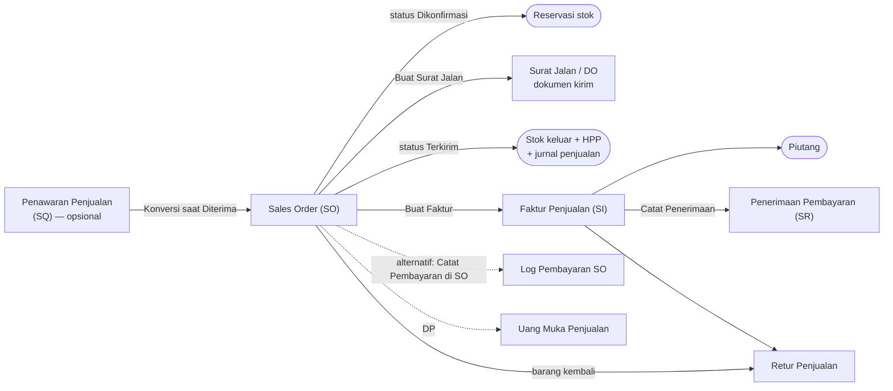
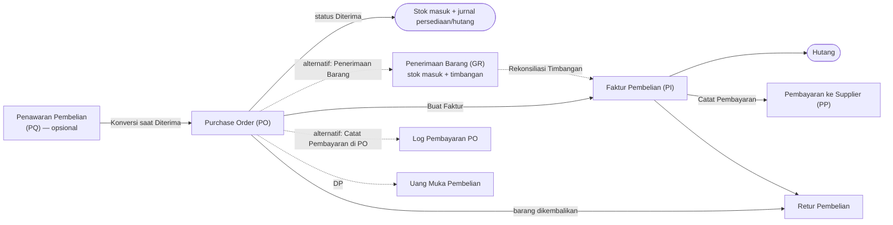
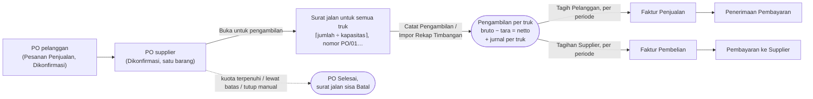

# 03 — Alur Transaksi (Cara Kerja Setiap Transaksi)

> **Tujuan:** menjawab pertanyaan praktis *"bagaimana saya mencatat X, dan apa yang terjadi setelah saya menekan Simpan?"* untuk setiap transaksi utama.
>
> **Dasar:** perilaku kode saat ini. Hal yang tidak bisa dipastikan ditandai **REQUIRES USER CONFIRMATION**. Temuan masalah dirujuk ke [08-TEMUAN-TEKNIS.md](08-TEMUAN-TEKNIS.md) dengan kode `T-xx`.
>
> Setiap transaksi dijelaskan dengan 13 pertanyaan yang sama:
> 1. Mulai dari mana? · 2. Data apa yang diisi? · 3. Field wajib? · 4. Apa yang terjadi saat disimpan? · 5. Stok berubah? · 6. Akuntansi berubah? · 7. Jurnal terbentuk? · 8. Dokumen/status apa yang dihasilkan? · 9. Bisa diubah? · 10. Jika sudah diposting? · 11. Bisa dibatalkan? · 12. Jika dibatalkan, stok & akuntansi? · 13. Cara menemukannya lagi?

---

## Peta alur besar

### Alur penjualan

| Langkah | Wajib? | Sifat | Mengubah stok | Membentuk jurnal |
|---|---|---|---|---|
| Penawaran (SQ) | Opsional | Komersial | Tidak | Tidak |
| Sales Order (SO) | **Wajib** untuk alur berbasis dokumen | Operasional | Reservasi (Dikonfirmasi), keluar (Terkirim) | Ya saat **Terkirim** |
| Surat Jalan (DO) | Opsional (untuk cetak & kontrol kirim) | Operasional/logistik | **Tidak** | Tidak |
| Faktur Penjualan (SI) | Opsional di sistem (umumnya wajib di bisnis) | Keuangan | Tidak | Ya |
| Penerimaan Pembayaran (SR) atau Log Pembayaran SO | Salah satu | Keuangan | Tidak | Ya |
| Retur Penjualan | Bila ada barang kembali | Operasional + keuangan | Ya (masuk) | Ya |

> **Pendapatan dicatat sekali (T-01, diperbaiki):** *SO Terkirim* membentuk HPP dan pengurangan persediaan. Pendapatan, piutang, dan PPN keluaran dibentuk oleh Faktur Penjualan bila SO sudah difakturkan; bila belum, oleh SO Terkirim. Rincian di [04-AKUNTANSI.md](04-AKUNTANSI.md) §4.1.
>
> ❓ Untuk penjualan dari stok gudang: kapan faktur dibuat — saat barang dikirim, atau ditagih belakangan (misalnya per bulan)? Satu faktur untuk satu pengiriman atau gabungan beberapa pengiriman? — **REQUIRES USER CONFIRMATION**. Untuk pengambilan, penagihan per periode dari beberapa truk sudah tersedia (lihat [§V](#v-pengambilan-trading)).

### Alur pembelian

| Langkah | Wajib? | Sifat | Mengubah stok | Membentuk jurnal |
|---|---|---|---|---|
| Penawaran Pembelian (PQ) | Opsional | Komersial | Tidak | Tidak |
| Purchase Order (PO) | **Wajib** untuk alur berbasis dokumen | Operasional | Masuk saat **Diterima** | Ya saat **Diterima** |
| Penerimaan Barang (GR) | Opsional (jalur terpisah, bisa bertahap) | Operasional/gudang | Ya (bila "Langsung update stok") | Lewat PO saat PO menjadi *Diterima*; per penerimaan bila PO difakturkan per penerimaan |
| Rekonsiliasi Timbangan | Opsional | Kontrol | Tidak | Tidak (menentukan qty faktur) |
| Faktur Pembelian (PI) | Opsional di sistem | Keuangan | Tidak | Ya |
| Pembayaran (PP) atau Log Pembayaran PO | Salah satu | Keuangan | Tidak | Ya |
| Retur Pembelian | Bila barang dikembalikan | Operasional + keuangan | Ya (keluar) | Ya |

> **Persediaan & hutang dicatat sekali (T-02, T-07, diperbaiki):** bila PO sudah punya Faktur Pembelian aktif, jurnal penerimaan PO tidak dibentuk; faktur yang menjadi dasarnya. Ada **dua cara** mencatat barang datang (status PO *Diterima* dan menu *Penerimaan Barang*); keduanya dicegah menambah stok dua kali, dan penerimaan yang melengkapi seluruh qty PO mengubah status PO menjadi *Diterima*.
>
> ❓ Apakah barang dari supplier bisa datang bertahap (sebagian)? Kapan faktur supplier diterima? Siapa yang mencatat penerimaan di gudang? — **REQUIRES USER CONFIRMATION**

### Alur pengambilan (trading)

Barang dibeli dari supplier dan diambil truk pelanggan langsung di supplier, tanpa masuk gudang. Rincian di [§V](#v-pengambilan-trading).

| Langkah | Wajib? | Sifat | Mengubah stok | Membentuk jurnal |
|---|---|---|---|---|
| PO pelanggan (Pesanan Penjualan) | **Wajib**, status Dikonfirmasi | Komersial | Tidak | Tidak (pesanan pengambilan dibukukan per truk) |
| PO supplier dibuka untuk pengambilan | **Wajib**, satu barang per PO | Operasional | Tidak | Tidak |
| Catat Pengambilan / Impor Rekap Timbangan | **Wajib** per truk | Operasional | **Tidak** | Ya, per truk: pembelian, HPP, penjualan |
| Tagih Pelanggan | Per periode (mis. mingguan) | Keuangan | Tidak | Ya (penjualan pindah ke faktur) |
| Tagihan Supplier | Per periode | Keuangan | Tidak | Ya (pembelian pindah ke faktur) |
| Penerimaan / Pembayaran | Atas faktur | Keuangan | Tidak | Ya |

---

## A. Penawaran Penjualan (Sales Quotation, SQ)

| # | Pertanyaan | Jawaban (perilaku saat ini) |
|---|---|---|
| 1 | Mulai dari mana | Menu **Penjualan → Penawaran Penjualan** → tombol **Buat Quotation** |
| 2 | Data diisi | Pelanggan (ketik/pilih), tanggal, berlaku s/d, baris barang (barang atau manual, qty, harga), catatan |
| 3 | Wajib | Pelanggan; minimal 1 baris dengan qty & harga > 0 |
| 4 | Saat disimpan | Dokumen tersimpan berstatus **Draft** dengan nomor `SQ.YYYY.MM.NNNNN` |
| 5 | Stok | Tidak berubah |
| 6–7 | Akuntansi / jurnal | Tidak ada |
| 8 | Status | Draft → **Dikirim** (tombol Kirim) → **Diterima** / **Ditolak** (di detail) |
| 9 | Bisa diubah | ❌ Tidak ada tombol ubah/hapus |
| 10 | Setelah diterima | Muncul tombol **Convert → SO**: membuat SO Draft dengan baris yang sama |
| 11–12 | Batal | Status **Ditolak**; tidak ada efek stok/akuntansi |
| 13 | Menemukan lagi | Tab Penawaran Penjualan; "Jejak Dokumen" dari SO hasil konversi |

Catatan: baris "item manual" tersimpan dengan nama "Custom Item" (nama yang diketik hilang); konversi bisa dilakukan berulang kali pada penawaran yang sama (T-15); tombol Terima/Tolak memakai skrip inline yang diblokir kebijakan keamanan di hosting produksi (T-14).

## B. Sales Order (SO)

| # | Pertanyaan | Jawaban |
|---|---|---|
| 1 | Mulai dari mana | **Penjualan → Sales Order** → **Buat SO Baru** |
| 2 | Data diisi | Pelanggan, tanggal, jatuh tempo (opsional), status awal, gudang (bila >1 gudang), baris barang (barang/manual, qty, harga, diskon per baris), centang PPN |
| 3 | Wajib | Pelanggan, tanggal, minimal 1 baris |
| 4 | Saat disimpan | Nomor `SO.YYYY.MM.NNNNN`; total = subtotal + PPN (bila dicentang). Bila status **Dikonfirmasi** → stok direservasi (peringatan bila tidak cukup). Bila status **Terkirim** → stok langsung dikurangi |
| 5 | Stok | Reservasi saat *Dikonfirmasi*; stok fisik berkurang saat *Terkirim* |
| 6–7 | Akuntansi / jurnal | Saat *Terkirim*: Piutang (+PPN Keluaran) vs Penjualan, dan HPP vs Persediaan (harga pokok rata-rata). Pembayaran lewat "Catat Pembayaran": Kas/Bank vs Piutang |
| 8 | Status | Draft · Dikonfirmasi · Terkirim · Lunas · Dibatalkan · **Selesai** (pesanan pengambilan yang sudah habis diambil, lihat [§V](#v-pengambilan-trading)) (+ status impor Accurate: Menunggu Proses, Diproses Sebagian, Diproses) |
| 9 | Bisa diubah | ✅ Ya, di semua status (form Edit), termasuk mengganti status |
| 10 | Setelah Terkirim | Mengubah baris akan mengembalikan stok lama lalu mengurangi stok baru; jurnal dihitung ulang otomatis. ⚠ Perhitungan ulang stok saat edit tidak memperbarui stok per gudang dengan benar (T-05) |
| 11 | Batal | Ubah status ke **Dibatalkan** (tidak dikunci), atau **Hapus** (dengan undo + recycle bin) |
| 12 | Efek batal | Reservasi dilepas; bila sebelumnya Terkirim, stok dikembalikan; jurnal hilang dari buku besar (dihitung ulang dari status). Dokumen turunan (Surat Jalan, Faktur) **tidak** ikut dibatalkan |
| 13 | Menemukan lagi | Daftar SO (filter status, rentang tanggal, urut kolom), pencarian global, detail SO menampilkan Surat Jalan & Faktur terkait, tombol **Jejak** |

Fitur tambahan: ubah status langsung dari daftar, ubah status massal, duplikat, cetak "Pesanan Penjualan", ringkasan PDF per periode, import/export Excel/CSV.

❓ Apakah pelanggan memesan lewat PO resmi mereka? Apakah satu pesanan bisa dikirim bertahap? Apakah ada harga khusus per pelanggan? — **REQUIRES USER CONFIRMATION**

## C. Surat Jalan / Delivery Order (DO)

| # | Pertanyaan | Jawaban |
|---|---|---|
| 1 | Mulai dari mana | Detail SO → **Buat DO**, atau **Penjualan → Surat Jalan** → **Buat DO Baru** |
| 2 | Data diisi | Referensi (Manual / Sales Order / Purchase Order), pelanggan/supplier, tujuan, tanggal kirim, status, driver, no. kendaraan, no. PO pelanggan, catatan, qty per barang |
| 3 | Wajib | Pihak, tujuan, tanggal |
| 4 | Saat disimpan | Nomor `DO.YYYY.MM.NNN`. Bila dari SO, qty terisi otomatis sebesar **sisa yang belum dikirim** (mendukung kirim sebagian). Bila tujuan berbeda dari alamat pelanggan, diberi tanda "TUJUAN DIUBAH" |
| 5 | Stok | ❌ **Tidak berubah** — stok hanya berubah lewat status SO *Terkirim* |
| 6–7 | Akuntansi | Tidak ada |
| 8 | Status | Pending · Dalam Pengiriman · Terkirim (form) — plus status impor: Terkirim/Faktur Sebagian/Difakturkan |
| 9 | Bisa diubah | ✅ Ya; perubahan status divalidasi |
| 10–12 | Batal | Hapus (undo + recycle bin); tidak ada efek stok/akuntansi |
| 13 | Menemukan lagi | Daftar Surat Jalan (menampilkan asal SO/PO), detail SO/PO, Jejak Dokumen |

Fitur: cetak Surat Jalan, **Bulk Surat Jalan** (membagi total muatan per kapasitas truk menjadi beberapa lembar Excel).

Surat jalan **pengambilan** (dibuat otomatis saat PO supplier dibuka untuk pengambilan) tidak tampil di daftar ini; daftar menampilkan jumlahnya dengan tautan ke Pengambilan → PO Pengambilan. Ubah dan hapus surat jalan pengambilan dari menu Surat Jalan ditolak — surat jalan itu hanya diubah lewat menu Pengambilan agar kuota PO, timbangan, dan faktur tetap konsisten ([§V](#v-pengambilan-trading)).

❓ Apakah pengiriman barang **seharusnya** yang mengurangi stok (bukan status SO)? Apakah armada sendiri, ekspedisi, atau keduanya? — **REQUIRES USER CONFIRMATION**

## D. Faktur Penjualan (Sales Invoice, SI)

| # | Pertanyaan | Jawaban |
|---|---|---|
| 1 | Mulai dari mana | Detail SO → **Buat Faktur**, atau **Penjualan → Faktur Penjualan** → **Buat Faktur** |
| 2 | Data diisi | Sumber = SO berstatus Terkirim, tanggal, catatan (baris diambil dari SO). Faktur dari pengambilan dibuat lewat **Pengambilan → Tagih Pelanggan** (satu baris per truk, [§V](#v-pengambilan-trading)) |
| 3 | Wajib | Dokumen sumber |
| 4 | Saat disimpan | Nomor `SI.YYYY.MM.NNNNN`, langsung berstatus **Belum Lunas** (Outstanding); tarif dan nilai PPN ikut dari SO |
| 5 | Stok | Tidak |
| 6–7 | Akuntansi | Piutang (+PPN Keluaran) vs Penjualan. HPP tetap dibentuk oleh pengiriman SO (atau oleh truk, untuk faktur dari pengambilan) — lihat [04 §4.1](04-AKUNTANSI.md) |
| 8 | Status | Belum Lunas → **Lunas** otomatis bila total penerimaan ≥ nilai faktur · Dibatalkan |
| 9–12 | Ubah/batal | Tidak bisa diubah atau dihapus. **Batalkan** bila belum ada penerimaan dan retur: dokumen tetap tersimpan berstatus Dibatalkan; pendapatan & piutang kembali dicatat dari SO Terkirim, atau — untuk faktur dari pengambilan — truknya kembali menjadi "belum ditagih" |
| 13 | Menemukan lagi | Tab Faktur Penjualan, detail SO ("Faktur Terkait"), Kartu Piutang pelanggan, Umur Piutang. Detail faktur dari pengambilan menampilkan jumlah truk, periode, dan nomor surat jalannya |

Cetak: tombol **Cetak PDF** (perlu verifikasi template faktur, T-16).

## E. Penerimaan Pembayaran Pelanggan

Ada **dua cara** mencatat uang masuk dari pelanggan:

| Cara | Lokasi | Dasar | Efek |
|---|---|---|---|
| **Penerimaan (SR)** | Penjualan → Penerimaan → Catat Penerimaan | Faktur Belum Lunas | Jurnal Kas/Bank vs Piutang; faktur jadi Lunas bila penuh |
| **Log Pembayaran SO** | Detail SO → + Catat Pembayaran | Sales Order | Jurnal Kas/Bank vs Piutang; SO jadi Lunas bila penuh (kecuali sudah Terkirim) |

| # | Pertanyaan | Jawaban (SR) |
|---|---|---|
| 2–3 | Data / wajib | Faktur sumber, tanggal, jumlah (> 0), metode (Tunai, Transfer BCA, Transfer Mandiri, Lainnya), catatan |
| 4 | Saat disimpan | Langsung **Diposting** |
| 6–7 | Jurnal | Debit Kas (Tunai) / Bank BCA / Bank Mandiri, Kredit Piutang Usaha |
| 9–12 | Ubah/batal | Tidak bisa diubah atau dihapus. **Batalkan**: saldo kas/bank dan piutang dikembalikan, status faktur dihitung ulang |
| 13 | Menemukan | Tab Penerimaan, Kartu Piutang, Riwayat Akun Kas |

⚠ Kedua cara tidak saling mengenali: mencatat pembayaran yang sama di SO **dan** di faktur akan menggandakan kas (T-06). Sebagai pengaman, dialog Catat Pembayaran (SO/PO) dan Catat Penerimaan/Pembayaran (faktur) menampilkan pembayaran yang sudah tercatat di jalur lain dan sisa tagihan gabungan, lalu meminta konfirmasi bila jumlah melebihi sisa. Pembayaran sebagian didukung di kedua cara.

❓ Bagaimana pelanggan membayar (tunai/transfer/giro), apakah sering dicicil, rekening bank apa yang dipakai? — **REQUIRES USER CONFIRMATION**

## F. Uang Muka Penjualan (Down Payment)

| # | Jawaban |
|---|---|
| Mulai | Penjualan → Uang Muka Penjualan → **Terima DP** |
| Data | SO (yang belum Lunas), tanggal, jumlah, catatan |
| Saat disimpan | Status **Diterima** → jurnal Kas vs Uang Muka Penjualan (kewajiban) |
| Terapkan | Tombol **Terapkan** → status Diterapkan → jurnal Uang Muka vs Piutang, **dan** otomatis menambah Log Pembayaran SO (⚠ membentuk jurnal kas kedua — T-04) |
| Batal | Hapus (tanpa pembatasan) |

## G. Retur Penjualan (SRN)

| # | Jawaban |
|---|---|
| Mulai | Penjualan → Retur Penjualan → **Buat Retur** |
| Data | Sumber (SO Terkirim atau Faktur), tanggal, qty retur per baris (≤ qty asli), alasan |
| Saat disimpan | Status **Draft** (belum ada efek) |
| Posting | Tombol **Post** → stok barang bertambah; jurnal: Penjualan & PPN (debit) vs Piutang, Persediaan vs HPP |
| Ubah/batal | ❌ Tidak ada ubah/hapus; posting tidak bisa dibatalkan |
| Catatan | Retur dari **Faktur** tidak memuat baris barang (T-12); stok retur tidak tercatat per gudang (T-05) |

❓ Apakah retur sering terjadi? Barang retur kembali ke stok jual atau dianggap rusak? Uang dikembalikan atau dipotong tagihan berikutnya? — **REQUIRES USER CONFIRMATION**

## H. Penawaran Pembelian (PQ)

Sama seperti Penawaran Penjualan, tetapi pihaknya **Supplier** dan harga default diambil dari **harga beli** barang. Konversi menghasilkan **PO Draft**.

## I. Purchase Order (PO)

| # | Pertanyaan | Jawaban |
|---|---|---|
| 1 | Mulai dari mana | **Pembelian → Purchase Order** → **Buat PO Baru** |
| 2 | Data diisi | Supplier, tanggal, jatuh tempo (opsional), status, gudang, baris barang (harga otomatis dari Harga Supplier bila ada), PPN |
| 3 | Wajib | Supplier, tanggal, minimal 1 baris |
| 4 | Saat disimpan | Nomor `PO.YYYY.MM.NNNNN`. Bila status **Diterima** → stok langsung bertambah |
| 5 | Stok | Bertambah saat *Diterima* |
| 6–7 | Jurnal | Saat *Diterima*: Persediaan (barang stok) / Beban Operasional Lain (baris manual) + PPN Masukan vs Hutang Usaha. Pembayaran via log: Hutang vs Kas/Bank |
| 8 | Status | Draft · Dikonfirmasi · Diterima · Lunas · Dibatalkan · **Selesai** (PO pengambilan yang ditutup, lihat [§V](#v-pengambilan-trading)) (+ status impor) |
| 9 | Bisa diubah | ✅ Ya, semua status (tanpa validasi transisi di form) |
| 10 | Setelah Diterima | Edit mengembalikan stok lama lalu menambah stok baru. ⚠ Bisa menggandakan stok (T-05) |
| 11–12 | Batal | Status Dibatalkan atau Hapus; bila sudah Diterima stok dikurangi kembali; jurnal hilang |
| 13 | Menemukan | Daftar PO, pencarian, detail PO (DO & Faktur terkait), Jejak Dokumen, Kartu Hutang |

Cetak: "Pesanan Pembelian" (menampilkan PPh 23 2% sebagai informasi — ❓ **REQUIRES USER CONFIRMATION** apakah relevan).

## J. Penerimaan Barang (Goods Receipt, GR)

| # | Jawaban |
|---|---|
| Mulai | Pembelian → Penerimaan Barang → **Terima Barang** |
| Data | PO (Draft/Dikonfirmasi/Lunas yang belum Diterima), tanggal terima, catatan, centang "Langsung update stok", dan per baris: qty diterima (maksimal sisa yang belum diterima), qty surat jalan, **Bruto**, **Tara**, **Netto** (= Bruto − Tara; boleh diketik langsung bila tidak ada bruto), harga satuan |
| Saat disimpan | Dokumen `GR-…`; bila dicentang, stok bertambah di gudang PO (atau gudang utama). Bila seluruh qty PO sudah diterima, status PO menjadi **Diterima**. Tara lebih besar dari bruto ditolak |
| Akuntansi | Persediaan & hutang dicatat dari PO saat PO menjadi *Diterima*. Bila PO difakturkan **per penerimaan** (Rekonsiliasi Timbangan), setiap penerimaan yang belum difakturkan membentuk jurnal persediaan/hutangnya sendiri ([04 §4.2](04-AKUNTANSI.md)) |
| Batal | Hapus: draft bebas dihapus; penerimaan yang sudah menambah stok dihapus dengan mengurangi stok kembali — ditolak bila barangnya sudah terpakai, bila PO sudah diterima penuh, atau bila penerimaan sudah difakturkan (batalkan fakturnya dulu) |

**Rekonsiliasi Timbangan** (Pembelian → Rekonsiliasi Timbangan): per penerimaan, bandingkan qty pesanan, qty surat jalan, dan netto timbangan, lalu tetapkan qty yang menjadi dasar faktur (bukan qty pesanan). Penerimaan yang sudah direkonsiliasi bisa dibuatkan **faktur pembelian sendiri** (satu faktur per penerimaan), sehingga satu PO bisa punya beberapa faktur.

**Validasi SJ Supplier** (Pembelian → Validasi SJ Supplier): rekap tagihan dari supplier (Excel) dicocokkan dengan penerimaan yang sudah direkonsiliasi; selisih tonase atau harga ditandai sebelum faktur dibuat. Panduan: [SJ_VALIDATION_DEMO.md](SJ_VALIDATION_DEMO.md).

➡ Dua cara mencatat barang datang (status PO *Diterima* dan menu Penerimaan Barang) dicegah menambah stok dua kali (T-07). Cara baku yang dipakai bisnis — **REQUIRES USER CONFIRMATION**. Pengambilan dari **PO pengambilan** dicatat di [§V](#v-pengambilan-trading), bukan lewat menu ini.

## K. Faktur Pembelian (PI) dan Pembayaran ke Supplier (PP)

Sama seperti Faktur Penjualan & Penerimaan (bagian D–E), dengan arah berlawanan:
- Faktur Pembelian dibuat dari **PO Diterima**, dari **satu penerimaan** yang sudah direkonsiliasi (Rekonsiliasi Timbangan), atau dari **pengambilan** (Pengambilan → Tagihan Supplier, [§V](#v-pengambilan-trading)) → status Belum Lunas → jurnal Persediaan (+PPN Masukan) vs Hutang. Bila PO sudah punya faktur aktif, jurnal penerimaan PO tidak dibentuk lagi (T-02).
- Pembayaran (PP) dari faktur Belum Lunas → jurnal Hutang vs Kas/Bank → faktur Lunas bila penuh.
- Faktur dan pembayaran tidak bisa diubah atau dihapus; keduanya bisa **dibatalkan** dengan aturan yang sama seperti bagian D–E. Membatalkan faktur dari pengambilan membuat truknya kembali "belum difakturkan supplier".

## L. Uang Muka Pembelian dan Retur Pembelian

- **Uang muka pembelian:** Pembelian → Uang Muka Pembelian → **Bayar DP** (PO belum Diterima/Lunas) → jurnal Uang Muka Pembelian vs Kas; **Terapkan** → Hutang vs Uang Muka + log pembayaran PO (⚠ T-04).
- **Retur pembelian:** dari PO Diterima atau Faktur Pembelian → Draft → **Post** → stok berkurang; jurnal Hutang vs Persediaan/Beban & PPN Masukan.

## M. Penyesuaian Stok (Item Adjustment)

| # | Jawaban |
|---|---|
| Mulai | Persediaan → Penyesuaian Stok → **Buat Penyesuaian** |
| Data | Tanggal, keterangan, baris: barang, Tambah(+)/Kurang(−), qty |
| Saat disimpan | Stok langsung berubah; nomor `ADJ.YYYY.MM.NNNNN` |
| Jurnal | Tambah: Persediaan vs Beban Penyesuaian Persediaan (selisih lebih). Kurang: Beban Penyesuaian vs Persediaan — dinilai dengan harga pokok rata-rata |
| Ubah | ❌ Tidak ada ubah |
| Batal | **Hapus** kapan saja → stok dikembalikan, jurnal hilang |

❓ Seberapa sering stock opname dilakukan? Barang rusak/hilang dicatat bagaimana? — **REQUIRES USER CONFIRMATION**

## N. Transfer Antar Gudang (Item Transfer, IT)

| # | Jawaban |
|---|---|
| Mulai | Persediaan → Gudang & Transfer → **Transfer Item** |
| Data | Dari gudang, ke gudang, tanggal, baris barang & qty (dicek terhadap stok gudang asal), catatan |
| Saat disimpan | Langsung **Diposting**: stok gudang asal berkurang, gudang tujuan bertambah; total stok tetap |
| Jurnal | Tidak ada (nilai persediaan tidak berubah) |
| Batal | ❌ Tidak ada pembatalan (harus membuat transfer balik) |

❓ Berapa gudang/lokasi yang dimiliki? — **REQUIRES USER CONFIRMATION**

## O. Kas & Bank: Pengeluaran Lain, Penerimaan Lain, Transfer Rekening

| Transaksi | Data | Efek saat ini |
|---|---|---|
| **Pengeluaran Lain** (Other Payment) | Tanggal, rekening, penerima, kategori (ATK, Entertain, Utilities, Sewa, Gaji, Transportasi, Pemeliharaan, Asuransi, Pajak, Biaya Bank, Reimbursement, Lainnya), jumlah, metode (Transfer Bank, Tunai, Cek, Giro, QRIS), **akun beban** (terisi dari kategori, bisa diganti), referensi, keterangan | Jurnal otomatis: beban vs kas/bank ([04 §6](04-AKUNTANSI.md)) |
| **Penerimaan Lain** (Other Deposit) | Tanggal, rekening, pembayar, kategori (Penjualan, Penerimaan Lainnya, Refund, Bunga Bank, Lainnya), jumlah, metode, **akun pendapatan**, keterangan | Jurnal otomatis: kas/bank vs pendapatan |
| **Transfer Bank** | Tanggal, dari rekening, ke rekening, jumlah, biaya transfer | Jurnal otomatis: rekening tujuan (+ biaya bank) vs rekening asal |
| **Rekening Koran** | Rekening, periode, saldo awal & akhir, baris debit/kredit diketik manual | Pencatatan |
| **Rekonsiliasi Bank** | Pilih rekening koran; centang baris yang cocok; isi saldo akhir rekening koran | Menampilkan **saldo rekening koran vs saldo buku besar** dan selisihnya per akhir periode. Baris yang belum tercatat bisa langsung dicatat dengan **Catat biaya** (baris debit → Pengeluaran Lain kategori Biaya Bank) atau **Catat bunga** (baris kredit → Penerimaan Lain kategori Bunga Bank); tombol **Catat biaya bank** untuk biaya admin, biaya transfer, pajak bunga, atau bunga |

Kategori lama "Transport" ditampilkan sebagai **Transportasi** di daftar, rekap, dan ekspor.

**Rekap per bulan:** halaman Pengeluaran Lain dan Penerimaan Lain punya pemilih periode (per bulan atau semua periode), total periode, tabel **Rekap per kategori** (kategori, akun, jumlah transaksi, jumlah), dan tombol **Ekspor Excel** — file berisi daftar transaksi periode itu dan rekap per kategori, untuk akuntan atau pihak lain yang tidak memakai aplikasi. Transaksi berstatus batal tidak ikut rekap dan ekspor.

Semua dapat dihapus kapan saja; jurnalnya ikut hilang. Pengeluaran rutin bisa dicatat cepat lewat kartu **Biaya Operasional** di Entri Harian.

❓ Pemetaan kategori → akun perlu disetujui akuntan — **REQUIRES USER CONFIRMATION** ([04 §6](04-AKUNTANSI.md)).

## P. Jurnal Umum (Journal Voucher)

| # | Jawaban |
|---|---|
| Mulai | Akuntansi → Buku Besar → **Jurnal Umum** |
| Data | Tanggal, keterangan, ≥2 baris akun dengan debit/kredit |
| Aturan | Total debit harus sama dengan kredit; ditolak bila tanggal berada dalam periode terkunci |
| Hasil | Jurnal `JV.YYYY.MM.NNNNN` masuk buku besar |
| Ubah/hapus | ❌ Tidak tersedia di tampilan (koreksi dengan jurnal balik) |

## Q. Biaya Akrual

Akuntansi → Biaya Akrual → **Tambah Akrual** (tanggal, akun biaya, akun kredit/hutang, keterangan, jumlah) → Draft → **Posting** membuat Jurnal Umum otomatis. Menghapus akrual yang sudah diposting **tidak** menghapus jurnalnya.

## R. Penggajian

1. Akuntansi → Penggajian → **Tambah Karyawan** (nama, email, departemen, jabatan, gaji pokok, tunjangan transport & makan).
2. **Proses Payroll** (periode) → bila "langsung posting": jurnal Beban Gaji + Beban Tunjangan vs Hutang Gaji.
3. **Bayar** (metode Tunai/Transfer BCA/Transfer Mandiri, tanggal) → jurnal Hutang Gaji vs Kas/Bank.

Tidak ada potongan PPh 21, BPJS, lembur, atau slip gaji. ❓ Apakah penggajian memang dikelola di sistem ini? — **REQUIRES USER CONFIRMATION**

## S. Aset Tetap

Aset Tetap → **Tambah Aset** (nama, kategori, tanggal & nilai perolehan, lokasi, kategori fiskal, status). Tersedia mutasi lokasi dan disposisi. **Tidak** ada jurnal perolehan, penyusutan, atau pelepasan.

## T. Import dari Excel (termasuk saldo awal)

Pengaturan → Kelola Backup → **Import dari Excel** (atau menu Import dari Excel). Template berisi sheet: Sales Orders, Purchase Orders, Delivery Orders, Invoices, Payments, **Opening Balances** (saldo awal akun → Jurnal Umum seimbang), **Opening Stock** (stok & harga pokok awal). Pratinjau dan validasi dilakukan sebelum data disimpan; pelanggan/supplier/barang yang belum ada dibuat otomatis.

❓ Dari mana data awal akan diambil (Excel, software lain, catatan manual)? Per tanggal berapa saldo awal? — **REQUIRES USER CONFIRMATION**

## U. Piutang dan Hutang — cara memantaunya

| Kebutuhan | Tempat di aplikasi | Dasar perhitungan |
|---|---|---|
| Siapa belum bayar | Akuntansi → Ringkasan Keuangan → **Piutang pelanggan** (umur piutang) | Faktur Penjualan belum lunas − penerimaan − retur; SO terkirim yang belum difakturkan; **pengambilan yang belum ditagih** |
| Riwayat per pelanggan | Detail Pelanggan → **Kartu Piutang** | Faktur, SO terkirim belum difakturkan, dan pengambilan belum ditagih (debit); penerimaan dan retur (kredit) |
| Saldo akuntansi | Buku Besar → akun 110201 Piutang Usaha | Jurnal |
| Hutang ke supplier | Akuntansi → Ringkasan Keuangan → **Hutang ke supplier** | Faktur Pembelian belum lunas; PO diterima / penerimaan yang belum difakturkan; **pengambilan yang belum ada faktur supplier** |
| Riwayat per supplier | Detail Supplier → **Kartu Hutang** | Sama seperti Kartu Piutang, sisi supplier |
| Ringkasan per pelanggan (pengambilan) | Ringkasan → **Tagihan pelanggan** | Belum ditagih, ditagih belum lunas, lewat jatuh tempo, diterima bulan ini |

Semua layar memakai satu perhitungan saldo (T-09, diperbaiki), sehingga angka dashboard, umur piutang/hutang, dan kartu piutang/hutang sama. Pengambilan yang belum ditagih **tidak punya jatuh tempo** — termin baru berjalan sejak faktur dibuat — sehingga tidak pernah dihitung "lewat jatuh tempo"; keterlambatan menagih muncul sebagai peringatan "pengambilan belum ditagih" (Ringkasan dan notifikasi).

## V. Pengambilan (trading)

Barang dibeli dari supplier dan diambil truk pelanggan langsung di lokasi supplier; barang tidak masuk gudang. Satu **PO pelanggan** (dicatat sebagai Pesanan Penjualan) dipasangkan dengan satu atau lebih **PO supplier** untuk barang yang sama. Setiap truk adalah satu **pengambilan** dengan satu surat jalan dan satu hasil timbangan. Semua layarnya ada di grup menu **Pengambilan**; tugas harian juga bisa dibuka dari **Entri Harian**.

### V1. Membuka PO supplier untuk pengambilan

| # | Pertanyaan | Jawaban |
|---|---|---|
| 1 | Mulai dari mana | PO supplier dibuat dan dikonfirmasi di Pembelian → Pesanan Pembelian, lalu **Pengambilan → PO Pengambilan** → daftar **PO siap dibuka** → **Buka untuk pengambilan** |
| 2 | Data diisi | PO pelanggan (Pesanan Penjualan berstatus Dikonfirmasi yang memuat barang yang sama), kapasitas per truk (bawaan 35), batas pengambilan (bawaan akhir bulan tanggal PO) |
| 3 | Wajib | PO supplier berstatus **Dikonfirmasi** berisi **tepat satu barang** (satu jenis/ukuran per PO); PO pelanggan; kapasitas > 0; batas pengambilan tidak sebelum tanggal PO |
| 4 | Saat disimpan | Surat jalan untuk semua truk langsung dibuat: ⌈jumlah PO ÷ kapasitas⌉ lembar (mis. 500 ton ÷ 35 = 15), bernomor `<No PO>/01`, `/02`, …, berstatus **Siap**, berisi pelanggan, tujuan (alamat pelanggan), barang, dan harga jual dari PO pelanggan. Jumlahnya tetap: PO tidak bisa mendapat surat jalan tambahan. Layar memperingatkan bila PO pelanggan sudah punya PO pengambilan yang berjalan, atau bila jumlah PO supplier melebihi sisa PO pelanggan |
| 5 | Stok | Tidak berubah |
| 6–7 | Akuntansi | Tidak ada jurnal; jurnal dibentuk per truk saat pengambilan dicatat |
| 8 | Status | PO tetap **Dikonfirmasi** (berjalan) sampai ditutup menjadi **Selesai** (§V4) |
| 9–12 | Ubah/batal | Surat jalan yang belum dipakai bisa **dibatalkan** satu per satu (alasan opsional). PO bisa ditutup (**Tutup PO**) dan dibuka kembali (§V4) |
| 13 | Menemukan lagi | PO Pengambilan (tab Berjalan / Selesai) dan detail PO. **Ekspor Excel untuk timbangan** (per PO atau per supplier) menghasilkan daftar surat jalan dengan kolom tanggal, No Polisi, sopir, bruto, tara, netto yang diisi bagian timbangan; **Cetak SJ** mencetak satu surat jalan |

### V2. Catat Pengambilan (satu truk)

| # | Pertanyaan | Jawaban |
|---|---|---|
| 1 | Mulai dari mana | **Pengambilan → Catat Pengambilan**, tombol di PO Pengambilan / detail PO, atau kartu di Entri Harian. Formnya nyaman dipakai di HP |
| 2 | Data diisi | PO pengambilan, surat jalan (yang masih Siap terpilih otomatis), tanggal ambil, No. Polisi, sopir, **bruto** dan **tara** (netto dihitung) atau netto langsung, tujuan (terisi alamat pelanggan), No. DO / tiket timbang, foto DO (opsional, diperkecil otomatis), catatan |
| 3 | Wajib | PO dan surat jalan, tanggal, No. Polisi, netto > 0. Tara harus lebih kecil dari bruto; tanggal tidak sebelum tanggal PO dan tidak setelah batas pengambilan |
| 4 | Saat disimpan | Surat jalan menjadi **Diambil**, netto menjadi qty. Harga jual = harga di PO pelanggan. Harga beli = **Harga Supplier** yang berlaku pada tanggal ambil (bila tidak ada, harga PO); bila berbeda dari harga PO muncul peringatan. Tujuan yang diubah dari alamat pelanggan ditandai "Tujuan diubah". Netto jauh di atas kapasitas truk (lebih dari 125%) memunculkan peringatan. Bila total diambil melebihi kuota PO, penyimpanan ditolak kecuali dikonfirmasi **Tetap simpan**. Bila kuota terpenuhi, PO ditutup otomatis |
| 5 | Stok | **Tidak berubah** — barang langsung dari supplier ke pelanggan |
| 6–7 | Jurnal | Satu jurnal per truk: pembelian (Persediaan + PPN Masukan vs Hutang), HPP vs Persediaan pada harga beli, dan penjualan (Piutang vs Penjualan + PPN Keluaran). Setelah ada faktur, bagian penjualan/pembelian pindah ke faktur — [04 §4.5](04-AKUNTANSI.md#45-pengambilan-trading) |
| 8 | Status | Siap → **Diambil** → **Ditagih** (sudah ada Faktur Penjualan aktif) · **Batal** (surat jalan tidak dipakai) |
| 9 | Bisa diubah | Berat diubah lewat **Impor Rekap Timbangan** / **Kotak Masuk Rekap** atau **Koreksi berat** di detail PO dengan alasan wajib (riwayat berat disimpan, §V3). Harga beli bisa dikoreksi di Tagihan Supplier selama truk belum masuk faktur supplier (riwayat harga disimpan). Menu Surat Jalan menolak ubah/hapus surat jalan pengambilan |
| 10–12 | Batal | Pengambilan yang sudah dicatat tidak bisa dibatalkan atau dihapus dari aplikasi; yang bisa dibatalkan hanya surat jalan yang belum dipakai |
| 13 | Menemukan lagi | Detail PO pengambilan, Rekap Pengambilan, Laporan per Periode (jenis Pengambilan), umur piutang/hutang dan Kartu Piutang/Hutang (selama belum ditagih), faktur yang menagihnya |

### V3. Impor Rekap Timbangan dan Perubahan Timbangan

| # | Jawaban |
|---|---|
| Mulai | **Pengambilan → Impor Rekap Timbangan** (atau kartu Entri Harian) → **Pilih file rekap** (.xlsx, .xls, .csv) |
| Kolom yang dibaca | No SJ, Tanggal, No Polisi, Sopir, Bruto, Tara, Netto (juga No PO, Barang, Pelanggan, No tiket bila ada). Nama kolom fleksibel (mis. "Nopol", "Berat bersih"); angka desimal dengan koma dan tanggal hari/bulan/tahun dikenali. Paling tepat memakai file dari **Ekspor Excel untuk timbangan** yang sudah diisi bagian timbangan |
| Pencocokan | Per No SJ; baris tanpa No SJ dicocokkan dengan Tanggal + No Polisi pada pengambilan yang sudah tercatat |
| Hasil sebelum diterapkan | **Baru dicatat** (surat jalan Siap yang ada beratnya di rekap), **Sama** (dilewati), **Berubah** (berat berbeda dari yang tercatat; ditandai bila sudah ditagih), **Tidak cocok / bermasalah** (No SJ tidak dikenal, SJ muncul dua kali, SJ batal, PO sudah ditutup, lewat batas, netto kosong) |
| Terapkan | Baris baru dicatat dengan aturan yang sama seperti Catat Pengambilan (centang "Tetap catat walau melebihi kuota PO" bila perlu). Baris berubah memperbarui berat dan menyimpan riwayatnya |
| Rekap kumulatif | Rekap boleh berisi semua pengambilan sejak awal: baris yang sama dilewati, berat yang berubah ditandai |
| Dari email (simulasi) | **Pengambilan → Kotak Masuk Rekap**: rekap Excel dan foto DO dari email supplier dibaca bersama; per surat jalan, angka rekap dibandingkan dengan foto DO dan yang tercatat. Yang cocok dicatat sekali klik lewat jalur yang sama dengan impor ini; yang beda (rekap ≠ foto, berat lama diubah, foto kurang jelas, tanpa foto) menunggu keputusan. Lihat [13](13-SIMULASI-EMAIL-DAN-CV.md) |

**Perubahan Timbangan:** bila berat berubah pada truk yang **sudah masuk faktur** (pelanggan atau supplier), faktur **tidak diubah otomatis**. Muncul peringatan di Pengambilan → Perubahan Timbangan, PO Pengambilan, Ringkasan, dan notifikasi sampai ditandai **selesai** dengan catatan tindak lanjut (mis. "selisih ditagihkan susulan di faktur berikutnya"). Faktur berikutnya memakai berat baru. Halaman yang sama memuat riwayat semua perubahan berat (waktu, pengguna, sumber, berat lama → baru).

### V4. Kuota, batas pengambilan, dan penutupan PO

- **Kuota** = jumlah di PO supplier. Pengambilan yang membuat total melebihi kuota ditolak kecuali dikonfirmasi.
- **Batas pengambilan (cut-off)** = bawaan akhir bulan tanggal PO, bisa diatur saat PO dibuka. Pengambilan bertanggal setelah batas ditolak; sisa diambil lewat PO supplier baru.
- PO ditutup menjadi **Selesai** saat kuota terpenuhi (otomatis saat pengambilan dicatat), saat lewat batas (otomatis setiap kali daftar PO Pengambilan dibuka), atau lewat **Tutup PO**. Surat jalan yang belum dipakai menjadi **Batal**. Menutup PO butuh hak ubah Pembelian; bila pencatat tidak punya hak itu, PO tetap terbuka sampai ditutup pengguna yang berhak.
- **Buka kembali**: PO kembali Dikonfirmasi dan surat jalan yang dibatalkan saat PO ditutup aktif lagi dengan nomor yang sama. Bila batas sudah lewat, hanya pengambilan bertanggal sampai batas yang bisa dicatat, dan PO ditutup lagi saat daftar dibuka.
- **PO pelanggan** menjadi **Selesai** saat seluruh qty-nya sudah diambil dan tidak ada PO supplier yang masih berjalan untuknya. PO supplier yang ditutup karena batas dengan sisa tonase membiarkan PO pelanggan tetap berjalan, sehingga sisanya bisa diambil lewat PO supplier baru untuk PO pelanggan yang sama. Apakah PO pelanggan juga harus berakhir saat cut-off — **REQUIRES USER CONFIRMATION** ([11 §2](11-KEBUTUHAN-MEETING-14-SEP-2026.md)).
- Ringkasan dan notifikasi menandai PO yang lewat batas tetapi masih terbuka, batas dalam 3 hari, atau kuota terambil ≥ 90%.

### V5. Tagih Pelanggan

| # | Pertanyaan | Jawaban |
|---|---|---|
| 1 | Mulai dari mana | **Pengambilan → Tagih Pelanggan**, kartu di Entri Harian, atau baris "Pengambilan belum ditagih" di Ringkasan |
| 2 | Data diisi | Pilih pelanggan dari daftar yang punya pengambilan belum ditagih (nilai termasuk PPN, umur pengambilan tertua) → periode (bawaan: sehari setelah periode faktur pengambilan terakhir pelanggan itu sampai hari ini, atau 7 hari terakhir; tombol cepat Minggu ini / 7 hari terakhir / Bulan ini) → centang truk → tanggal faktur |
| 3 | Wajib | Minimal satu truk, semua dari pelanggan yang sama. Truk dari PO pelanggan dengan pengaturan PPN berbeda tidak bisa digabung dalam satu faktur |
| 4 | Saat disimpan | Satu **Faktur Penjualan**: satu baris per truk (netto × harga jual; keterangan No SJ · tanggal · No. Polisi), periode pengambilan, jatuh tempo = tanggal faktur + termin pelanggan, PPN dari PO pelanggan. Truknya menjadi **Ditagih**. Layar memberi tahu bila masih ada pengambilan belum ditagih sebelum periode yang dipilih |
| 5 | Stok | Tidak |
| 6–7 | Jurnal | Faktur membentuk Piutang (+PPN Keluaran) vs Penjualan; bagian penjualan di jurnal truk berhenti sehingga tidak tercatat dua kali. HPP tetap di jurnal truk |
| 8 | Status | Belum Lunas → Lunas (lewat Penerimaan Pembayaran) · Dibatalkan |
| 9–12 | Ubah/batal | Faktur tidak bisa diubah. **Batalkan** (bila belum ada penerimaan dan retur) → truknya kembali "belum ditagih" dan bisa ditagih lagi. Truk yang sudah ada di faktur aktif tidak bisa ditagih dua kali |
| 13 | Menemukan lagi | Faktur Penjualan (detail menampilkan jumlah truk, periode, dan No SJ), Rekap Pengambilan (kolom Faktur Pelanggan), Kartu Piutang. Setelah faktur dibuat tersedia **Buka faktur**, **Cetak**, dan **Ekspor rekap Excel** untuk dikirim ke pelanggan |

### V6. Tagihan Supplier

| # | Pertanyaan | Jawaban |
|---|---|---|
| 1 | Mulai dari mana | **Pengambilan → Tagihan Supplier** → pilih supplier yang punya pengambilan belum difakturkan |
| 2 | Data diisi | No. faktur supplier, tanggal faktur, periode tagihan, **tonase ditagih**, **harga per ton** ditagih, catatan harga (bila tagihan memakai lebih dari satu harga), centang truk |
| 3 | Wajib | No. faktur supplier (tidak boleh sama dengan faktur aktif lain dari supplier yang sama), tonase ditagih > 0, minimal satu truk; **alasan** bila tonase berbeda dari pengambilan kita |
| 4 | Saat disimpan | Sebelum disimpan, layar membandingkan tonase dan harga tagihan dengan pengambilan kita dan menandai selisih, truk dengan perubahan timbangan yang belum selesai, serta truk yang belum memakai Harga Supplier yang berlaku. Harga beli truk bisa disamakan dengan harga tagihan atau dengan Harga Supplier (riwayat harga disimpan). Bila tonase atau harga berbeda, diminta konfirmasi. Hasilnya satu **Faktur Pembelian**, satu baris per truk **dengan harga beli yang tercatat di truk**; angka tagihan supplier dan alasan selisih disimpan di catatan faktur |
| 5 | Stok | Tidak |
| 6–7 | Jurnal | Faktur membentuk Persediaan (+PPN Masukan) vs Hutang; bagian pembelian di jurnal truk berhenti. HPP truk mengikuti nilai yang dibukukan faktur untuk truk itu |
| 8 | Status | Belum Lunas → Lunas (lewat Pembayaran ke Supplier) · Dibatalkan |
| 9–12 | Ubah/batal | **Batalkan** (bila belum ada pembayaran dan retur) → truknya kembali "belum difakturkan supplier" |
| 13 | Menemukan lagi | Faktur Pembelian, Rekap Pengambilan (kolom Faktur Supplier), Kartu Hutang |

### V7. Rekap dan pemantauan

- **Rekap Pengambilan**: semua truk per periode, pelanggan, supplier, dan PO; jumlah truk, total netto, belum ditagih ke pelanggan, belum ada faktur supplier; ekspor Excel (tanggal, No SJ, PO supplier, PO pelanggan, pelanggan, barang, No. Polisi, sopir, bruto, tara, netto, faktur pelanggan, faktur supplier).
- **Laporan per Periode** (Laporan → Laporan per Periode) dengan jenis **Pengambilan**: netto, nomor PO dan PO pelanggan, total netto sendiri (tidak dicampur total pesanan).
- **Ringkasan**: Alur pengambilan, Tagihan pelanggan, PO pengambilan berjalan, Tonase per bulan, dan baris Perlu tindakan ([09 §4](09-AUDIT-UX.md)). **Notifikasi**: perubahan timbangan, PO di batas cut-off, pengambilan belum ditagih lebih dari 7 hari ([02 §4](02-PETA-MODUL-DAN-NAVIGASI.md)).
- **Arsip Excel** per tahun (Kelola Backup) memuat sheet Rekap Pengambilan.

❓ **REQUIRES USER CONFIRMATION** (rincian di [11](11-KEBUTUHAN-MEETING-14-SEP-2026.md)):
- Format rekap Excel asli dari bagian timbangan supplier (contoh file) — untuk memastikan kolom yang dibaca Impor Rekap Timbangan.
- Apakah PO pelanggan juga berakhir saat cut-off akhir bulan, atau tetap berjalan sampai habis (perilaku saat ini).
- Membaca angka di foto DO/tiket secara otomatis belum dibuat; foto hanya disimpan sebagai bukti.

---

## Ringkasan: transaksi mana yang mengubah apa

| Transaksi | Stok | Buku besar | Dapat dibatalkan |
|---|---|---|---|
| Penawaran (SQ/PQ) | — | — | Tolak |
| SO Dikonfirmasi | Reservasi | — | Ubah status/hapus |
| SO Terkirim | Keluar | Penjualan, Piutang, HPP | Ubah status/hapus |
| Surat Jalan | — | — | Hapus |
| Faktur Penjualan | — | Penjualan, Piutang, PPN Keluaran | Batalkan (bila belum ada penerimaan/retur) |
| Penerimaan (SR) / Log Pembayaran SO | — | Kas/Bank, Piutang | Batalkan / hapus log |
| Uang Muka Penjualan | — | Kas, Uang Muka, Piutang | Hapus |
| Retur Penjualan (Post) | Masuk | Balik penjualan & HPP | Tidak |
| PO Diterima | Masuk | Persediaan, Hutang | Ubah status/hapus |
| Penerimaan Barang | Masuk | Lewat PO Diterima, atau per penerimaan bila difakturkan per penerimaan | Hapus (stok dikurangi kembali; ditolak bila sudah terpakai/difakturkan) |
| Faktur Pembelian | — | Persediaan, PPN Masukan, Hutang | Batalkan (bila belum ada pembayaran/retur) |
| Pembayaran (PP) / Log Pembayaran PO | — | Hutang, Kas/Bank | Batalkan / hapus log |
| Buka PO untuk pengambilan | — | — | Batalkan surat jalan yang belum dipakai; Tutup PO |
| Pengambilan (per truk) | — (tidak masuk gudang) | Pembelian, HPP, penjualan per truk (sampai ditagih) | Tidak |
| Faktur dari pengambilan (Tagih Pelanggan / Tagihan Supplier) | — | Penjualan & piutang / persediaan & hutang pindah ke faktur | Batalkan → truk kembali belum ditagih |
| Retur Pembelian (Post) | Keluar | Balik persediaan & hutang | Tidak |
| Penyesuaian Stok | ± | Persediaan vs Beban Penyesuaian | Hapus |
| Transfer Gudang | Pindah | — | Tidak |
| Pengeluaran/Penerimaan Lain, Transfer Bank | — | Beban/pendapatan vs kas/bank; antar rekening (+ biaya bank) | Hapus |
| Jurnal Umum, Biaya Akrual (posting) | — | Sesuai input | Tidak |
| Penggajian (posting & bayar) | — | Beban/Hutang Gaji, Kas | Tidak |
| Aset Tetap | — | — | Hapus |
