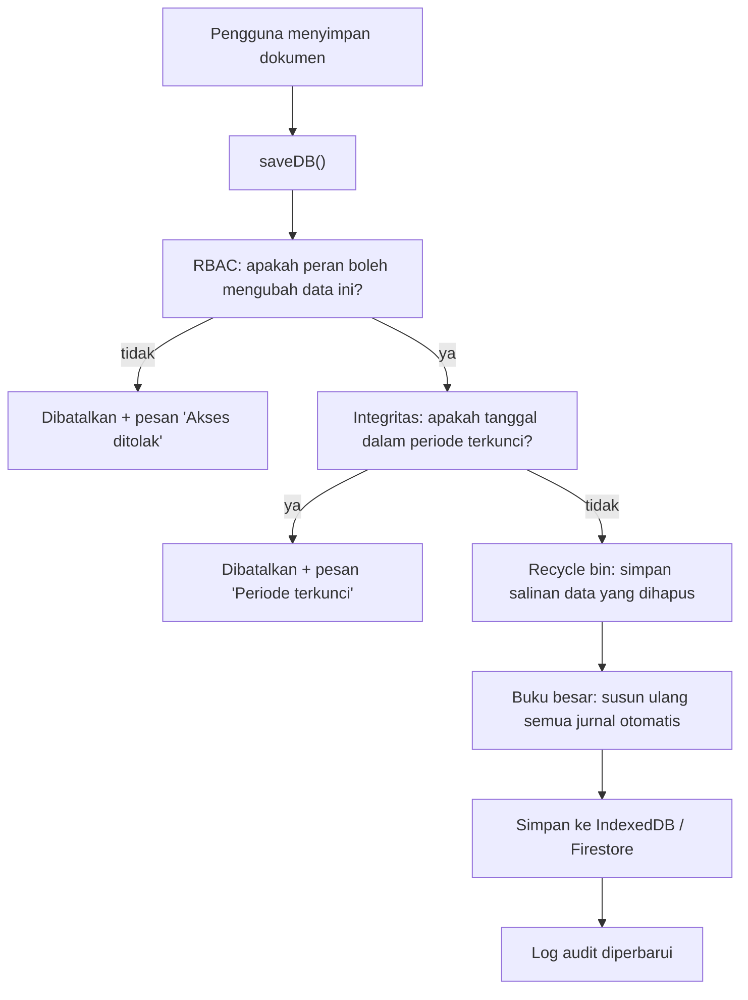

# 04 — Logika Akuntansi dan Alur Dokumen

> **Tujuan:** memisahkan dengan jelas **apa yang dilakukan pengguna** (aksi bisnis) dari **apa yang dilakukan sistem di belakang layar** (konsekuensi akuntansi).
>
> **Prinsip desain yang dipertahankan:** tampilan boleh sederhana, tetapi logika akuntansi tidak disederhanakan. Pengguna umum cukup melihat lapis pertama; staf akunting bisa membuka lapis kedua.

---

## 1. Dua lapis penjelasan

| Aksi pengguna (lapis 1) | Yang terjadi di sistem (lapis 2) |
|---|---|
| "Kirim barang pesanan" (SO → Terkirim) | Stok keluar → HPP dihitung rata-rata → jurnal Piutang vs Penjualan, HPP vs Persediaan |
| "Terima barang dari supplier" (PO → Diterima) | Stok masuk → harga pokok rata-rata diperbarui → jurnal Persediaan vs Hutang |
| "Buat faktur untuk pelanggan" | Dokumen tagihan resmi → piutang, pendapatan, dan PPN keluaran dicatat oleh faktur (tidak lagi oleh pengiriman) |
| "Catat pembayaran pelanggan" | Pelunasan piutang → jurnal Kas/Bank vs Piutang → status faktur Lunas bila penuh |
| "Bayar supplier" | Pelunasan hutang → jurnal Hutang vs Kas/Bank |
| "Truk pelanggan mengambil barang di supplier" (Catat Pengambilan) | Tanpa pergerakan stok → satu jurnal per truk: pembelian (Persediaan + PPN Masukan vs Hutang), HPP vs Persediaan, penjualan (Piutang vs Penjualan + PPN Keluaran) |
| "Tagih pelanggan / catat tagihan supplier dari pengambilan" | Penjualan atau pembelian truk pindah ke faktur; tidak tercatat dua kali |
| "Koreksi stok hasil opname" | Jurnal Persediaan vs Beban Penyesuaian Persediaan |
| "Catat pengeluaran / penerimaan lain" (Kas & Bank) | Jurnal beban vs kas/bank, atau kas/bank vs pendapatan, sesuai kategori/akun |
| "Catat biaya yang belum dibayar" | Jurnal Umum Beban vs Hutang |
| "Proses gaji" | Jurnal Beban Gaji vs Hutang Gaji; saat dibayar Hutang Gaji vs Kas |

---

## 2. Cara mesin akuntansi bekerja

1. **Jurnal diturunkan dari dokumen (*derived*).** Setiap kali data disimpan, sistem menyusun ulang semua jurnal otomatis berdasarkan status dokumen saat itu (`public/classic/core/gl.js`, fungsi `reconcileAll`). Tidak ada jurnal otomatis yang diketik manual.
2. **Konsekuensinya:** jika status dokumen diubah atau dokumen dihapus, jurnalnya ikut berubah/hilang pada perhitungan berikutnya. Tidak ada "jurnal balik" terpisah; jejak perubahannya tercatat di **Log Audit**.
3. **Jurnal manual** (Jurnal Umum, posting Biaya Akrual, pembayaran gaji, saldo awal) disimpan apa adanya dan tidak dihitung ulang. Salinannya disimpan di koleksi `journalVouchers` yang ikut tersinkron di mode cloud; jurnal otomatis disusun ulang di setiap perangkat.
4. **Keseimbangan dijaga:** setiap jurnal otomatis dibentuk seimbang; Jurnal Umum ditolak bila debit ≠ kredit. Menu **Cek Buku Besar** memeriksa semua jurnal.
5. **Nomor jurnal stabil:** `J:SO:<id>:rev`, `J:PO:<id>:recv`, `J:GR:<id>:recv` (penerimaan barang), `J:SI:<id>:rev`, `J:SR:<id>`, `J:DO:<id>:trip` (satu truk pengambilan), `J:OP:<id>` / `J:OD:<id>` / `J:BT:<id>` (Kas & Bank), dst. — sehingga penghitungan ulang tidak membuat duplikat.

---

## 3. Bagan Akun bawaan (Chart of Accounts)

Bagan akun (22 akun) dibuat otomatis bila kosong; akun bawaan yang belum ada di bagan lama ditambahkan otomatis tanpa mengubah akun yang sudah ada. Akun bawaan tidak bisa diubah dari tampilan (hanya dilihat di *Bagan Akun*); akun tambahan dapat masuk lewat Import Excel atau data yang sudah ada.

| No. Akun | Nama | Tipe | Dipakai oleh |
|---|---|---|---|
| 110101 | Kas | Kas & Bank | Pembayaran metode Tunai / lainnya |
| 110102 | Bank BCA | Kas & Bank | Metode "Transfer BCA" |
| 110103 | Bank Mandiri | Kas & Bank | Metode "Transfer Mandiri" |
| 110201 | Piutang Usaha | Piutang | Penjualan, penerimaan, pengambilan belum ditagih |
| 110401 | Persediaan Barang | Persediaan | Pembelian, HPP, penyesuaian, retur; pengambilan (masuk dan keluar di truk yang sama, saldo nol) |
| 130101 | PPN Masukan | Aset lancar lain | PPN atas pembelian |
| 130201 | Uang Muka Pembelian | Aset lancar lain | DP ke supplier |
| 210101 | Hutang Usaha | Hutang | Pembelian, pembayaran |
| 210201 | Hutang PPN (PPN Keluaran) | Kewajiban lancar lain | PPN atas penjualan |
| 210301 | Uang Muka Penjualan | Kewajiban lancar lain | DP dari pelanggan |
| 210401 | Hutang Gaji | Kewajiban lancar lain | Penggajian |
| 310101 | Modal Disetor | Ekuitas | Saldo awal (manual) |
| 320101 | Laba Ditahan | Ekuitas | (manual) |
| 400001 | Penjualan | Pendapatan | Penjualan |
| 400004 | Diskon Penjualan | Pendapatan (kontra) | Diskon per baris |
| 510101 | Beban Pokok Penjualan | HPP | Penjualan, retur |
| 610101 | Beban Operasional Lain | Beban | Baris PO non-stok; Pengeluaran Lain (kategori tanpa akun khusus); pajak bunga |
| 610201 | Beban Penyesuaian Persediaan | Beban | Penyesuaian stok |
| 610301 | Beban Gaji | Beban | Penggajian; Pengeluaran Lain kategori Gaji |
| 610302 | Beban Tunjangan | Beban | Penggajian |
| 610401 | Beban Administrasi Bank | Beban | Pengeluaran Lain kategori Biaya Bank; biaya transfer antar rekening |
| 710101 | Pendapatan Lain-lain | Pendapatan lain | Penerimaan Lain (kategori selain Penjualan), termasuk Bunga Bank |

**Penentuan akun (3 lapis):** per barang (`accountMap`) → per pelanggan/supplier (`glOverrides`) → default perusahaan. Lapis 1 dan 2 **belum** memiliki tampilan pengaturan.

❓ Apakah bisnis sudah punya bagan akun sendiri (dari akuntan/konsultan pajak) yang harus dipakai? Rekening bank apa saja yang aktif? — **REQUIRES USER CONFIRMATION**

---

## 4. Aturan posting per dokumen

### 4.1 Penjualan

| Dokumen / kejadian | Kapan jurnal dibuat | Debit | Kredit |
|---|---|---|---|
| **SO → Terkirim** | Status = Terkirim | **HPP** (qty × harga pokok rata-rata); selama SO belum difakturkan juga Piutang Usaha (neto + PPN) dan Diskon Penjualan | **Persediaan**; selama belum difakturkan juga Penjualan (bruto) dan PPN Keluaran |
| Log Pembayaran SO | Setiap baris log (kecuali yang berasal dari uang muka) | Kas / Bank (sesuai metode) | Piutang Usaha |
| **Faktur Penjualan** | Status Belum Lunas atau Lunas | Piutang Usaha; Diskon; HPP (harga pokok statis) **hanya** untuk faktur tanpa SO sumber dan bukan dari pengambilan | Penjualan; PPN Keluaran; Persediaan (bila ada HPP) |
| Penerimaan (SR) | Status Diposting | Kas / Bank | Piutang Usaha |
| Uang muka diterima | Status Diterima/Diterapkan | Kas / Bank | Uang Muka Penjualan |
| Uang muka diterapkan | Status Diterapkan | Uang Muka Penjualan | Piutang Usaha |
| Retur Penjualan | Status Diposting | Penjualan; PPN Keluaran; Persediaan (harga pokok statis) | Piutang Usaha; Diskon; HPP |

> **Aturan pencatatan satu kali (T-01, diperbaiki):**
> 1. **HPP & pengurangan persediaan** mengikuti pergerakan barang: dibentuk oleh **SO Terkirim** (sesuai kartu stok dan harga pokok rata-rata).
> 2. **Pendapatan, piutang, dan PPN keluaran** dibentuk **satu kali**: oleh **Faktur Penjualan** bila SO sudah difakturkan; bila belum, oleh SO Terkirim.
> 3. Faktur yang tidak memiliki SO sumber (misalnya hasil impor) membentuk jurnal lengkap, termasuk HPP.
> 4. Faktur mewarisi tarif & nilai PPN dari SO sumbernya (T-03).
> 5. Faktur dari pengambilan tidak membentuk HPP; HPP ada di jurnal truknya (§4.5).

### 4.2 Pembelian

| Dokumen / kejadian | Kapan | Debit | Kredit |
|---|---|---|---|
| **PO → Diterima** | Status = Diterima dan PO belum punya Faktur Pembelian aktif | Persediaan (baris barang); Beban Operasional Lain (baris manual); PPN Masukan | Hutang Usaha |
| **Penerimaan Barang yang belum difakturkan** (PO yang difakturkan per penerimaan) | Penerimaan sudah menambah stok, belum ada faktur untuk penerimaan itu | Persediaan (qty diterima × harga satuan penerimaan, atau harga neto PO); PPN Masukan (tarif PO) | Hutang Usaha |
| Log Pembayaran PO | Setiap baris log (kecuali yang berasal dari uang muka) | Hutang Usaha | Kas / Bank |
| **Faktur Pembelian** | Belum Lunas / Lunas | Persediaan; Beban; PPN Masukan | Hutang Usaha |
| Pembayaran (PP) | Diposting | Hutang Usaha | Kas / Bank |
| Uang muka dibayar | Dibayar/Diterapkan | Uang Muka Pembelian | Kas / Bank |
| Uang muka diterapkan | Diterapkan | Hutang Usaha | Uang Muka Pembelian |
| Retur Pembelian | Diposting | Hutang Usaha | Persediaan; Beban; PPN Masukan |

> **Persediaan & hutang dicatat satu kali (T-02, diperbaiki):** bila PO sudah memiliki Faktur Pembelian aktif, jurnal penerimaan PO tidak dibentuk; faktur yang menjadi dasar persediaan & hutang. Kartu stok dan harga pokok rata-rata tetap memakai tanggal penerimaan barang.

> **Faktur per penerimaan (Rekonsiliasi Timbangan):** PO bisa difakturkan satu penerimaan barang demi satu penerimaan. Sejak faktur per penerimaan pertama dibuat, jurnal tingkat PO berhenti; sebagai gantinya **setiap penerimaan yang sudah menambah stok tetapi belum difakturkan** membentuk jurnalnya sendiri (`J:GR:<id>:recv`), dan bila PO ditandai Diterima melebihi yang dibawa penerimaannya, sisanya dicatat dengan jurnal PO. Dengan begitu persediaan dan hutang selalu memuat semua yang sudah diterima: yang sudah difakturkan lewat fakturnya, sisanya lewat penerimaan.

> **Uang muka (T-04, diperbaiki):** baris log pembayaran yang berasal dari penerapan uang muka tidak membentuk jurnal kas (jurnal uang muka sudah mencakupnya).

### 4.3 Persediaan

| Kejadian | Debit | Kredit |
|---|---|---|
| Penyesuaian stok (+) | Persediaan | Beban Penyesuaian Persediaan |
| Penyesuaian stok (−) | Beban Penyesuaian Persediaan | Persediaan |
| Transfer antar gudang | — (tidak ada jurnal) | — |
| Penerimaan Barang (menu terpisah) | Lewat jurnal PO saat PO menjadi Diterima, atau jurnal per penerimaan (§4.2) | |
| Pengambilan | Tidak menyentuh stok; persediaan masuk dan keluar di jurnal truk yang sama (§4.5) | |

### 4.4 Keuangan lain

| Kejadian | Debit | Kredit |
|---|---|---|
| Jurnal Umum | Sesuai input | Sesuai input |
| Biaya Akrual (posting) | Akun beban dipilih | Akun kredit dipilih |
| Penggajian (posting) | Beban Gaji; Beban Tunjangan | Hutang Gaji |
| Pembayaran gaji | Hutang Gaji | Kas / Bank |
| Pengeluaran Lain / Penerimaan Lain / Transfer Bank | Lihat §6 | |

### 4.5 Pengambilan (trading)

Setiap truk yang sudah dicatat (surat jalan berstatus Diambil/Ditagih dengan netto > 0) membentuk **satu jurnal** `J:DO:<id>:trip` bertanggal hari pengambilan. Barang langsung berpindah dari supplier ke pelanggan, jadi stok tidak bergerak dan **persediaan bersih nol per truk**. Pesanan pengambilan (PO supplier dan PO pelanggannya) tidak membentuk jurnal pengiriman/penerimaan di tingkat pesanan, walaupun statusnya diubah menjadi Terkirim/Diterima.

| Bagian jurnal truk | Kapan dibentuk | Debit | Kredit |
|---|---|---|---|
| Pembelian | Selama truk belum masuk Faktur Pembelian aktif | Persediaan (netto × harga beli = DPP); PPN Masukan | Hutang Usaha |
| HPP | Selalu | HPP — sebesar DPP pembelian; setelah ada Faktur Pembelian, sebesar nilai yang dibukukan faktur itu untuk truk tersebut | Persediaan (jumlah yang sama) |
| Penjualan | Selama truk belum masuk Faktur Penjualan aktif | Piutang Usaha (DPP + PPN) | Penjualan (netto × harga jual); PPN Keluaran |

- **Harga:** harga jual dari PO pelanggan; harga beli dari Harga Supplier yang berlaku pada tanggal pengambilan (bila tidak ada, harga PO supplier), atau harga yang dikoreksi di Tagihan Supplier. PPN mengikuti pengaturan PPN masing-masing PO (termasuk harga sudah termasuk PPN).
- **Faktur dari pengambilan** (Tagih Pelanggan / Tagihan Supplier) mencatat daftar truknya. Faktur Penjualan membentuk piutang, penjualan, dan PPN keluaran tanpa HPP; Faktur Pembelian membentuk persediaan, PPN masukan, dan hutang. Bagian yang sama di jurnal truk berhenti, sehingga tidak ada yang tercatat dua kali. Bila fakturnya dibatalkan, bagian itu kembali dicatat dari truk.
- **Perubahan berat setelah faktur:** faktur tidak berubah. Selama belum ada faktur supplier, pembelian dan HPP truk mengikuti berat baru; setelah ada faktur supplier, HPP tetap sebesar yang dibukukan faktur, sehingga persediaan tetap nol. Selisih ditindaklanjuti lewat Perubahan Timbangan ([03 §V3](03-ALUR-TRANSAKSI.md#v3-impor-rekap-timbangan-dan-perubahan-timbangan)).
- **Piutang/hutang belum ditagih:** truk yang belum masuk faktur dihitung sebagai saldo terbuka (umur piutang/hutang, Kartu Piutang/Hutang, Ringkasan) **tanpa jatuh tempo** — termin berjalan sejak faktur — sehingga tidak pernah lewat jatuh tempo.

**Contoh (PPN 11%):** satu truk, netto 35 ton, harga beli Rp 100.000/ton, harga jual Rp 150.000/ton.

| Saat | Akun | Debit | Kredit |
|---|---|---|---|
| Truk dicatat (belum ada faktur) | Persediaan Barang | 3.500.000 | |
| | PPN Masukan | 385.000 | |
| | Hutang Usaha | | 3.885.000 |
| | Beban Pokok Penjualan | 3.500.000 | |
| | Persediaan Barang | | 3.500.000 |
| | Piutang Usaha | 5.827.500 | |
| | Penjualan | | 5.250.000 |
| | Hutang PPN (PPN Keluaran) | | 577.500 |
| Setelah Tagih Pelanggan | Jurnal truk tinggal pembelian + HPP; Faktur Penjualan mencatat Piutang 5.827.500 / Penjualan 5.250.000 + PPN Keluaran 577.500 | | |
| Setelah Tagihan Supplier | Jurnal truk tinggal HPP (dan penjualan bila belum ditagih); Faktur Pembelian mencatat Persediaan 3.500.000 + PPN Masukan 385.000 / Hutang 3.885.000 | | |

Hasil: laba kotor Rp 1.750.000 (5.250.000 − 3.500.000), persediaan nol, dan neraca saldo seimbang di setiap tahap. Bila beberapa truk ditagih dalam satu faktur, PPN dihitung dari total DPP faktur, sehingga bisa berbeda pembulatan Rp 1 dengan jumlah PPN per truk.

---

## 5. Harga Pokok (HPP) — rata-rata bergerak

Sistem menghitung harga pokok per barang dengan **rata-rata bergerak (moving average)**, diulang dari awal setiap kali data disimpan (`public/classic/core/cost-ledger.js`).

| Pergerakan yang dihitung | Arah | Nilai |
|---|---|---|
| Saldo awal (selisih stok saat ini dengan pergerakan tercatat) | Masuk | Harga beli di data barang |
| PO berstatus Diterima | Masuk | Subtotal baris ÷ qty (setelah diskon) |
| Penyesuaian (+) | Masuk | Harga pokok rata-rata saat itu |
| Penyesuaian (−) | Keluar | Harga pokok rata-rata |
| SO berstatus Terkirim | Keluar | Harga pokok rata-rata → **HPP SO** |

Batasan saat ini:
- Retur penjualan/pembelian dan faktur tanpa SO memakai **harga beli statis** di data barang, bukan rata-rata.
- Penerimaan Barang (GR) dan transfer gudang tidak menjadi pergerakan.
- Nilai persediaan di halaman *Barang* memakai **stok × harga beli** (bukan rata-rata).
- Pengambilan tidak memakai harga pokok rata-rata: HPP tiap truk = harga beli truk itu (§4.5), karena barangnya tidak pernah masuk gudang.

❓ Metode penilaian persediaan yang dipakai akuntan bisnis (rata-rata, FIFO, harga terakhir)? — **REQUIRES USER CONFIRMATION**

---

## 6. Kas & Bank — apa yang masuk buku besar

| Data | Di buku besar? | Keterangan |
|---|---|---|
| Penerimaan pelanggan (SR, log SO, DP) | ✅ | Akun kas/bank sesuai metode |
| Pembayaran supplier (PP, log PO, DP) | ✅ | |
| Pembayaran gaji | ✅ | Jurnal Umum |
| Biaya Akrual | ✅ | Jurnal Umum |
| Pengeluaran Lain, Penerimaan Lain, Transfer Bank | ✅ (T-08, diperbaiki) | Jurnal otomatis `J:OP:<id>`, `J:OD:<id>`, `J:BT:<id>`; ikut hilang bila transaksinya dihapus |
| Saldo kas & bank di Ringkasan Keuangan dan Ringkasan | ✅ | Saldo akun kas/bank di buku besar (T-10, diperbaiki) |
| Rekening di menu Kas & Bank (`settings.bankAccounts`) | Dipetakan ke akun | Metode Tunai → Kas 110101; selain itu akun yang tersimpan pada rekening, atau dari nama bank (BCA → 110102, Mandiri → 110103), selain itu Kas 110101. Belum ada tampilan untuk memilih akun per rekening |

**Aturan posting Kas & Bank:**

| Transaksi | Debit | Kredit |
|---|---|---|
| Pengeluaran Lain | Akun beban yang dipilih di form; bawaan dari kategori: **Gaji → 610301 Beban Gaji**, **Biaya Bank → 610401 Beban Administrasi Bank**, Reimbursement dan kategori lain (ATK, Entertain, Utilities, Sewa, Transportasi, Pemeliharaan, Asuransi, Pajak, Lainnya) → **610101 Beban Operasional Lain** | Kas/Bank sesuai rekening & metode |
| Penerimaan Lain | Kas/Bank sesuai rekening & metode | Akun pendapatan yang dipilih; bawaan: **Penjualan → 400001**, **Bunga Bank** dan kategori lain → **710101 Pendapatan Lain-lain** |
| Transfer Bank | Rekening tujuan; biaya transfer → 610401 Beban Administrasi Bank | Rekening asal (jumlah + biaya) |
| Catat biaya/bunga dari rekening koran | Biaya admin & biaya transfer → Pengeluaran Lain kategori Biaya Bank (610401); pajak bunga → Pengeluaran Lain kategori Biaya Bank dengan akun 610101; bunga → Penerimaan Lain kategori Bunga Bank (710101) | |

**Rekonsiliasi Bank** membandingkan saldo akhir rekening koran dengan saldo akun buku besar rekening itu per akhir periode dan menampilkan selisihnya; bila beberapa rekening memakai akun buku besar yang sama, layar memberi tahu bahwa saldo buku besar mencakup rekening-rekening tersebut.

❓ Pemetaan kategori → akun di atas (termasuk pajak bunga ke 610101 karena belum ada akun khusus) perlu disetujui akuntan — **REQUIRES USER CONFIRMATION**

---

## 7. PPN (Pajak Pertambahan Nilai)

| Aspek | Perilaku |
|---|---|
| Pengaturan | Status PKP, NPWP, tarif PPN (default 11%), tarif PPh, pembulatan |
| Di SO/PO | Centang "Kenakan PPN" → PPN = DPP × tarif; total = DPP + PPN |
| Di jurnal | PPN Keluaran (210201) saat penjualan diposting; PPN Masukan (130101) saat pembelian diposting; pada pengambilan, per truk sampai truk itu masuk faktur |
| Rekap PPN (Laporan → Rekap PPN) | PPN dari dokumen yang diposting (T-11, diperbaiki): faktur aktif, SO terkirim / PO diterima yang belum difakturkan, dikurangi retur yang diposting. Pengambilan yang **belum ditagih** sudah tercatat PPN-nya di buku besar tetapi baru masuk Rekap PPN setelah difakturkan |
| Ekspor Coretax (Akuntansi → Ekspor Coretax) | File XML faktur pajak keluaran per masa pajak untuk diimpor di Coretax (Faktur Keluaran → Impor), dari faktur penjualan aktif dan SO terkirim yang belum difakturkan; DPP dan PPN sama dengan Rekap PPN. Kode transaksi 04; PPN 11% ditulis cara Coretax (tarif 12% atas DPP nilai lain 11/12 × DPP, nilai PPN sama). NPWP perusahaan 16 digit, kode barang (6 digit) dan kode satuan diatur di **Konfigurasi**; layar memberi peringatan sebelum ekspor bila data belum lengkap. Nomor faktur pajak dari Coretax bisa dicatat kembali per faktur. CSV format lama tetap tersedia. Bukan koneksi langsung ke DJP; uji impor pertama di Coretax sebelum dipakai rutin — kode barang & satuan **REQUIRES USER CONFIRMATION** |

❓ Apakah perusahaan PKP? Siapa yang membuat faktur pajak & lapor SPT (internal atau konsultan)? — **REQUIRES USER CONFIRMATION**

---

## 8. Laporan keuangan — sumber data

| Laporan | Sumber | Catatan |
|---|---|---|
| Neraca Saldo (Trial Balance) | Semua jurnal | Akun bersaldo nol disembunyikan |
| Laba Rugi | Neraca saldo per tipe akun | Beban pajak dipisah berdasarkan nama akun |
| Neraca | Neraca saldo + laba periode berjalan | Saldo kumulatif sampai tanggal akhir; saldo negatif tampil dengan tanda minus |
| Arus Kas | Baris jurnal akun kas/bank | Diklasifikasikan dari akun lawan pertama (metode langsung sederhana) |
| Umur Piutang / Hutang | Saldo faktur (penerimaan/pembayaran dan retur diperhitungkan), pesanan terkirim/diterima yang belum difakturkan, penerimaan barang yang belum difakturkan, dan pengambilan yang belum ditagih | Perhitungan saldo yang sama dengan dashboard dan kartu piutang/hutang; pengambilan belum ditagih tanpa jatuh tempo |
| Kartu Stok | PO Diterima, penyesuaian, SO Terkirim | Saldo awal = stok sekarang − pergerakan; pengambilan tidak muncul (tidak mengubah stok) |
| Kartu Piutang/Hutang | Faktur, pesanan & pengambilan yang belum difakturkan, penerimaan/pembayaran, retur | |
| Rekap Pengambilan, Laporan per Periode | Data pengambilan per truk | Tonase (netto) dan status penagihan; bukan dari jurnal |
| Budget vs Aktual | Jurnal per akun per bulan | |

**Saldo awal:** database kosong tidak memiliki jurnal saldo awal. Tanpa saldo awal (modal, kas awal, persediaan awal), Neraca bisa menampilkan persediaan negatif meskipun stok barang ada. Saldo awal dimasukkan lewat **Import Excel → Opening Balances** atau **Jurnal Umum**. Data demo memuat satu jurnal saldo awal: kas, bank, dan persediaan terhadap Modal Disetor.

**Arsip Excel** (Kelola Backup → Arsip Excel): satu file Excel per tahun (atau semua tahun) berisi pelanggan, supplier, barang, pesanan penjualan & pembelian, rekap pengambilan, faktur penjualan & pembelian, penerimaan & pembayaran, pengeluaran & penerimaan lain, dan jurnal — untuk disimpan di hard disk atau dibaca akuntan tanpa membuka aplikasi. Untuk pemulihan data tetap dipakai backup file (Export ke File).

---

## 9. Pengaman integritas akuntansi

| Pengaman | Cara kerja | Lokasi |
|---|---|---|
| **Kunci periode** | Transaksi bertanggal ≤ tanggal kunci tidak bisa ditambah/diubah/dihapus; perubahan dibatalkan otomatis | Keuangan → Integritas Data → Kunci Periode |
| **Log audit** | Setiap tambah/ubah/hapus/ubah status dicatat (lokal, maks. 2.000 entri); mode cloud juga punya log akses server | Keuangan → Audit Log |
| **Cek buku besar** | Memeriksa semua jurnal seimbang dan neraca saldo balance | Keuangan → Cek Buku Besar |
| **Recycle bin** | Data terhapus disimpan 90 hari, bisa dipulihkan | Pengaturan → Recycle Bin |
| **RBAC** | Perubahan oleh peran yang tidak berhak dibatalkan | Otomatis |

❓ Apakah bulan yang sudah "tutup buku" perlu dikunci? Siapa yang boleh membuka kunci? — **REQUIRES USER CONFIRMATION**
