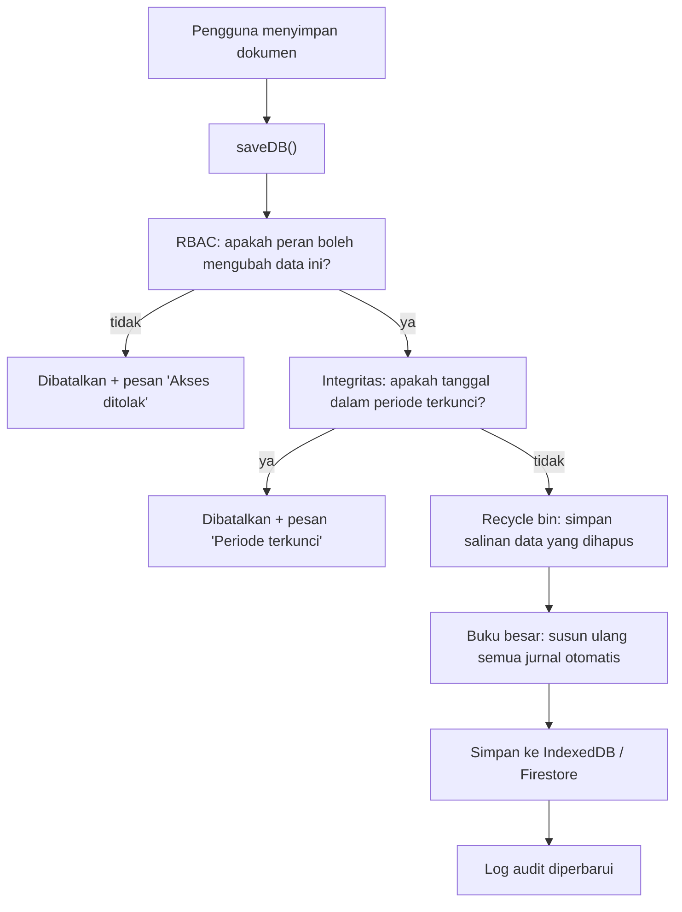

# 04 — Logika Akuntansi dan Alur Dokumen

> **Tujuan:** memisahkan dengan jelas **apa yang dilakukan pengguna** (aksi bisnis) dari **apa yang dilakukan sistem di belakang layar** (konsekuensi akuntansi).
>
> **Prinsip desain yang dipertahankan:** tampilan boleh sederhana, tetapi logika akuntansi tidak disederhanakan. Pengguna umum cukup melihat lapis pertama; staf akunting bisa membuka lapis kedua.

---

## 1. Dua lapis penjelasan

| Aksi pengguna (lapis 1) | Yang terjadi di sistem (lapis 2) |
|---|---|
| "Kirim barang pesanan" (SO → Terkirim) | Stok keluar → HPP dihitung rata-rata → jurnal Piutang vs Penjualan, HPP vs Persediaan |
| "Terima barang dari supplier" (PO → Diterima) | Stok masuk → harga pokok rata-rata diperbarui → jurnal Persediaan vs Hutang |
| "Buat faktur untuk pelanggan" | Dokumen tagihan resmi → piutang terbentuk |
| "Catat pembayaran pelanggan" | Pelunasan piutang → jurnal Kas/Bank vs Piutang → status faktur Lunas bila penuh |
| "Bayar supplier" | Pelunasan hutang → jurnal Hutang vs Kas/Bank |
| "Koreksi stok hasil opname" | Jurnal Persediaan vs Beban Penyesuaian Persediaan |
| "Catat biaya yang belum dibayar" | Jurnal Umum Beban vs Hutang |
| "Proses gaji" | Jurnal Beban Gaji vs Hutang Gaji; saat dibayar Hutang Gaji vs Kas |

---

## 2. Cara mesin akuntansi bekerja

1. **Jurnal diturunkan dari dokumen (*derived*).** Setiap kali data disimpan, sistem menyusun ulang semua jurnal otomatis berdasarkan status dokumen saat itu (`public/classic/core/gl.js`, fungsi `reconcileAll`). Tidak ada jurnal otomatis yang diketik manual.
2. **Konsekuensinya:** jika status dokumen diubah atau dokumen dihapus, jurnalnya ikut berubah/hilang pada perhitungan berikutnya. Tidak ada "jurnal balik" terpisah; jejak perubahannya tercatat di **Log Audit**.
3. **Jurnal manual** (Jurnal Umum, posting Biaya Akrual, pembayaran gaji) disimpan apa adanya dan tidak dihitung ulang.
4. **Keseimbangan dijaga:** setiap jurnal otomatis dibentuk seimbang; Jurnal Umum ditolak bila debit ≠ kredit. Menu **Cek Buku Besar** memeriksa semua jurnal.
5. **Nomor jurnal stabil:** `J:SO:<id>:rev`, `J:PO:<id>:recv`, `J:SI:<id>:rev`, `J:SR:<id>`, dst. — sehingga penghitungan ulang tidak membuat duplikat.

---

## 3. Bagan Akun bawaan (Chart of Accounts)

Bagan akun dibuat otomatis bila kosong. Akun bawaan tidak bisa diubah dari tampilan (hanya dilihat di *Bagan Akun*); akun tambahan dapat masuk lewat Import Excel atau data yang sudah ada.

| No. Akun | Nama | Tipe | Dipakai oleh |
|---|---|---|---|
| 110101 | Kas | Kas & Bank | Pembayaran metode Tunai / lainnya |
| 110102 | Bank BCA | Kas & Bank | Metode "Transfer BCA" |
| 110103 | Bank Mandiri | Kas & Bank | Metode "Transfer Mandiri" |
| 110201 | Piutang Usaha | Piutang | Penjualan, penerimaan |
| 110401 | Persediaan Barang | Persediaan | Pembelian, HPP, penyesuaian, retur |
| 130101 | PPN Masukan | Aset lancar lain | PPN atas pembelian |
| 130201 | Uang Muka Pembelian | Aset lancar lain | DP ke supplier |
| 210101 | Hutang Usaha | Hutang | Pembelian, pembayaran |
| 210201 | Hutang PPN (PPN Keluaran) | Kewajiban lancar lain | PPN atas penjualan |
| 210301 | Uang Muka Penjualan | Kewajiban lancar lain | DP dari pelanggan |
| 210401 | Hutang Gaji | Kewajiban lancar lain | Penggajian |
| 310101 | Modal Disetor | Ekuitas | Saldo awal (manual) |
| 320101 | Laba Ditahan | Ekuitas | (manual) |
| 400001 | Penjualan | Pendapatan | Penjualan |
| 400004 | Diskon Penjualan | Pendapatan (kontra) | Diskon per baris |
| 510101 | Beban Pokok Penjualan | HPP | Penjualan, retur |
| 610101 | Beban Operasional Lain | Beban | Baris PO non-stok |
| 610201 | Beban Penyesuaian Persediaan | Beban | Penyesuaian stok |
| 610301 | Beban Gaji | Beban | Penggajian |
| 610302 | Beban Tunjangan | Beban | Penggajian |

**Penentuan akun (3 lapis):** per barang (`accountMap`) → per pelanggan/supplier (`glOverrides`) → default perusahaan. Lapis 1 dan 2 **belum** memiliki tampilan pengaturan.

❓ Apakah bisnis sudah punya bagan akun sendiri (dari akuntan/konsultan pajak) yang harus dipakai? Rekening bank apa saja yang aktif? — **REQUIRES USER CONFIRMATION**

---

## 4. Aturan posting per dokumen

### 4.1 Penjualan

| Dokumen / kejadian | Kapan jurnal dibuat | Debit | Kredit |
|---|---|---|---|
| **SO → Terkirim** | Status = Terkirim | Piutang Usaha (neto + PPN); Diskon Penjualan (diskon); **HPP** (qty × harga pokok rata-rata) | Penjualan (bruto); PPN Keluaran; **Persediaan** |
| Log Pembayaran SO | Setiap baris log | Kas / Bank (sesuai metode) | Piutang Usaha |
| **Faktur Penjualan** | Status Belum Lunas atau Lunas | Piutang Usaha; Diskon; HPP (harga pokok statis) | Penjualan; PPN Keluaran; Persediaan |
| Penerimaan (SR) | Status Diposting | Kas / Bank | Piutang Usaha |
| Uang muka diterima | Status Diterima/Diterapkan | Kas / Bank | Uang Muka Penjualan |
| Uang muka diterapkan | Status Diterapkan | Uang Muka Penjualan | Piutang Usaha |
| Retur Penjualan | Status Diposting | Penjualan; PPN Keluaran; Persediaan (harga pokok statis) | Piutang Usaha; Diskon; HPP |

> ⚠ **T-01 — Pendapatan tercatat ganda.** Faktur hanya bisa dibuat dari SO yang sudah Terkirim, dan keduanya membentuk jurnal pendapatan + HPP. Pada alur normal (kirim → faktur), penjualan, piutang, HPP, dan pengurangan persediaan tercatat **dua kali**.
>
> **Aturan perbaikan (mengikuti logika yang sudah ada, tanpa mengubah model):**
> 1. **HPP & pengurangan persediaan** tetap mengikuti pergerakan barang: dibentuk oleh **SO Terkirim** (sesuai kartu stok dan harga pokok rata-rata).
> 2. **Pendapatan, piutang, dan PPN keluaran** dibentuk **satu kali**: oleh **Faktur Penjualan** bila SO sudah difakturkan; bila SO belum difakturkan, tetap oleh SO Terkirim (perilaku lama).
> 3. Faktur yang tidak memiliki SO sumber (misalnya hasil impor) tetap membentuk jurnal lengkap.
> 4. Faktur mewarisi tarif & nilai PPN dari SO sumbernya (T-03).
>
> Status perbaikan dicatat di [08-TEMUAN-TEKNIS.md](08-TEMUAN-TEKNIS.md).

### 4.2 Pembelian

| Dokumen / kejadian | Kapan | Debit | Kredit |
|---|---|---|---|
| **PO → Diterima** | Status = Diterima | Persediaan (baris barang); Beban Operasional Lain (baris manual); PPN Masukan | Hutang Usaha |
| Log Pembayaran PO | Setiap baris log | Hutang Usaha | Kas / Bank |
| **Faktur Pembelian** | Belum Lunas / Lunas | Persediaan; Beban; PPN Masukan | Hutang Usaha |
| Pembayaran (PP) | Diposting | Hutang Usaha | Kas / Bank |
| Uang muka dibayar | Dibayar/Diterapkan | Uang Muka Pembelian | Kas / Bank |
| Uang muka diterapkan | Diterapkan | Hutang Usaha | Uang Muka Pembelian |
| Retur Pembelian | Diposting | Hutang Usaha | Persediaan; Beban; PPN Masukan |

> ⚠ **T-02 — Hutang & persediaan tercatat ganda** pada alur PO Diterima → Faktur Pembelian. **Aturan perbaikan:** bila PO sudah memiliki Faktur Pembelian aktif, jurnal penerimaan PO tidak dibentuk; faktur yang menjadi dasar persediaan & hutang. Kartu stok dan harga pokok rata-rata tetap memakai tanggal penerimaan barang.

> ⚠ **T-04 — Uang muka tercatat ganda.** Menerapkan DP menambah log pembayaran yang juga membentuk jurnal kas. **Aturan perbaikan:** baris log pembayaran yang berasal dari DP tidak membentuk jurnal kas (jurnal DP sudah mencakupnya).

### 4.3 Persediaan

| Kejadian | Debit | Kredit |
|---|---|---|
| Penyesuaian stok (+) | Persediaan | Beban Penyesuaian Persediaan |
| Penyesuaian stok (−) | Beban Penyesuaian Persediaan | Persediaan |
| Transfer antar gudang | — (tidak ada jurnal) | — |
| Penerimaan Barang (menu terpisah) | — (tidak ada jurnal) ⚠ T-07 | — |

### 4.4 Keuangan lain

| Kejadian | Debit | Kredit |
|---|---|---|
| Jurnal Umum | Sesuai input | Sesuai input |
| Biaya Akrual (posting) | Akun beban dipilih | Akun kredit dipilih |
| Penggajian (posting) | Beban Gaji; Beban Tunjangan | Hutang Gaji |
| Pembayaran gaji | Hutang Gaji | Kas / Bank |
| Pengeluaran Lain / Penerimaan Lain / Transfer Bank | ⚠ Tidak ada jurnal (T-08) | |

---

## 5. Harga Pokok (HPP) — rata-rata bergerak

Sistem menghitung harga pokok per barang dengan **rata-rata bergerak (moving average)**, diulang dari awal setiap kali data disimpan (`public/classic/core/cost-ledger.js`).

| Pergerakan yang dihitung | Arah | Nilai |
|---|---|---|
| Saldo awal (selisih stok saat ini dengan pergerakan tercatat) | Masuk | Harga beli di data barang |
| PO berstatus Diterima | Masuk | Subtotal baris ÷ qty (setelah diskon) |
| Penyesuaian (+) | Masuk | Harga pokok rata-rata saat itu |
| Penyesuaian (−) | Keluar | Harga pokok rata-rata |
| SO berstatus Terkirim | Keluar | Harga pokok rata-rata → **HPP SO** |

Batasan saat ini:
- Retur penjualan/pembelian dan faktur tanpa SO memakai **harga beli statis** di data barang, bukan rata-rata.
- Penerimaan Barang (GR) dan transfer gudang tidak menjadi pergerakan.
- Nilai persediaan di halaman *Barang* memakai **stok × harga beli** (bukan rata-rata).

❓ Metode penilaian persediaan yang dipakai akuntan bisnis (rata-rata, FIFO, harga terakhir)? — **REQUIRES USER CONFIRMATION**

---

## 6. Kas & Bank — apa yang masuk buku besar

| Data | Di buku besar? | Keterangan |
|---|---|---|
| Penerimaan pelanggan (SR, log SO, DP) | ✅ | Akun kas/bank sesuai metode |
| Pembayaran supplier (PP, log PO, DP) | ✅ | |
| Pembayaran gaji | ✅ | Jurnal Umum |
| Biaya Akrual | ✅ | Jurnal Umum |
| Pengeluaran Lain, Penerimaan Lain, Transfer Bank | ⚠ Belum (T-08) | Perbaikan diusulkan: jurnal otomatis dengan pemetaan kategori → akun |
| Saldo "Kas Tunai / Bank BCA / Bank Mandiri" di halaman Keuangan | ❌ | Angka yang diketik manual ("Edit Saldo Kas & Bank"), **bukan** saldo buku besar (T-10) |
| Rekening di menu Kas & Bank (`settings.bankAccounts`) | ❌ | Daftar rekening terpisah dari akun buku besar |

Artinya saat ini ada **tiga** representasi rekening yang berbeda: akun buku besar, saldo manual di halaman Keuangan, dan daftar rekening di menu Kas & Bank.

**Aturan perbaikan T-08 (diusulkan & dicatat di [08](08-TEMUAN-TEKNIS.md)):**

| Transaksi | Debit | Kredit |
|---|---|---|
| Pengeluaran Lain | Akun beban (Gaji → Beban Gaji; lainnya → Beban Operasional Lain; bisa dipilih) | Kas (metode Tunai) atau Bank sesuai rekening |
| Penerimaan Lain | Kas/Bank | Pendapatan Lain-lain (akun baru 710101) atau Penjualan untuk kategori "Penjualan" |
| Transfer Bank | Bank tujuan (+ Beban Administrasi Bank untuk biaya, akun baru 610401) | Bank asal |

❓ Pemetaan kategori → akun di atas perlu disetujui akuntan — **REQUIRES USER CONFIRMATION**

---

## 7. PPN (Pajak Pertambahan Nilai)

| Aspek | Perilaku |
|---|---|
| Pengaturan | Status PKP, NPWP, tarif PPN (default 11%), tarif PPh, pembulatan |
| Di SO/PO | Centang "Kenakan PPN" → PPN = DPP × tarif; total = DPP + PPN |
| Di jurnal | PPN Keluaran (210201) saat penjualan diposting; PPN Masukan (130101) saat pembelian diposting |
| Rekap PPN (menu Pajak) | Menjumlahkan PPN dari SO/PO non-draft |
| Laporan SPT PPN | ⚠ Menghitung 11% dari total yang **sudah termasuk PPN** dan dari semua status (T-11) — tidak andal |
| e-Faktur | Menu tersedia, bukan integrasi resmi DJP |

❓ Apakah perusahaan PKP? Siapa yang membuat faktur pajak & lapor SPT (internal atau konsultan)? — **REQUIRES USER CONFIRMATION**

---

## 8. Laporan keuangan — sumber data

| Laporan | Sumber | Catatan |
|---|---|---|
| Neraca Saldo (Trial Balance) | Semua jurnal | Akun bersaldo nol disembunyikan |
| Laba Rugi | Neraca saldo per tipe akun | Beban pajak dipisah berdasarkan nama akun |
| Neraca | Neraca saldo + laba periode berjalan | ⚠ Dengan filter tanggal hanya menghitung jurnal dalam rentang (T-13); saldo negatif ditampilkan sebagai positif (T-13) |
| Arus Kas | Baris jurnal akun kas/bank | Diklasifikasikan dari akun lawan pertama (metode langsung sederhana) |
| Umur Piutang | Faktur Penjualan & penerimaan | ⚠ PPN terhitung dua kali (T-09) |
| Kartu Stok | PO Diterima, penyesuaian, SO Terkirim | Saldo awal = stok sekarang − pergerakan |
| Kartu Piutang/Hutang | Faktur & penerimaan/pembayaran | |
| Budget vs Aktual | Jurnal per akun per bulan | |

**Saldo awal:** belum ada jurnal saldo awal pada data kosong. Tanpa saldo awal (modal, kas awal, persediaan awal), Neraca bisa menampilkan persediaan negatif meskipun stok barang ada. Saldo awal dimasukkan lewat **Import Excel → Opening Balances** atau **Jurnal Umum**.

---

## 9. Pengaman integritas akuntansi

| Pengaman | Cara kerja | Lokasi |
|---|---|---|
| **Kunci periode** | Transaksi bertanggal ≤ tanggal kunci tidak bisa ditambah/diubah/dihapus; perubahan dibatalkan otomatis | Keuangan → Integritas Data → Kunci Periode |
| **Log audit** | Setiap tambah/ubah/hapus/ubah status dicatat (lokal, maks. 2.000 entri); mode cloud juga punya log akses server | Keuangan → Audit Log |
| **Cek buku besar** | Memeriksa semua jurnal seimbang dan neraca saldo balance | Keuangan → Cek Buku Besar |
| **Recycle bin** | Data terhapus disimpan 90 hari, bisa dipulihkan | Pengaturan → Recycle Bin |
| **RBAC** | Perubahan oleh peran yang tidak berhak dibatalkan | Otomatis |

❓ Apakah bulan yang sudah "tutup buku" perlu dikunci? Siapa yang boleh membuka kunci? — **REQUIRES USER CONFIRMATION**
