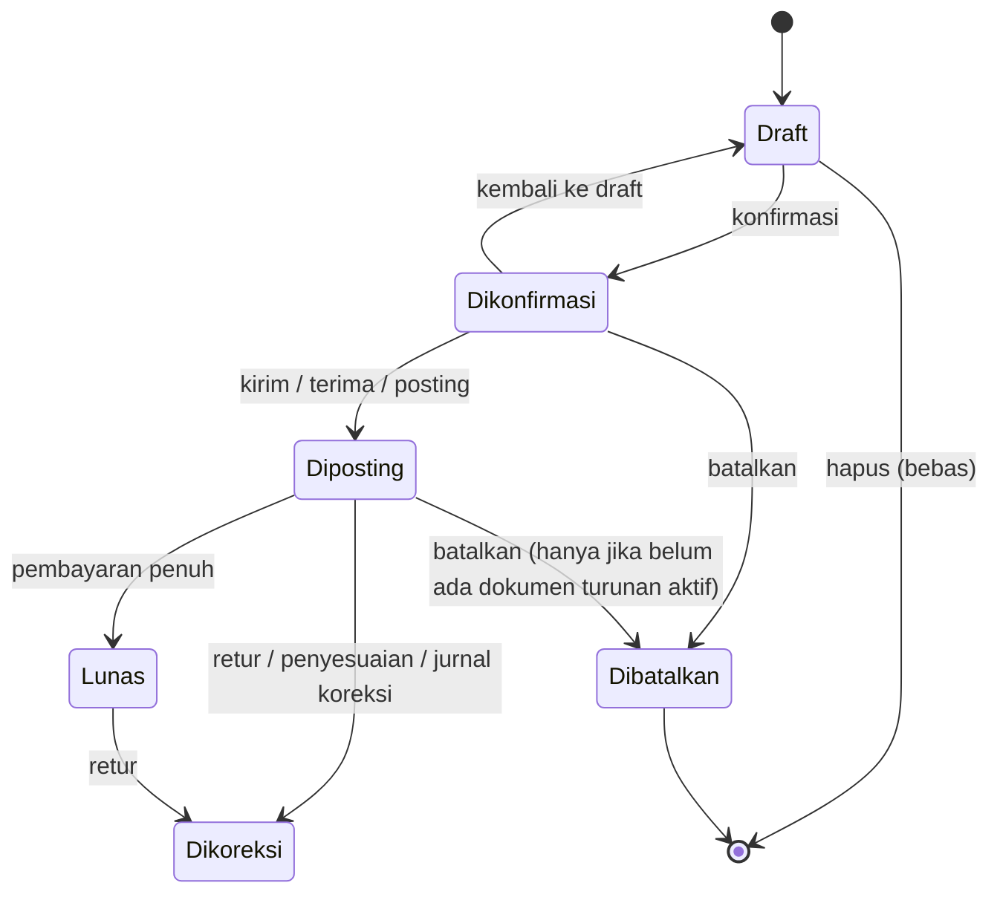

# 05 — Siklus Status Dokumen dan Model Koreksi

> **Pertanyaan yang dijawab:** *"Kalau transaksi salah, apa yang boleh dilakukan — ubah, batalkan, retur, atau jurnal koreksi?"*
>
> Dokumen ini berisi (1) status yang ada saat ini, (2) apa yang terjadi pada ubah/hapus/batal, dan (3) model koreksi yang konsisten dengan logika akuntansi aplikasi.

---

## 1. Kosakata status yang dipakai di dokumen ini

| Istilah umum | Arti | Padanan di aplikasi |
|---|---|---|
| **Draft** | Belum berlaku; bebas diubah | Draft |
| **Diajukan / Dikonfirmasi** | Komitmen bisnis, belum ada efek akuntansi | Dikonfirmasi (SO/PO), Dikirim (penawaran), Pending (DO) |
| **Diposting** | Sudah memengaruhi stok dan/atau buku besar | Terkirim (SO), Diterima (PO), Belum Lunas (faktur), Diposting (penerimaan, pembayaran, retur, transfer) |
| **Lunas** | Kewajiban/tagihan sudah dibayar penuh | Lunas (SO/PO/faktur) |
| **Selesai** | Siklus dokumen tuntas | Difakturkan (DO), Diterima/Ditolak (penawaran) |
| **Dibatalkan** | Tidak berlaku; tetap tersimpan untuk jejak | Dibatalkan (SO/PO; belum ada di dokumen lain) |
| **Dibalik (reversed)** | Efeknya dinetralkan oleh dokumen/jurnal lawan | Retur Penjualan/Pembelian, Jurnal Umum koreksi |
| **Diubah** | Isi dokumen diganti setelah dibuat | Form Edit |
| **Dikoreksi** | Kesalahan diperbaiki dengan dokumen koreksi | Retur, Penyesuaian Stok, Jurnal Umum |

---

## 2. Status per jenis dokumen (saat ini)

| Dokumen | Status | Transisi yang divalidasi mesin |
|---|---|---|
| Penawaran (SQ/PQ) | Draft → Dikirim → Diterima / Ditolak | Draft→Dikirim; Dikirim→Diterima/Ditolak/Draft; Diterima & Ditolak = akhir |
| Sales Order | Draft, Dikonfirmasi, Terkirim, Lunas, Dibatalkan (+ status impor) | Draft→Dikonfirmasi/Lunas/Terkirim; Dikonfirmasi→Lunas/Terkirim/Draft; Lunas→Terkirim/Dikonfirmasi; Terkirim→Lunas |
| Purchase Order | Draft, Dikonfirmasi, Diterima, Lunas, Dibatalkan (+ status impor) | Seperti SO dengan "Diterima" |
| Surat Jalan (DO) | Pending, Dalam Pengiriman, Terkirim, Faktur Sebagian, Difakturkan | Divalidasi di form Edit |
| Faktur (SI/PI) | Belum Lunas → Lunas | Otomatis dari penerimaan/pembayaran |
| Penerimaan / Pembayaran (SR/PP) | Diposting | — |
| Retur (SRN/PRN) | Draft → Diposting | — |
| Transfer Gudang (IT) | Diposting | — |
| Uang Muka | Diterima/Dibayar → Diterapkan | — |
| Biaya Akrual | Draft → Diposting | — |
| Penggajian | Draft → Diposting → Dibayar | — |

**Temuan:**
- Status "Dibatalkan" pada SO/PO hanya ada di daftar pilihan tampilan; mesin dokumen tidak mengenalnya sebagai status resmi (transisi dari/ke status yang tidak dikenal selalu diizinkan).
- Validasi transisi hanya berlaku saat mengubah status dari **daftar** (satuan/massal) dan di form Surat Jalan — **tidak** di form Edit SO/PO (T-17).
- Satu field status SO mencampur dua hal berbeda: **pengiriman** (Terkirim) dan **pembayaran** (Lunas). Pesanan yang sudah dikirim lalu dibayar tetap "Terkirim"; yang dibayar lebih dulu menjadi "Lunas" lalu harus diubah manual ke "Terkirim".

---

## 3. Apa yang terjadi saat mengubah, menghapus, membatalkan (saat ini)

| Dokumen | Ubah | Hapus | Batal | Efek pada stok & akuntansi |
|---|---|---|---|---|
| **SO** | ✅ Semua status | ✅ Semua status (undo + recycle bin) | Ubah status ke Dibatalkan | Reservasi dilepas; stok dikembalikan bila sebelumnya Terkirim; jurnal ikut hilang |
| **PO** | ✅ Semua status | ✅ Semua status | Ubah status | Stok dikurangi kembali bila sebelumnya Diterima; jurnal hilang |
| **Surat Jalan** | ✅ | ✅ | — | Tidak ada efek |
| **Penawaran** | ❌ | ❌ | Ditolak | — |
| **Faktur (SI/PI)** | ❌ | ❌ | ❌ | Koreksi hanya via retur |
| **Penerimaan/Pembayaran** | ❌ | ❌ | ❌ | — |
| **Retur** | ❌ | ❌ | ❌ (setelah posting) | — |
| **Penyesuaian stok** | ❌ | ✅ kapan saja | — | Stok dikembalikan; jurnal hilang |
| **Transfer gudang** | ❌ | ❌ | ❌ | — |
| **Jurnal Umum** | ❌ | ❌ | — | Koreksi dengan jurnal balik |
| **Uang muka, Biaya Akrual, Pengeluaran Lain** | Sebagian | ✅ kapan saja | — | Akrual yang dihapus meninggalkan jurnalnya |
| **Pelanggan/Supplier/Barang** | ✅ | ✅ dengan cek sebagian relasi | — | Mengubah stok di data barang tidak memperbarui stok per gudang (T-05) |

**Risiko terhadap integritas akuntansi:**
1. Dokumen yang sudah memengaruhi buku besar (SO Terkirim, PO Diterima) masih bisa **diubah atau dihapus** tanpa jejak di buku besar (hanya log audit). Laporan bulan lalu bisa berubah diam-diam kecuali periode dikunci.
2. Menghapus SO/PO tidak ikut membatalkan Surat Jalan, Faktur, atau pembayaran turunannya.
3. Dokumen keuangan yang salah (faktur, penerimaan) tidak bisa dibatalkan sama sekali — pengguna terdorong memakai jalan pintas.

---

## 4. Model koreksi yang direkomendasikan

Model ini **mengikuti mesin yang sudah ada** (jurnal diturunkan dari status dokumen) dan menambahkan batasan yang wajar. Bagian yang sudah diterapkan dicatat di §5.

| Situasi | Tindakan yang benar | Efek |
|---|---|---|
| Salah ketik di dokumen **Draft** | **Ubah** atau **hapus** | Tidak ada efek stok/akuntansi |
| Salah di dokumen **Dikonfirmasi** (belum ada efek akuntansi) | **Ubah** (dengan pemberitahuan) atau **Batalkan** | Reservasi stok diperbarui/dilepas |
| Dokumen **Diposting** salah dan belum punya dokumen turunan | **Batalkan** (status Dibatalkan, dokumen tetap tersimpan) | Stok dikembalikan; jurnal otomatis tidak lagi dibentuk; tercatat di log audit |
| Dokumen **Diposting** yang sudah punya faktur/pembayaran | **Tidak diubah langsung.** Batalkan dokumen turunan lebih dulu, atau gunakan **Retur** | Rantai dokumen tetap konsisten |
| Barang dikembalikan pelanggan/ke supplier | **Retur Penjualan / Retur Pembelian** | Stok & jurnal dibalik sebagian atau penuh |
| Selisih stok fisik | **Penyesuaian Stok** | Jurnal selisih persediaan |
| Salah akun / nilai di buku besar tanpa kesalahan dokumen | **Jurnal Umum koreksi** | Jejak koreksi terlihat di buku besar |
| Faktur salah dan belum dibayar | **Batalkan faktur** | Piutang/hutang tidak lagi terbentuk |
| Penerimaan/pembayaran salah | **Batalkan penerimaan/pembayaran** | Kas/bank dan piutang/hutang kembali; status faktur kembali Belum Lunas |
| Bulan sudah ditutup | **Kunci periode**; koreksi dibukukan di periode berjalan | Laporan periode lama tidak berubah |

Prinsip:
1. **Hapus hanya untuk Draft** (dan dokumen tanpa efek). Dokumen berefek dibatalkan, bukan dihapus.
2. **Batalkan dari hilir ke hulu:** pembayaran → faktur → pengiriman → order.
3. **Jejak tidak hilang:** dokumen batal tetap tersimpan dengan status Dibatalkan dan tercatat di log audit.
4. **Koreksi nilai akuntansi yang sudah dilaporkan** memakai dokumen koreksi (retur, penyesuaian, jurnal umum), bukan mengubah dokumen lama.

❓ Keputusan yang perlu disepakati dengan pemilik/akuntan — **REQUIRES USER CONFIRMATION**:
- Apakah dokumen yang sudah dikirim/diterima boleh diubah oleh staf, atau hanya oleh peran tertentu (misalnya admin)?
- Apakah pembatalan perlu persetujuan (approval)?
- Apakah auditor/akuntan membutuhkan **jurnal balik eksplisit** di buku besar (bukan hanya log audit)?
- Apakah ada batas waktu koreksi (misalnya setelah tanggal 5 bulan berikutnya dikunci)?

---

## 5. Status penerapan model

Kolom ini diperbarui seiring perbaikan aplikasi. Rincian teknis di [08-TEMUAN-TEKNIS.md](08-TEMUAN-TEKNIS.md).

| Aturan | Status |
|---|---|
| Validasi transisi status juga berlaku di form Edit SO/PO | Direncanakan |
| Dokumen yang sudah punya dokumen turunan tidak bisa dihapus (ditawarkan Batalkan) | Direncanakan |
| Pembatalan Faktur Penjualan/Pembelian (bila belum ada pembayaran) | Direncanakan |
| Pembatalan Penerimaan/Pembayaran (status faktur dihitung ulang) | Direncanakan |
| Konversi penawaran hanya sekali | Direncanakan |
| Jurnal balik eksplisit untuk pembatalan | Menunggu konfirmasi kebutuhan |
| Approval pembatalan | Menunggu konfirmasi kebutuhan |
