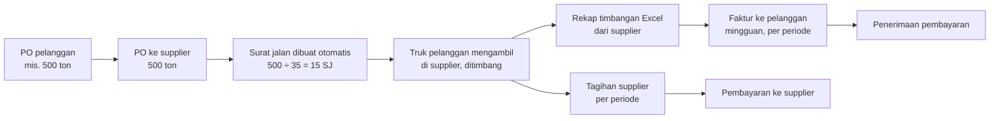

# 11 — Kebutuhan dari Meeting 14 September 2026

> **Sumber:** catatan meeting dan rekaman meeting dengan pemilik usaha (14 September 2026).
> Dokumen ini memetakan setiap kebutuhan ke penyelesaiannya di aplikasi dan statusnya.
> Hal yang belum bisa dipastikan ditandai **REQUIRES USER CONFIRMATION**.
>
> Dokumen terkait: [01 Ringkasan Sistem](01-RINGKASAN-SISTEM.md) · [03 Alur Transaksi](03-ALUR-TRANSAKSI.md) · [04 Akuntansi](04-AKUNTANSI.md) · [06 Matriks Kebutuhan](06-MATRIKS-KEBUTUHAN.md) · [12 Keamanan & Infrastruktur](12-KEAMANAN-DAN-INFRASTRUKTUR.md)

---

## 1. Gambaran usaha yang dikonfirmasi

- Perusahaan adalah **pedagang (trading)**: menjembatani pihak yang punya barang (supplier/produsen) dengan pihak yang butuh barang (pelanggan). Perusahaan tidak memproduksi barang.
- Barang yang paling banyak berjalan saat ini: **batu split** dan sejenisnya (batu gunung untuk jalan), dalam satuan **ton**. Daftar barang lengkap akan diberikan pemilik — **REQUIRES USER CONFIRMATION**.
- Tidak ada karyawan tetap selain direksi; staf tidak bekerja di satu tempat. Admin membuka PO, membuat invoice, merekap pengambilan dan pembayaran, serta pajak. Pembukuan oleh akuntan biasanya hanya di akhir tahun.
- Masalah utama: pekerjaan masih manual, berulang, dan tersebar. Dibutuhkan satu sistem yang mengintegrasikan pembelian, pengambilan, penagihan, pembayaran, laporan keuangan, dan pajak.
- Prioritas pemilik: **penagihan cepat**, **laporan keuangan**, **perpajakan**, dan **data akurat** — selisih antara tagihan supplier dan tagihan ke pelanggan harus terdeteksi.

## 2. Alur pengambilan (inti usaha)

| Kebutuhan (dari meeting) | Penyelesaian di aplikasi | Status |
|---|---|---|
| PO pelanggan diteruskan menjadi PO ke supplier dengan jumlah sama | PO supplier dihubungkan ke PO pelanggan saat dibuka untuk pengambilan (`pickupFlow.soId`) | Inti selesai; layar sedang dibuat |
| Truk ±35 ton, 2–3 truk sehari, satu PO diambil bertahap sampai ±1 bulan | Setiap truk = satu **pengambilan** (surat jalan) dengan tanggal, no. polisi, sopir, bruto/tara/netto | Inti selesai; layar sedang dibuat |
| Saat PO dibuka, surat jalan langsung dibuat sebanyak kemungkinan truk (500 ÷ 35 → 15) dengan nomor PO | Membuka PO pengambilan membuat ⌈jumlah ÷ kapasitas truk⌉ surat jalan bernomor `<No PO>/01…`; kapasitas bisa diatur per PO | Inti selesai |
| PO tidak boleh dipakai lebih dari 15 surat jalan | Jumlah surat jalan tetap; tidak ada surat jalan tambahan untuk PO yang sama | Inti selesai |
| PO tidak boleh dipakai melebihi kuota tonase | Pengambilan yang melewati kuota ditolak kecuali dikonfirmasi; PO ditutup otomatis saat kuota terpenuhi | Inti selesai |
| Cut-off akhir bulan: PO yang belum habis dihentikan | Batas tanggal PO (default akhir bulan PO); PO lewat batas ditutup, surat jalan sisa dibatalkan | Inti selesai |
| Satu PO pelanggan yang belum habis saat cut-off dilanjutkan bulan berikutnya | PO supplier baru untuk PO pelanggan yang sama | Inti selesai — **REQUIRES USER CONFIRMATION:** apakah PO pelanggan juga dianggap selesai saat cut-off, atau tetap berjalan |
| Mencegah salah ambil: dua pelanggan mengambil barang sama di hari yang sama, nama PT sama tapi lokasi berbeda, truk untuk A dibawa ke B | Surat jalan terikat ke satu PO pelanggan dan tujuan; perubahan tujuan ditandai "Tujuan diubah" | Inti selesai |
| Daftar surat jalan mudah diekspor ke Excel untuk bagian timbangan supplier (pengguna awam komputer) | Ekspor Excel per PO / per supplier dengan kolom kosong untuk diisi timbangan; format yang sama bisa diimpor kembali | Inti selesai; tombol di layar sedang dibuat |
| Setiap pengambilan direkap (barang, tanggal, tonase) | Rekap Pengambilan per periode, pelanggan, supplier, PO; ekspor Excel | Inti selesai; layar sedang dibuat |
| Rekap Excel dari timbangan bisa diimpor tanpa input ulang | Impor Rekap Timbangan: membaca kolom No SJ / Tanggal / No Polisi / Sopir / Bruto / Tara / Netto (nama kolom fleksibel), mencocokkan ke surat jalan | Inti selesai; layar sedang dibuat — format rekap asli dari supplier **REQUIRES USER CONFIRMATION** (contoh file belum diterima) |
| Rekap dari timbangan bersifat kumulatif dan kadang mengubah data lama tanpa pemberitahuan (30 → 35 ton) setelah pelanggan ditagih | Saat impor, perubahan berat pada pengambilan yang sudah ada terdeteksi; riwayat berat disimpan; bila sudah ditagih, muncul peringatan "Perubahan Timbangan" sampai ditindaklanjuti | Inti selesai; layar & notifikasi sedang dibuat |
| Bukti yang dipakai: DO (delivery order) dari supplier / surat jalan, yang dikirim sebagai foto | Foto tiket/DO bisa dilampirkan pada pengambilan sebagai bukti saat menelusuri perubahan | Layar sedang dibuat |
| Usulan membaca angka di foto DO dengan AI untuk dibandingkan dengan Excel | Belum dibuat. Butuh layanan AI berbayar dan koneksi internet; dicatat sebagai tahap berikutnya | **REQUIRES USER CONFIRMATION** — apakah diinginkan, dan siapa menanggung biaya layanannya |
| Foto DO/surat jalan dikirim lewat WhatsApp (bukan email) | Tidak ada integrasi email/WhatsApp; foto diunggah manual ke pengambilan, rekap Excel diimpor | Sesuai kebutuhan saat ini |

## 3. Penagihan dan pembayaran

| Kebutuhan | Penyelesaian di aplikasi | Status |
|---|---|---|
| Faktur ke pelanggan biasanya seminggu sekali, sesuai pengambilan dari tanggal X sampai Y; tidak menunggu PO selesai; satu PO bisa punya beberapa faktur | Tagih Pelanggan: pilih pelanggan dan periode → semua pengambilan yang belum ditagih menjadi satu faktur (satu baris per truk); pengambilan yang sudah ditagih tidak bisa ditagih lagi | Inti selesai; layar sedang dibuat |
| Satu klik membuat faktur dari pengambilan tanggal 1–10 | Sama seperti di atas | Layar sedang dibuat |
| Melihat mana yang sudah/belum ditagih, sudah/belum dibayar, outstanding per pelanggan | Pengambilan yang belum ditagih dihitung sebagai piutang "belum ditagih"; ringkasan per pelanggan di Ringkasan | Inti selesai; blok Ringkasan sedang dibuat |
| Tagihan dari supplier dicocokkan dengan pengambilan (mis. diambil 100 ton, ditagih 110 ton) | Tagihan Supplier: tonase dan harga tagihan dibandingkan dengan pengambilan pada periode yang sama sebelum disimpan | Inti selesai; layar sedang dibuat |
| Harga di faktur beli lupa diperbarui setelah supplier mengabarkan harga baru | Harga beli tiap pengambilan memakai **Harga Supplier** yang berlaku pada tanggal pengambilan (bukan harga lama di PO); selisih dengan harga PO ditampilkan | Inti selesai |
| Semua data yang sama mengalir ke laporan keuangan | Setiap pengambilan membentuk jurnal pembelian, HPP, dan penjualan; faktur mengambil alih bagian penjualan/pembelian; neraca saldo tetap seimbang | Selesai (lihat [04 Akuntansi](04-AKUNTANSI.md)) |
| Rekap per PO per bulan / 3 bulan, naik-turun performa | Rekap Pengambilan per periode dan tonase per bulan di Ringkasan | Sedang dibuat |

## 4. Biaya, kas & bank, hak akses, dan pajak

| Kebutuhan | Penyelesaian di aplikasi | Status |
|---|---|---|
| Pengeluaran di luar transaksi: transport, ATK, entertain, reimbursement, dll. — dicatat langsung di aplikasi (bukan impor Excel), dengan kategori siap pakai | Kas & Bank → Pengeluaran Lain dengan kategori; otomatis dijurnal ke Laba Rugi | Kategori ada; kategori Biaya Bank & Reimbursement sedang ditambahkan |
| Rekap pengeluaran per bulan per kategori, bisa diekspor ke Excel untuk akuntan/pihak lain tanpa akses aplikasi | Filter periode, total per kategori, ekspor Excel di Pengeluaran Lain / Penerimaan Lain | Sedang dibuat |
| Saldo dicocokkan dengan rekening koran; selisih muncul dari biaya transfer, biaya admin bulanan, bunga yang tidak dicatat | Rekening Koran & Rekonsiliasi Bank; pencatatan cepat biaya bank/bunga dari baris rekening koran; selisih saldo ditampilkan | Sedang dibuat |
| Fitur yang belum dipakai (mis. aset tetap) tidak perlu dihapus | Semua fitur tetap ada; yang tidak dipakai bisa disembunyikan per pengguna | Sesuai — daftar fitur yang dipakai **REQUIRES USER CONFIRMATION** |
| Pengguna A hanya bisa membuka fitur 1–5, pengguna lain 1–10; admin (bukan karyawan tetap) tidak perlu melihat semua, termasuk pengeluaran tertentu | Akses menu per pengguna (mempersempit peran), diatur admin di Manajemen Pengguna; ditegakkan juga di server pada mode cloud | Sedang dibuat |
| Data yang sama dipakai untuk Coretax | Ekspor Coretax: file XML faktur pajak keluaran per masa pajak, dengan DPP dan PPN yang sama dengan buku besar | Selesai — format perlu diuji impor di Coretax; kode barang & satuan **REQUIRES USER CONFIRMATION** |
| Admin tidak perlu membuat faktur pajak dari nol | Data faktur pajak diambil dari faktur penjualan yang sudah ada | Selesai |

## 5. Tampilan dan perangkat

| Kebutuhan | Penyelesaian | Status |
|---|---|---|
| Huruf agak besar, mudah dibaca ("50 klub"), tidak memakai huruf yang aneh | Ukuran teks bawaan "Besar"; tiap pengguna bisa memilih Normal / Besar / Sangat besar di menu pengguna; huruf Inter | Selesai |
| Lebih sering dipakai di komputer (admin memakai PC dengan layar ±16 inci); di HP terlalu kecil | Tata letak utama untuk layar komputer; tetap bisa dibuka di HP untuk melihat/mencatat | Selesai |
| Tampilan bebas, yang penting sistemnya; format surat jalan dan invoice mengikuti format perusahaan | Template cetak memakai profil perusahaan | **REQUIRES USER CONFIRMATION** — contoh format surat jalan dan invoice perusahaan belum diterima |
| User-friendly | Navigasi berlabel bahasa Indonesia, alur pengambilan dalam satu grup menu "Pengambilan", Entri Harian untuk tugas rutin | Sedang disempurnakan |

## 6. Data, keamanan, dan biaya

Dibahas rinci di [12 Keamanan & Infrastruktur](12-KEAMANAN-DAN-INFRASTRUKTUR.md):

- Data disimpan selamanya untuk analisis dan kebutuhan pajak; bisa diarsipkan ke hard disk setelah beberapa tahun.
- Data hanya boleh diakses pihak perusahaan; pengembang hanya mengakses atas permintaan.
- Spesifikasi minimal komputer dan perkiraan biaya server (cloud) diminta pemilik.
- Penawaran harga program, biaya pemeliharaan, dan cara menghitung perubahan/penambahan fitur — **REQUIRES USER CONFIRMATION** (keputusan bisnis, bukan bagian aplikasi).
- Pemilik ingin mencoba sistem dengan data contoh berformat sama dengan data perusahaan sebelum memutuskan.

## 7. Bahan yang masih ditunggu dari pemilik

| Bahan | Untuk apa |
|---|---|
| Contoh rekap Excel dari bagian timbangan | Memastikan Impor Rekap Timbangan membaca kolom yang benar |
| Contoh DO supplier dan surat jalan perusahaan (foto) | Template cetak surat jalan dan bukti pengambilan |
| Contoh PO dan invoice perusahaan | Template cetak PO dan invoice |
| Daftar barang dan satuan | Data master barang dan kode Coretax |
| Siapa saja pengguna dan fitur yang boleh dibuka masing-masing | Pengaturan akses per pengguna |
| Keputusan cut-off PO pelanggan | Aturan penutupan PO pelanggan di akhir bulan |
