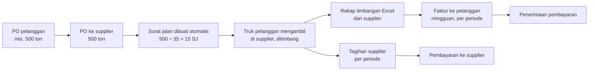

# 11 — Kebutuhan dari Meeting 14 September 2026

> **Sumber:** catatan meeting dan rekaman meeting dengan pemilik usaha (14 September 2026).
> Dokumen ini memetakan setiap kebutuhan ke penyelesaiannya di aplikasi dan statusnya.
> Hal yang belum bisa dipastikan ditandai **REQUIRES USER CONFIRMATION**.
>
> Dokumen terkait: [01 Ringkasan Sistem](01-RINGKASAN-SISTEM.md) · [03 Alur Transaksi](03-ALUR-TRANSAKSI.md) · [04 Akuntansi](04-AKUNTANSI.md) · [06 Matriks Kebutuhan](06-MATRIKS-KEBUTUHAN.md) · [12 Keamanan & Infrastruktur](12-KEAMANAN-DAN-INFRASTRUKTUR.md) · [13 Kotak Masuk Rekap](13-SIMULASI-EMAIL-DAN-CV.md) · [14 Pertanyaan untuk Pemilik](14-PERTANYAAN-UNTUK-PEMILIK.md) · [15 Contoh Alur 500 Ton](15-CONTOH-ALUR-500-TON.md)

---

## 1. Gambaran usaha yang dikonfirmasi

- Perusahaan adalah **pedagang (trading)**: menjembatani pihak yang punya barang (supplier/produsen) dengan pihak yang butuh barang (pelanggan). Perusahaan tidak memproduksi barang.
- Barang yang paling banyak berjalan saat ini: **batu split** dan sejenisnya (batu gunung untuk jalan), dalam satuan **ton**. Daftar barang lengkap akan diberikan pemilik — **REQUIRES USER CONFIRMATION**.
- Tidak ada karyawan tetap selain direksi; staf tidak bekerja di satu tempat. Admin membuka PO, membuat invoice, merekap pengambilan dan pembayaran, serta pajak. Pembukuan oleh akuntan biasanya hanya di akhir tahun.
- Masalah utama: pekerjaan masih manual, berulang, dan tersebar. Dibutuhkan satu sistem yang mengintegrasikan pembelian, pengambilan, penagihan, pembayaran, laporan keuangan, dan pajak.
- Prioritas pemilik: **penagihan cepat**, **laporan keuangan**, **perpajakan**, dan **data akurat** — selisih antara tagihan supplier dan tagihan ke pelanggan harus terdeteksi.

## 2. Alur pengambilan (inti usaha)

| Kebutuhan (dari meeting) | Penyelesaian di aplikasi | Status |
|---|---|---|
| PO pelanggan diteruskan menjadi PO ke supplier dengan jumlah sama | Pengambilan → PO Pengambilan → **PO siap dibuka**: PO supplier dihubungkan ke PO pelanggan saat dibuka untuk pengambilan | Selesai |
| Truk ±35 ton, 2–3 truk sehari, satu PO diambil bertahap sampai ±1 bulan | Setiap truk = satu **pengambilan** (surat jalan) dengan tanggal, no. polisi, sopir, bruto/tara/netto. **Catat Pengambilan** bisa dipakai dari HP (satu kolom, huruf besar, netto dihitung otomatis) | Selesai |
| Saat PO dibuka, surat jalan langsung dibuat sebanyak kemungkinan truk (500 ÷ 35 → 15) dengan nomor PO | Membuka PO pengambilan membuat ⌈jumlah ÷ kapasitas truk⌉ surat jalan bernomor `<No PO>/01…`; kapasitas bisa diatur per PO; surat jalan bisa dicetak | Selesai |
| PO tidak boleh dipakai lebih dari 15 surat jalan | Jumlah surat jalan tetap; tidak ada surat jalan tambahan untuk PO yang sama | Selesai |
| PO tidak boleh dipakai melebihi kuota tonase | Pengambilan yang melewati kuota ditolak kecuali dikonfirmasi; PO ditutup otomatis saat kuota terpenuhi | Selesai |
| Cut-off akhir bulan: PO yang belum habis dihentikan | Batas tanggal PO (default akhir bulan PO); PO lewat batas ditutup saat PO Pengambilan dibuka, surat jalan sisa dibatalkan; peringatan menjelang cut-off di Ringkasan dan notifikasi | Selesai |
| Satu PO pelanggan yang belum habis saat cut-off dilanjutkan bulan berikutnya | PO supplier baru untuk PO pelanggan yang sama; PO pelanggan tetap berjalan sampai jumlahnya terpenuhi | Selesai — **REQUIRES USER CONFIRMATION:** apakah PO pelanggan juga dianggap selesai saat cut-off |
| Mencegah salah ambil: dua pelanggan mengambil barang sama di hari yang sama, nama PT sama tapi lokasi berbeda, truk untuk A dibawa ke B | Surat jalan terikat ke satu PO pelanggan dan tujuan; perubahan tujuan ditandai "Tujuan diubah"; Tagih Pelanggan memberi tanda bila PO supplier yang sama juga diambil untuk pelanggan lain. Pelanggan/supplier bernama sama (satu perusahaan, dua lokasi): saat disimpan muncul peringatan dan saran menambah lokasi pada nama; pilihan pelanggan di form pesanan menampilkan alamat; Tagih Pelanggan dan Tagihan Supplier menampilkan alamat di samping nama yang kembar | Selesai |
| Daftar surat jalan mudah diekspor ke Excel untuk bagian timbangan supplier (pengguna awam komputer) | **Ekspor Excel untuk timbangan** per PO / per supplier dengan kolom kosong untuk diisi; format yang sama bisa diimpor kembali | Selesai |
| Setiap pengambilan direkap (barang, tanggal, tonase) | **Rekap Pengambilan** per periode, pelanggan, supplier, PO dengan status faktur kedua sisi; ekspor Excel. Juga di Laporan → Laporan per Periode (jenis Pengambilan) | Selesai |
| Rekap Excel dari timbangan bisa diimpor tanpa input ulang | **Impor Rekap Timbangan** (.xlsx/.xls/.csv) membaca rekap format supplier yang asli (semua sheet per material, judul kolom dua baris, Isi/Kosong/Qty, subtotal per hari) dan file dari Ekspor Excel untuk timbangan; truk dicocokkan lewat No PO lalu No DO; menampilkan baris baru / sama / berubah / tidak cocok sebelum diterapkan; riwayat sebelum aplikasi dipakai dilewati | Selesai — diuji dengan rekap asli lokasi Cikande dan Serang (11 Okt 2026; 210 truk terbaca, sebelumnya 0) |
| Rekap dari timbangan bersifat kumulatif dan kadang mengubah data lama tanpa pemberitahuan (30 → 35 ton) setelah pelanggan ditagih | Saat impor, perubahan berat pada pengambilan yang sudah ada terdeteksi; riwayat berat disimpan; bila sudah ditagih, muncul di **Perubahan Timbangan**, Ringkasan, Entri Harian, dan notifikasi. Selisihnya ditagih dengan **faktur susulan** langsung dari kartu peringatan (**Tagih selisih ke pelanggan**, **Catat tagihan selisih supplier**) — usulan "invoice tambahan untuk selisihnya" di meeting | Selesai |
| Bukti yang dipakai: **DO (delivery order) supplier** yang tercetak; surat jalan kita ditulis tangan di timbangan. Bila berbeda, DO yang dijadikan patokan | Foto DO bisa dilampirkan pada pengambilan (diperkecil otomatis), No. DO disimpan, dan foto dilihat kembali di detail PO dan Perubahan Timbangan | Selesai |
| Foto DO dan rekap Excel **dikirim supplier lewat email** dengan format subjek tetap; admin tidak mau input ulang karena justru memperlambat penagihan | **Kotak Masuk Rekap** (simulasi): email rekap masuk, Excel dibaca, foto DO dibaca, dicocokkan per surat jalan, yang cocok dicatat sekali klik, yang beda ditahan dan dibalas ke supplier. Lihat [13](13-SIMULASI-EMAIL-DAN-CV.md) | Simulasi — sambungan ke email sungguhan **REQUIRES USER CONFIRMATION** (alamat email, contoh email) |
| Usulan membaca angka di foto DO dengan AI untuk dibandingkan dengan Excel | Diperagakan di Kotak Masuk Rekap: bagian yang dibaca ditandai di foto beserta tingkat keyakinannya; foto kurang jelas tidak dipakai otomatis | Simulasi — layanan AI dan biayanya **REQUIRES USER CONFIRMATION** |

## 3. Penagihan dan pembayaran

| Kebutuhan | Penyelesaian di aplikasi | Status |
|---|---|---|
| Faktur ke pelanggan biasanya seminggu sekali, sesuai pengambilan dari tanggal X sampai Y; tidak menunggu PO selesai; satu PO bisa punya beberapa faktur | **Tagih Pelanggan**: daftar pelanggan dengan pengambilan belum ditagih → pilih periode (bawaan: sejak faktur terakhir, atau 7 hari terakhir) → semua truk dicentang → DPP, PPN, total → Buat Faktur (satu baris per truk, nomor SJ dan tanggal tercetak di faktur). Pengambilan yang sudah ditagih tidak bisa ditagih lagi; membatalkan faktur mengembalikannya | Selesai |
| Satu klik membuat faktur dari pengambilan tanggal 1–10 | Sama seperti di atas | Selesai |
| Melihat mana yang sudah/belum ditagih, sudah/belum dibayar, outstanding per pelanggan | Ringkasan → **Alur pengambilan** (belum ditagih / ditagih belum lunas / lunas, untuk pelanggan dan supplier) dan **Tagihan pelanggan** per pelanggan. Pengambilan yang belum ditagih dihitung sebagai piutang "belum ditagih" (belum jatuh tempo sampai difakturkan) | Selesai |
| Tagihan dari supplier dicocokkan dengan pengambilan (mis. diambil 100 ton, ditagih 110 ton) | **Tagihan Supplier**: no. faktur supplier, periode, tonase dan harga yang ditagih dibandingkan dengan pengambilan sebelum disimpan; selisih tonase wajib diberi alasan; harga pengambilan bisa dikoreksi. Selisih yang tersisa muncul di Ringkasan → Perlu tindakan | Selesai |
| Harga di faktur beli lupa diperbarui setelah supplier mengabarkan harga baru | Harga beli tiap pengambilan memakai **Harga Supplier** yang berlaku pada tanggal pengambilan (bukan harga lama di PO); selisih dengan harga PO ditampilkan; form PO juga mengambil harga yang berlaku pada tanggal PO | Selesai |
| Semua data yang sama mengalir ke laporan keuangan | Setiap pengambilan membentuk jurnal pembelian, HPP, dan penjualan; faktur mengambil alih bagian penjualan/pembelian; neraca saldo tetap seimbang | Selesai (lihat [04 Akuntansi](04-AKUNTANSI.md)) |
| Rekap per PO per bulan / 3 bulan, naik-turun performa | Ringkasan → **Tonase per bulan** (6 bulan, tren per pelanggan, per PO 3 bulan); Rekap Pengambilan per periode | Selesai |

## 4. Biaya, kas & bank, hak akses, dan pajak

| Kebutuhan | Penyelesaian di aplikasi | Status |
|---|---|---|
| Pengeluaran di luar transaksi: transport, ATK, entertain, reimbursement, dll. — dicatat langsung di aplikasi (bukan impor Excel), dengan kategori siap pakai | Kas & Bank → Pengeluaran Lain dengan kategori (Transportasi, ATK, Entertain, Biaya Bank, Reimbursement, dll.); otomatis dijurnal ke Laba Rugi | Selesai |
| Rekap pengeluaran per bulan per kategori, bisa diekspor ke Excel untuk akuntan/pihak lain tanpa akses aplikasi | Pilihan bulan, **Rekap per kategori** (dengan akun bukunya), ekspor Excel (rincian + rekap) di Pengeluaran Lain / Penerimaan Lain | Selesai |
| Saldo dicocokkan dengan rekening koran; selisih muncul dari biaya transfer, biaya admin bulanan, bunga yang tidak dicatat | Rekening Koran & Rekonsiliasi Bank: saldo rekening koran dibandingkan dengan saldo buku; baris yang belum tercatat bisa langsung dicatat sebagai biaya admin/transfer, pajak bunga, atau bunga | Selesai |
| Fitur yang belum dipakai (mis. aset tetap) tidak perlu dihapus | Semua fitur tetap ada; yang tidak dipakai bisa disembunyikan per pengguna | Sesuai — daftar fitur yang dipakai **REQUIRES USER CONFIRMATION** |
| Pengguna A hanya bisa membuka fitur 1–5, pengguna lain 1–10; admin (bukan karyawan tetap) tidak perlu melihat semua, termasuk pengeluaran tertentu | **Akses menu** per pengguna di Manajemen Pengguna: admin sistem mencentang grup menu yang boleh dibuka (mis. Pengambilan dan Penjualan saja). Daftar ini hanya mempersempit peran; tanpa daftar, pengguna mengikuti perannya. Menu, halaman, tombol, dan pencarian ikut tersaring; pada mode cloud penyimpanan juga ditolak server. Staf admin kantor yang mencatat pengambilan dan membuat faktur diberi peran **Manajer** lalu dipersempit dengan Akses menu (peran Akunting hanya bisa melihat penjualan/pembelian, tidak bisa mencatat) — peran **Admin** aplikasi adalah administrator sistem dan selalu melihat semua | Selesai — pembatasan per **grup menu**, bukan per kategori pengeluaran. Di Ringkasan, kotak **Kas & bank** dan **Laba kotor** hanya tampil bagi pengguna yang boleh membuka Akuntansi/Laporan ("keuntungan dilihat level selanjutnya"); Piutang dan Hutang mengikuti akses Penjualan dan Pembelian. Pengeluaran mana yang harus disembunyikan dan dari siapa **REQUIRES USER CONFIRMATION** |
| Data yang sama dipakai untuk Coretax | Ekspor Coretax: file XML faktur pajak keluaran per masa pajak, dengan DPP dan PPN yang sama dengan faktur penjualan di buku besar. Pengambilan yang belum ditagih sudah mencatat PPN Keluaran di buku besar, tetapi baru masuk Rekap PPN dan Coretax setelah difakturkan | Selesai — format perlu diuji impor di Coretax; kode barang & satuan **REQUIRES USER CONFIRMATION**; saat PPN pengambilan diakui (saat diambil atau saat ditagih) **REQUIRES USER CONFIRMATION** |
| Admin tidak perlu membuat faktur pajak dari nol | Data faktur pajak diambil dari faktur penjualan yang sudah ada | Selesai |

## 5. Tampilan dan perangkat

| Kebutuhan | Penyelesaian | Status |
|---|---|---|
| Huruf agak besar, mudah dibaca ("50 klub"), tidak memakai huruf yang aneh | Huruf Geist (sederhana). Tiap pengguna bisa memilih Normal / Besar / Sangat besar di menu pengguna; bawaannya Normal | Sebagian — apakah bawaannya dijadikan Besar **REQUIRES USER CONFIRMATION** |
| Lebih sering dipakai di komputer (admin memakai PC dengan layar ±16 inci); di HP terlalu kecil | Tata letak utama untuk layar komputer; tetap bisa dibuka di HP untuk melihat/mencatat | Selesai |
| Tampilan bebas, yang penting sistemnya; format surat jalan dan invoice mengikuti format perusahaan | Template cetak memakai profil perusahaan | **REQUIRES USER CONFIRMATION** — contoh format surat jalan dan invoice perusahaan belum diterima |
| User-friendly | Navigasi berlabel bahasa Indonesia, alur pengambilan dalam satu grup menu "Pengambilan"; **Entri Harian** berisi tugas rutin (Catat Pengambilan, Impor Rekap Timbangan, Tagih Pelanggan, Biaya Operasional) dengan hitungan hari ini | Selesai |

## 6. Data, keamanan, dan biaya

Dibahas rinci di [12 Keamanan & Infrastruktur](12-KEAMANAN-DAN-INFRASTRUKTUR.md):

- Data disimpan selamanya untuk analisis dan kebutuhan pajak; bisa diarsipkan ke hard disk: Kelola Backup → **Arsip Excel** (satu file per tahun) dan file cadangan JSON.
- Data hanya boleh diakses pihak perusahaan; pengembang hanya mengakses atas permintaan.
- Spesifikasi minimal komputer dan perkiraan biaya server (cloud) diminta pemilik.
- Penawaran harga program, biaya pemeliharaan, dan cara menghitung perubahan/penambahan fitur — **REQUIRES USER CONFIRMATION** (keputusan bisnis, bukan bagian aplikasi).
- Pemilik ingin mencoba sistem dengan data contoh berformat sama dengan data perusahaan sebelum memutuskan.

## 7. Bahan yang masih ditunggu dari pemilik

| Bahan | Untuk apa |
|---|---|
| Contoh rekap Excel dari bagian timbangan | ✅ Diterima 11 Okt 2026 dan sudah terbaca |
| Contoh DO supplier dan surat jalan perusahaan (foto) | Template cetak surat jalan, bukti pengambilan, dan uji pembacaan foto |
| Contoh email dari bagian timbangan (subjek, isi, lampiran) | ✅ Foto layar diterima 11 Okt 2026 (subjek "Rekap & SJ <lokasi> <tanggal>") |
| Contoh PO dan invoice perusahaan | Template cetak PO dan invoice |
| Daftar barang dan satuan | Data master barang dan kode Coretax |
| Siapa saja pengguna dan fitur yang boleh dibuka masing-masing | Pengaturan akses per pengguna |
| Keputusan cut-off PO pelanggan | Aturan penutupan PO pelanggan di akhir bulan |

## 8. Keputusan yang perlu dikonfirmasi pemilik

Aplikasi sudah berjalan dengan pilihan bawaan di bawah ini. Bila kebiasaan perusahaan berbeda, pilihan ini bisa diubah — **REQUIRES USER CONFIRMATION**.

| Topik | Pilihan bawaan saat ini |
|---|---|
| Rekap timbangan yang datang setelah cut-off | PO harus dibuka kembali (Buka kembali) untuk mengimpor pengambilan bertanggal sebelum cut-off; PO tertutup lagi otomatis |
| Koreksi berat tanpa rekap timbangan | **Koreksi berat** di detail PO Pengambilan (per surat jalan): bruto/tara atau netto baru dengan alasan wajib; berat lama tersimpan di riwayat. Bila surat jalan sudah ditagih, faktur tidak diubah dan perubahan muncul di Perubahan Timbangan (sumber "Koreksi manual") |
| Membedakan PO pengambilan dan PO stok | Semua PO supplier Dikonfirmasi berisi satu barang muncul di "PO siap dibuka" |
| Truk terakhir | Mengambil sisa kuota; melebihi kuota harus dikonfirmasi |
| Perusahaan menyimpan stok? | Data contoh: batu dan slag hanya diperdagangkan; pasir dan batu belah lewat gudang |
| Periode faktur pelanggan | Mingguan (Senin–Minggu), dipotong di akhir bulan |
| Tagihan supplier | Faktur pembelian dicatat dengan harga pengambilan (setelah koreksi), bukan total yang ditagih supplier; no. faktur supplier dan tonase wajib diisi |
| PPN berbeda dalam satu faktur | Satu faktur pelanggan tidak boleh menggabungkan PO pelanggan dengan pengaturan PPN berbeda |
| Pengambilan belum ditagih | Belum jatuh tempo sampai difakturkan; peringatan bila belum ditagih lebih dari 7 hari |
| Akun biaya | Semua kategori pengeluaran (kecuali Gaji dan Biaya Bank) masuk satu akun Beban Operasional Lain; pajak bunga juga ke akun itu. Akuntan mungkin ingin akun terpisah |
| Reimbursement | Dicatat saat dibayar; belum ada pencatatan reimbursement yang terutang |
| Akses menu | Data pelanggan/supplier/karyawan punya centang sendiri; Entri Harian ikut Pembelian, Kas & Bank ikut Akuntansi; pembatasan berlaku untuk membuka dan menyimpan, bukan membaca data di server |
| Penerimaan barang gudang (bukan pengambilan) | PO yang diterima sebagian dan belum difakturkan baru dibukukan saat diterima penuh; stok bertambah sebesar Qty Terima, faktur memakai berat hasil rekonsiliasi |
