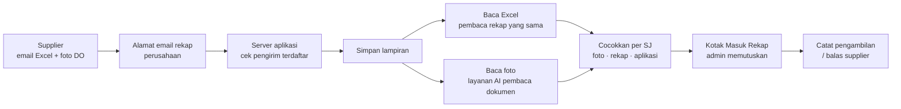

# 13 — Kotak Masuk Rekap: Simulasi Email dan Pembacaan Foto

> **Status:** simulasi untuk demonstrasi alur. Email dan pembacaan foto (computer vision, CV) **diperagakan**, belum tersambung ke kotak email atau layanan AI sungguhan. Pembacaan Excel, pencocokan, dan pencatatan ke aplikasi **berjalan seperti aslinya**.
>
> Dokumen terkait: [11 Kebutuhan Meeting](11-KEBUTUHAN-MEETING-14-SEP-2026.md) · [03 Alur Transaksi §V](03-ALUR-TRANSAKSI.md) · [12 Keamanan & Infrastruktur](12-KEAMANAN-DAN-INFRASTRUKTUR.md)

---

## 1. Masalah yang dijawab

Dari meeting 14 September 2026:

- Setiap truk ditimbang di supplier. Bagian timbangan supplier mengirim **rekap Excel** dan **foto DO** (delivery order supplier, tercetak) **lewat email**; subjek emailnya punya format tetap.
- DO supplier disepakati sebagai bukti utama bila angka berbeda.
- Rekap Excel bersifat kumulatif dan kadang **mengubah angka lama** tanpa pemberitahuan. Contoh dari meeting: supplier menagih 35 ton, padahal yang sudah ditagihkan ke pelanggan 30 ton.
- Admin harus mencocokkan Excel dengan foto satu per satu. Pemilik tidak mau admin menginput ulang dari foto karena justru memperlambat penagihan.
- Usulan di meeting: hubungkan ke email, lalu biarkan sistem membaca foto (CV) dan mencocokkannya dengan Excel.

## 2. Yang tersedia di aplikasi

Menu **Pengambilan → Kotak Masuk Rekap**: langkah kedua di alur pengambilan, setelah PO Pengambilan.

| Bagian | Isi |
|---|---|
| Kotak masuk | Email rekap dari supplier: pengirim, subjek, waktu, jumlah lampiran, status (**Baru**, **n perlu keputusan**, **Siap dicatat**, **Selesai**) |
| Isi email | Pesan supplier, lampiran **Excel** (bisa diunduh, file .xlsx sungguhan) dan **foto DO** per truk |
| Pemeriksaan otomatis | Empat langkah: lampiran diterima → Excel dibaca → foto dibaca → dicocokkan dengan surat jalan |
| Ringkasan | Siap dicatat · Perlu keputusan · Ditahan · Sudah tercatat |
| Hasil per surat jalan | Berat **tercatat** di aplikasi, berat di **rekap Excel**, berat di **foto DO** (dengan tingkat keyakinan), hasil, dan keputusan |
| Foto | Klik foto atau angka foto: foto besar dengan **kotak di bagian yang dibaca** (No. SJ tulisan tangan, tanggal, no. polisi, bruto, tara, netto, no. DO) dan tingkat keyakinan per bagian |
| Catat | Satu klik mencatat semua yang cocok dan yang sudah diputuskan, lewat jalur yang sama dengan Impor Rekap Timbangan |
| Balas ke supplier | Draf balasan otomatis berisi selisih yang perlu dijawab supplier |
| Riwayat | Kapan dicatat, berapa pengambilan, berapa berat berubah, balasan yang dikirim |

Ringkasan → **Perlu tindakan** dan angka di samping menu menunjukkan email yang belum diperiksa atau masih menunggu keputusan.

### Yang disimulasikan dan yang nyata

| Langkah | Di simulasi |
|---|---|
| Email masuk | **Diperagakan.** Tombol **Periksa email** membuat email dari PO pengambilan yang masih punya surat jalan siap |
| Excel dibaca | **Nyata.** File .xlsx dibuat lalu dibaca dengan pembaca yang sama dengan Impor Rekap Timbangan |
| Foto dibaca (CV) | **Diperagakan.** Foto contoh digambar oleh aplikasi; hasil bacanya dibuat bersama fotonya |
| Pencocokan foto ↔ Excel ↔ aplikasi | **Nyata** |
| Pencatatan | **Nyata.** Pengambilan, riwayat berat, foto DO, peringatan Perubahan Timbangan, dan jurnal tercatat seperti impor rekap biasa |
| Balasan ke supplier | **Diperagakan.** Disimpan di riwayat email, tidak dikirim |

Kotak masuk simulasi hanya disimpan di browser yang dipakai (tidak masuk data perusahaan). **Ulang simulasi** mengosongkannya; pengambilan yang sudah dicatat tetap ada.

> Karena pencatatan nyata, jalankan demo dengan **data contoh**, jangan dengan data perusahaan.

## 3. Hasil pemeriksaan per surat jalan

| Hasil | Artinya | Yang dilakukan |
|---|---|---|
| **Cocok** | Angka rekap = angka foto; belum tercatat | Dicatat saat **Catat** ditekan |
| **Perlu diperbarui** | Rekap = foto, tetapi berbeda dari yang tercatat | Berat diperbarui saat dicatat; bila sudah ditagih, faktur tidak diubah dan perubahan masuk Perubahan Timbangan |
| **Sudah tercatat** | Sama dengan yang tercatat | Tidak ada |
| **Rekap ≠ foto** | Angka rekap berbeda dari foto DO | Pilih: pakai angka foto / pakai angka rekap / tunda dan tanya supplier |
| **Berat lama diubah** | Rekap mengubah berat yang sudah tercatat, sedangkan foto sama dengan catatan (kasus 30 → 35 ton) | Bawaan **Tetap (sesuai foto)**; bisa dipilih pakai angka rekap. Masuk balasan ke supplier |
| **Foto kurang jelas** | Keyakinan baca berat di bawah 80% | Pilih: pakai angka rekap / isi dari foto (ketik) / tunda dan minta foto ulang |
| **Tanpa foto** | Ada di rekap, tidak ada foto | Pilih: pakai angka rekap / tunda dan minta foto |
| **Tidak ada di rekap** | Ada foto, tidak ada di rekap | Pilih: pakai angka foto / tunda |
| **SJ tidak dikenal** / **SJ sudah batal** | Nomor SJ tidak ada atau sudah dibatalkan | Tidak bisa dicatat; masuk balasan ke supplier |

Batas keyakinan 80% adalah pilihan awal — **REQUIRES USER CONFIRMATION**.

## 4. Skrip demo (±5 menit)

Tangkapan layar setiap langkah, contoh foto DO, dan contoh rekap Excel ada di [pitch/kotak-masuk-rekap](pitch/kotak-masuk-rekap/README.md).

Persiapan: data contoh, buka **Pengambilan → Kotak Masuk Rekap**. Bila sudah pernah dipakai, klik **Ulang simulasi**.

1. **Email pertama (semua cocok).** Klik **Periksa email** → email dari bagian timbangan supplier masuk. Buka email: tunjukkan lampiran Excel dan foto DO, lalu empat langkah pemeriksaan. Semua baris **Cocok** → klik **Catat 3 pengambilan**.
   - Tunjukkan hasilnya: angka **Tagih Pelanggan** di menu bertambah; di **PO Pengambilan** truknya sudah tercatat beserta foto DO-nya.
   - Pesan: *"Admin tidak mengetik ulang apa pun. Yang cocok cukup satu klik."*
2. **Email kedua (ada masalah).** Klik **Periksa email** lagi → rekap kumulatif dengan lima kasus:
   - **Berat lama diubah:** truk yang sudah ditagih tertulis 5 ton lebih berat di rekap, sedangkan foto DO-nya sama dengan yang ditagih. Ini kasus 30 → 35 dari meeting.
   - **Rekap ≠ foto:** rekap 3 ton lebih besar dari DO.
   - **Foto kurang jelas:** klik angkanya; kotak oranye menunjukkan bagian yang tidak terbaca yakin.
   - **Tanpa foto.**
   - Satu baris cocok.
3. Pilih keputusan: angka foto untuk selisih, angka rekap untuk foto buram, **Tunda** untuk yang tanpa foto. Biarkan **Tetap** untuk berat lama. Klik **Catat**.
4. Klik **Balas ke supplier**: draf balasan sudah berisi setiap selisih → **Kirim balasan** (simulasi).
5. Bila tadi dipilih **Pakai angka rekap** untuk berat lama, buka **Perubahan Timbangan**: perubahan atas truk yang sudah ditagih muncul di sana, faktur tidak berubah.

## 5. Cara kerja sistem nyata

Yang perlu dibangun untuk versi nyata:

| Bagian | Isi | Catatan |
|---|---|---|
| Penerima email | Alamat khusus rekap, atau email supplier yang sekarang diteruskan otomatis ke alamat itu; email masuk diteruskan ke server aplikasi (Cloud Functions). Email rekap dikenali dari format subjeknya | Butuh layanan penerima email atau akses ke kotak email perusahaan |
| Pengirim terdaftar | Email bagian timbangan per supplier disimpan di data supplier; email dari alamat lain ditahan | Mencegah rekap palsu |
| Penyimpanan lampiran | Excel dan foto disimpan bersama data perusahaan (Cloud Storage) | Ikut aturan akses di [12](12-KEAMANAN-DAN-INFRASTRUKTUR.md) |
| Pembaca foto | Foto dikirim ke layanan AI pembaca dokumen; hasilnya No. SJ, tanggal, no. polisi, bruto, tara, netto, no. DO, dan tingkat keyakinan | Biaya per foto tergantung layanan |
| Halaman | Kotak Masuk Rekap ini dipakai apa adanya; sumber datanya diganti dari simulasi ke server | — |
| Balasan | Dikirim dari alamat rekap perusahaan | — |

## 6. Yang perlu diputuskan pemilik

Semua butir di bawah **REQUIRES USER CONFIRMATION**:

1. **Alamat email rekap.** Email supplier sekarang masuk ke alamat siapa; boleh dibuat alamat khusus atau diteruskan otomatis; siapa yang mengelolanya.
2. **Contoh email** dari bagian timbangan (subjek, isi, lampiran), dan apakah DO supplier mencantumkan nomor surat jalan atau PO kita (bila tidak, pencocokan memakai tanggal + no. polisi).
3. **Layanan AI pembaca foto** dan **siapa yang menanggung biayanya** (dihitung per foto).
4. **Contoh asli:** foto DO dari supplier (termasuk yang kurang jelas) dan file rekap Excel aslinya, agar pembacaan diuji dengan dokumen nyata.
5. **Siapa yang boleh memutuskan selisih** (admin saja, atau perlu persetujuan pemilik untuk truk yang sudah ditagih).
6. **Batas keyakinan** yang dianggap "jelas" (saat ini 80%).
