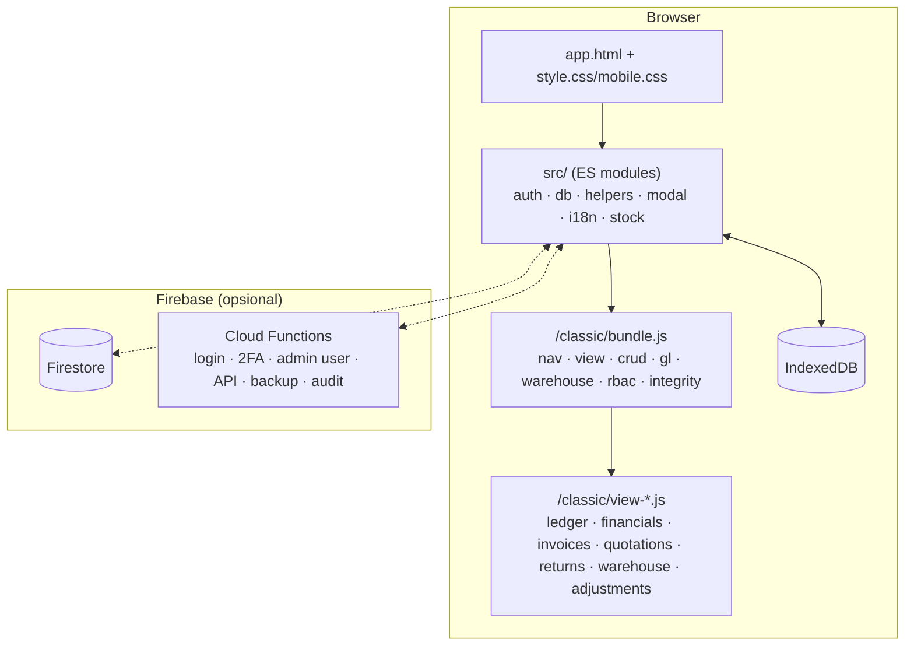

# Arsitektur Teknis

> Untuk pengembang. Menjelaskan cara aplikasi bekerja dan aturan yang harus dijaga saat mengubah kode. Letak file: [../PROJECT_STRUCTURE.md](../PROJECT_STRUCTURE.md).

---

## 1. Gambaran

Nusantara ERP adalah aplikasi web satu halaman **tanpa framework UI**.

| Lapisan | Lokasi | Cara dimuat |
|---|---|---|
| Halaman | `index.html` (landing), `app.html` (aplikasi) | Entry Vite; Firebase Hosting me-rewrite path lain ke `app.html` |
| ES modules | `src/` | Di-bundle Vite: boot, auth, database, helper, modal, i18n, notifikasi, backup, stok |
| Skrip klasik | `public/classic/` | Digabung plugin `classicBundlePlugin` (`vite.config.js`, urutan di `classicAll`) menjadi `/classic/bundle.js`; halaman besar dipecah menjadi chunk `/classic/view-<id>.js` yang dimuat saat dibuka (`core/lazy-views.js`) |
| Cloud Functions | `functions/` | Deploy terpisah ke Firebase |

Skrip klasik berbagi satu *global scope* dan saling memanggil melalui `window` (`window.DB`, `window.GL`, `window.navigate`, `window.saveDB`). Urutan di `classicAll` penting: file yang dipakai harus dimuat lebih dulu.

---

## 2. Urutan boot (`src/main.js`)

1. `initI18n()` → registrasi service worker (PWA).
2. Muat `doc-registry` (ES) dan Chart.js (`window.Chart`).
3. `idb.init()` → `initAuth()`.
4. Belum login → layar login (`setupLoginScreen`). Sudah login → `startApp()`:
   1. `loadDB()` — lokal: dari IndexedDB; cloud: salinan data server di IndexedDB (`erp_fs_cache_v1`) ditambah dokumen dengan `updatedAt` ≥ yang terbaru di salinan itu, plus hitungan dokumen per koleksi. Hitungan yang berbeda (dokumen dihapus di perangkat lain) atau salinan berumur > 30 hari membuat koleksi itu dimuat penuh. Salinan dihapus saat logout.
   2. `resolveUserRole()` → `window.__ERP_USER`.
   3. `initBackup()`.
   4. Muat `/classic/bundle.js`.
   5. `navigate('dashboard')` → `initNotifications()`.

Mode ditentukan `isFirebaseConfigured` (`src/config/firebase.js`): kunci `VITE_FIREBASE_*` kosong → mode lokal.

---

## 3. Data

- Semua data ada di satu objek **`window.DB`**: koleksi berbentuk array (`salesOrders`, `purchaseOrders`, `inventoryItems`, `deliveryOrders`, `salesInvoices`, …) dan objek tunggal (`settings`, `accounts`, `reservations`, `numberSequences`).
- **Menyimpan:** ubah `DB` lalu panggil `window.saveDB()`.
  - Mode lokal: seluruh `DB` ditulis ke IndexedDB (`nsa-local` → store `kv` → kunci `erp_db_v1`).
  - Mode cloud: dokumen yang berubah dikirim ke Firestore (debounce ±250 ms); listener real-time hanya memantau dokumen dengan `updatedAt` ≥ batas saat dimuat, dan perubahannya digabung per dokumen tanpa menimpa perubahan lokal yang belum tersimpan; hitungan per koleksi dicek ulang setiap 30 menit selama aplikasi terbuka; setiap tulis diberi `updatedAt` (waktu server) dan `updatedBy`.
- **Koleksi tersinkron** ditentukan `COLLECTIONS` di `src/core/db.js` (dan harus sama dengan `functions/backup.js` serta `firestore.rules`). Koleksi di luar daftar hanya tersimpan lokal (T-27).
- **Data turunan** — dihitung ulang, bukan sumber kebenaran: jurnal otomatis, harga pokok, total stok (`item.stock` = Σ stok per gudang).
- **Skema & migrasi:** `core/schema.js` (versi skema, gudang default), `core/doc-migrate.js` (penomoran & referensi), `normalizeImportedDB` (impor backup).
- **Data awal:** `initialData()` di `src/core/db.js` — data demo dari `src/core/demo-data.js` (dibuat relatif terhadap tanggal hari ini, deterministik) untuk database lokal yang masih kosong, Reset Data, dan Firestore yang masih kosong; database kosong bila `VITE_SEED_DEMO=false`. `emptyData` hanya melengkapi kunci yang hilang pada data tersimpan atau impor, tanpa menyisipkan data demo.

---

## 4. Rantai pembungkus (wrapper)

Beberapa modul membungkus fungsi global. Selalu panggil versi `window.*`, bukan referensi lokal, agar semua lapisan berjalan.

| Fungsi | Urutan dari luar ke dalam |
|---|---|
| `window.saveDB` | `rbac` (tolak & kembalikan perubahan yang tidak diizinkan) → `integrity` (log audit, kunci periode) → `trash` (salin data terhapus) → `gl-sync` (`GL.reconcileAll()`) → `db.js` (persist) |
| `window.navigate` | `lazy-views` (muat chunk) → `rbac` (cek akses halaman) → `doc-tabs` → `ui/nav.js` (render) |
| `window.openModal` | `doc-tabs` (detail dokumen tertentu ditampilkan sebagai tab) → `src/core/modal.js` |

---

## 5. Mesin dokumen

| Komponen | File | Tugas |
|---|---|---|
| Registri | `src/classic/core/doc-registry.js` | Tipe dokumen (SQ, PQ, SO, PO, DO, SI, PI, SR, PP, SRN, PRN, IT), prefix, status, transisi |
| Engine | `core/doc-engine.js` | `nextNumber` (`PREFIX.YYYY.MM.NNNNN`; nomor yang sudah dipakai di koleksi tipe itu dilewati — tipe di luar registri seperti OP, OD, BT, ADJ, JV mengirim koleksinya lewat `{ docs }`), `canTransition`, total |
| Jejak | `core/doc-flow.js` | Rantai dokumen lewat `sourceQuotation`, `soId`/`poId`, `sourceId`, `invoiceId` |
| ID dokumen | `src/core/helpers.js` `nextId` | ID internal SO/PO (`PREFIX.YYYY.MM.NNN`); nomor yang tampil tetap dari `nextNumber` |

## 6. Stok

| Komponen | File | Tugas |
|---|---|---|
| Gudang | `core/warehouse.js` | `warehouseStock` per barang; `addStock`, `removeStock`, `transferStock`, `setStock`; `item.stock` disinkronkan sebagai total |
| Mutasi & reservasi | `src/core/stock.js` | `applyStockMutation(order, 'in'|'out')`, `reserveStock`, `releaseReservation`, `checkOversell`, `getAvailableStock` |
| Harga pokok | `core/cost-ledger.js` | Rata-rata bergerak dari PO diterima, penyesuaian, SO terkirim |

**Aturan:** setiap perubahan stok harus lewat fungsi gudang. Mengubah `item.stock` langsung akan tertimpa saat total dihitung ulang (T-05).

## 7. Akuntansi

- `core/gl.js` — bagan akun bawaan, pemetaan akun (barang → pihak → default perusahaan), pembentuk jurnal per tipe dokumen, `reconcileAll()`, `trialBalance()`, `postJournalVoucher()`.
- `reconcileAll()` menyusun ulang **semua jurnal otomatis** dengan ID stabil (`J:SO:<id>:rev`, `J:PO:<id>:recv`, …) setiap kali `saveDB`. Jurnal manual (`source: 'manual'`) dan jurnal impor dipertahankan.
- Konsumen jurnal: `core/gl-view.js` (neraca saldo, jurnal, bagan akun), `core/financial-reports.js` (laporan keuangan), `core/budget-gl-extras.js` (anggaran, riwayat akun, biaya akrual, penggajian), dashboard.
- `core/balances.js` (`window.Balances`) — saldo piutang/hutang per dokumen, open items, umur, kartu pihak; membaca aturan yang sama dengan `gl.js` sehingga angka Piutang/Hutang sama dengan buku besar.
- **Pengambilan (trading):** `core/trading.js` (`window.Trading`) memegang aturan PO pengambilan — slot surat jalan (`deliveryOrders` dengan `pickup: true`), kuota, cut-off, trip (bruto/tara/netto), harga supplier per tanggal, faktur dari trip (`inv.doIds`, baris membawa `doId`), rekap timbangan, dan peringatan perubahan berat. Tidak ada koleksi Firestore baru. `gl.js` `buildPickupJournals` membukukan per trip (`J:DO:<id>:trip`): pembelian bila belum ada faktur supplier, HPP/Persediaan, penjualan bila belum ada faktur pelanggan; pesanan berstatus `pickupFlow` tidak membukukan di level pesanan. `core/trading-summary.js` (`window.TradingSummary`) menghitung angka Ringkasan, Entri Harian, dan notifikasi dari data yang sama.
- **Tahap pesanan:** `core/order-pipeline.js` (`window.OrderPipeline`) — tahap tiap SO/PO (Draf, Dikonfirmasi, Terkirim/Diterima belum faktur, Belum lunas, Lunas) dari status, faktur aktif, dan saldo `Balances`; pesanan pengambilan dari trip dan fakturnya. Dipakai funnel Ringkasan, strip status daftar pesanan, dan badge baris.
- **Penerimaan per tahap:** PO yang difakturkan per penerimaan barang (`pipeline-extras.js`) membukukan penerimaan yang belum difakturkan lewat `GL.receivedNotInvoiced` (`J:GR:<id>:recv`).
- Aturan posting lengkap: [04-AKUNTANSI.md](04-AKUNTANSI.md).

## 8. Keamanan dan kontrol

| Aspek | Implementasi |
|---|---|
| Login lokal | `src/core/local-users.js` (PBKDF2-HMAC-SHA256 600k, wajib ganti password pertama kali), `src/core/auth.js` |
| Login cloud | Callable `loginWithUsername` → custom token Firebase; pembatasan percobaan; `functions/auth.js`, `functions/auth-users.js` |
| 2FA | TOTP RFC 6238 (`src/core/totp.js`) + kode cadangan; rahasia disimpan di server pada mode cloud |
| Peran | `src/core/user-role.js` (peran & label), `core/rbac.js` (matriks peran × modul, sembunyikan menu, cegah klik, saring `saveDB`), `firestore.rules` (penegakan di server) |
| Akses menu per pengguna | `users/{uid}.modules` (cloud) atau catatan pengguna lokal: daftar modul yang **mempersempit** peran (izin = peran DAN modul ada di daftar; tanpa daftar = tanpa batas; Admin tidak bisa dibatasi; `dashboard` dan `config` selalu mengikuti peran). `rbac.js` `can()`/`canView()` menerapkannya pada menu, halaman (halaman bersama dihitung dari semua modul menu yang membukanya), tombol, pencarian, dan `saveDB`; `firestore.rules` `moduleAllowed()` pada penulisan; hanya admin yang bisa mengubah `users/{uid}`. Diatur di Manajemen Pengguna (`erp-crud.js`) |
| Audit & periode | `core/integrity.js` (log audit lokal, kunci periode, cek buku besar); `functions/access-log.js` (log akses server) |
| Recycle bin | `core/trash.js` (90 hari, maks. 300 entri) |
| CSP | `firebase.json`: `script-src 'self'` tanpa `unsafe-inline` — **dilarang** memakai atribut `onclick`/`onmouseover` inline; gunakan `data-action` + event delegation |

## 9. Antarmuka

- **Shell:** `app.html` — sidebar, panel sub-menu, topbar (pencarian, status data, tema, notifikasi, pengguna), dan kontainer halaman `#view-<id>`.
- **Navigasi:** `ui/nav.js` — `MENU_CONFIG`, `navigate(id)` merender lewat `getRenderer(id)` (`core/erp-view.js`) dan menyimpan cache halaman (`window.invalidateView(id)` untuk memaksa render ulang).
- **Router menu:** `core/menu-router.js` (`window.NSAMenu`) memetakan item menu ke fungsi `open*()` modul tambahan. Modul tambahan memakai pola *inject*: invalidasi halaman induk → `navigate` → ganti isi kontainer.
- **Komponen:** `src/core/helpers.js` (`idr`, `badge`, `secHdr`, `statRow`, …), `src/core/modal.js` (`openModal`, `closeModal`, `showToast`, `confirmDialog`).
- **Gaya:** `style.css` (token warna & komponen, tema terang/gelap via `data-theme`), `mobile.css`, `public/theme-init.js` (tema sebelum render), `public/mobile-ui.js`.
- **Bahasa:** `src/core/i18n.js` menerjemahkan teks Indonesia → Inggris di DOM saat bahasa Inggris dipilih.
- **Pola daftar:** strip status (`.ostrip`, tab ringan; satu klik = filter tahap) menggantikan kartu statistik di Pesanan Penjualan/Pembelian dan Faktur; tombol "Periode" (preset + rentang tanggal) menggantikan baris "Dari … s/d …"; satu menu "⋯" berisi ekspor/impor, "Filter status…", dan "Pilih beberapa" (kotak centang + aksi massal hanya saat dipilih); menu baris "⋯" per baris (`erp-view.js`). `window.openOrderStage(side, stage)` membuka daftar pesanan dengan filter tahap.
- **Tipografi tenang:** di tabel hanya nomor dokumen yang berwarna; status tampil sebagai teks bernada (`.badge-*` di dalam `tbody` tanpa latar); tebal hanya untuk total. `secHdr(title, sub, btn, action, { showSub: true })` — subjudul hanya bila diminta; ikon "+" hanya untuk tombol Buat/Tambah/Catat.
- **Daftar panjang:** `core/list-pager.js` (`window.NSAPager`) membagi daftar panjang per halaman (Jurnal — termasuk filter tanggal/akun/cari yang dulu Audit Jurnal —, Riwayat Kas & Bank, Laporan per Periode); total tetap dihitung dari semua data.
- **Daftar di ponsel (≤560px):** tabel daftar berkelas `.list-cards` tampil sebagai satu kartu per baris (`mobile.css`, "List cards on phones"): baris 1 nomor · status · "⋯", baris 2 pihak · jumlah, baris 3 keterangan kecil. Sel baris diberi `data-cell="title|status|menu|name|amount|meta|check|action"`; `data-cap` memberi label pendek di depan nilai, `data-unit` satuan di belakangnya. Header tabel disembunyikan, jadi pengurutan ada di "Urutkan" pada menu "⋯" daftar (`LIST_SORT`, hanya di ponsel). Di atas 560px tabel tidak berubah.
- **Menu ke halaman bawaan:** item menu tanpa rute khusus mengosongkan cache view-nya sebelum `navigate`, sehingga halaman yang pernah disuntikkan ke view yang sama tidak muncul lagi.
- **Halaman bersama:** `#view-pickups` dipakai `pickup-view.js` dan `pickup-billing.js`. Selama halaman tagihan terbuka, `renderPickups()` mengembalikan halaman tagihan (`_pickupBilling.isActive()/html()`), sehingga render ulang (mis. setelah penyimpanan ditolak) tidak mengganti halaman.
- **Ukuran teks:** semua ukuran memakai `rem`; `html[data-text-size]` (Normal / Besar / Sangat besar, disimpan di `localStorage` `erp_text_size`, dipasang `public/theme-init.js`) mengubah skala seluruh aplikasi. Token `--fs-*` dan `--tap-min` di `style.css`.
- **Tab dokumen:** `ui/doc-tabs.js` — detail dokumen dibuka sebagai tab hanya di dalam modulnya (maks. 5); dari halaman lain tampil sebagai dialog. Tab halaman bergaya browser sudah dihapus — keputusan di [09-AUDIT-UX.md §2](09-AUDIT-UX.md).

## 10. Cloud Functions (`functions/`)

| Fungsi | Jenis | Tugas |
|---|---|---|
| `api` | HTTPS | API baca-saja `/api/v1` ([API.md](API.md)) |
| `nightlyBackup` | Terjadwal | Snapshot koleksi ke `serverBackups` |
| `onBusinessWrite`, `recordLogout`, `adminListAccessLog` | Trigger/callable | Log akses server |
| `loginWithUsername`, `changeMyPassword` | Callable | Login & ganti password |
| `enable2FA`, `disable2FA`, `regenerateBackupCodes`, `get2FAStatus` | Callable | Verifikasi 2 langkah |
| `adminListUsers`, `adminCreateUser`, `adminSetPassword`, `adminSetRole`, `adminSetActive`, `adminDeleteUser`, `adminSetModules` | Callable | Manajemen pengguna oleh admin (`adminSetModules`: Akses menu, kunci divalidasi di `functions/user-modules.js`) |

## 11. Pengujian

Vitest + happy-dom (`tests/`). Tes yang memuat skrip klasik mengevaluasi file asli di `public/classic/`.

| Tes | Cakupan |
|---|---|
| `classic-bundle-smoke.test.ts` | Semua skrip klasik termuat; global wajib ada (`NSAMenu`, `GL`, `Integrity`, `DocEngine`, `NSAXlsx`, `navigate`, `invalidateView`); **setiap** `#view-*` di `app.html` bisa dirender; **setiap** rute `NSAMenu` bisa dibuka |
| `gl.test.ts`, `cost-ledger.test.ts` | Jurnal otomatis, neraca saldo, jurnal umum, harga pokok |
| `accounting-integrity.test.ts` | Pendapatan dan hutang dibentuk sekali per rantai pesanan–faktur, uang muka, jurnal Kas & Bank, dokumen termasuk PPN, saldo & umur faktur, stok lewat modul gudang |
| `demo-data.test.ts` | Data demo: stok per gudang, nomor unik, tautan dokumen, penggajian, status faktur, neraca saldo seimbang, persediaan = nilai stok, kas/bank tidak minus di hari mana pun, kasus demo |
| `doc-engine.test.ts`, `erp-flow.test.ts`, `stock-reservation.test.ts`, `transaction-rollback.test.ts` | Penomoran, transisi, alur dokumen, reservasi stok, rollback |
| `rbac.test.ts`, `integrity.test.ts` | Hak akses dan log audit/kunci periode |
| `user-module-access.test.ts` | Akses menu per pengguna: hanya mempersempit, halaman bersama, pengalihan, editor, kunci modul sama di klien/functions/rules |
| `trading-pickups.test.ts` | Pengambilan: slot SJ, kuota & cut-off, harga supplier, tagihan dari trip, rekap timbangan, jurnal per trip |
| `pickup-view.test.ts`, `pickup-billing.test.ts` | Layar Pengambilan (PO, catat, impor rekap, perubahan timbangan, rekap) dan Tagih Pelanggan / Tagihan Supplier; halaman bersama `#view-pickups` |
| `trading-summary.test.ts`, `dashboard-trading.test.ts`, `notifications.test.ts`, `dual-view.test.ts` | Angka pengambilan di Ringkasan, Entri Harian, dan notifikasi |
| `pipeline-reconciliation.test.ts`, `sj-validation.test.ts`, `funnel-report.test.ts` | Rekonsiliasi Timbangan dan faktur per penerimaan (neraca saldo), Validasi SJ Supplier, alur & Laporan per Periode |
| `kas-bank-recap.test.ts` | Kategori biaya, rekap per kategori & ekspor, biaya/bunga dari rekening koran, selisih saldo |
| `coretax-export.test.ts`, `archive-export.test.ts` | XML Coretax; Arsip Excel per tahun |
| `order-pipeline.test.ts`, `dashboard-pipeline.test.ts`, `order-list.test.ts`, `invoice-list.test.ts` | Tahap pesanan, funnel Ringkasan, strip & menu daftar pesanan, strip & halaman daftar faktur |
| `csp-inline-handlers.test.ts` | Tidak ada atribut `on*=` di markup (diblokir CSP) |
| `auth.test.ts`, `twofa-flow.test.ts`, `totp.test.ts` | Login lokal & 2FA |
| `db-dirty-save.test.ts`, `indexeddb-sync.test.ts` | Penyimpanan & sinkronisasi |
| `api-handler.test.ts` | API integrasi |
| `i18n.test.ts`, `data-validation.test.ts`, `example.test.ts` | Utilitas |

## 12. Daftar periksa saat menambah fitur

1. File klasik baru → daftarkan di `classicAll` (`vite.config.js`) setelah dependensinya.
2. Halaman baru → kontainer `
` di `app.html` **dan** renderer di `getRenderer` (diwajibkan smoke test).
3. Menu → `MENU_CONFIG` (`ui/nav.js`); bila membuka fungsi modul tambahan, tambahkan rute di `core/menu-router.js`.
4. Hak akses → petakan modul di `core/rbac.js` (dan `firestore.rules` `moduleOf`). Dokumen yang boleh ditulis dari dua modul (trip pengambilan: penjualan atau pembelian) memakai `recordModules()` / `canWriteDoc()`.
5. Koleksi baru → nilai default (`src/core/db.js`), `COLLECTIONS` (sinkron), `firestore.rules` (`moduleOf`), `functions/backup.js`.
6. Efek stok → lewat `core/warehouse.js`; efek akuntansi → pembentuk jurnal di `core/gl.js` + tes di `tests/gl.test.ts`.
7. Tanpa event handler inline (CSP); gunakan `data-action`.
8. Jalankan `npm run test:run`, `npm run type-check`, `npm run lint`, `npm run build`.
